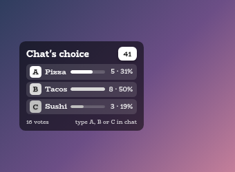
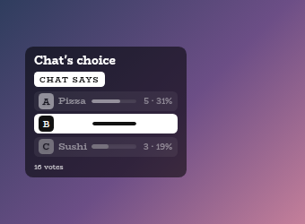

# Chat Poll Overlay

A StreamElements custom widget for quick chat polls. A moderator types one line, a countdown starts, the bars fill as chat votes by typing an option, and the widget declares what chat chose.

<p align="center"></p>

It was built for rounds like Two Truths and a Lie, but it suits any quick vote. It is one self-contained widget in plain JavaScript, with no dependencies and nothing to install.

## Features

- **One line opens a poll:** `!vote Pizza, Tacos, Sushi` puts the options on screen and starts the clock. Two to eight options.
- **Chat votes however it reaches for:** the option text, its number or its letter all count.
- **One person, one vote,** with room to change your mind until the clock runs out.
- **Live or blind:** show the bars filling as votes land, or hide the counts until the poll ends.
- **Declares a result:** when the clock runs out or the poll is ended early. A tie is shown as a tie, or broken at random if you prefer.
- **Rolls back mistakes:** restart, extend, cancel and a multi-step undo, so a mistimed poll is a quick recovery.
- **Survives a refresh:** the clock is stored as a wall-clock time, so a reloaded browser source returns with the same votes and the right time left.
- **Sizes itself to the poll:** the card grows to fit the longest option and shrinks only when the box runs out of room, so nothing is cut off mid-word.
- **A matching look:** a soft see-through black card with white text in BioRhyme, the same default as the other overlays in this set, so they look like one family on a stream.
- **Customisable:** more than 100 settings cover the shape, spacing, text, colours and fonts of every part of the card, the wording, sounds and animation.
- **Sounds:** optional sounds when a poll opens, when a vote is counted, for each of the last seconds, and when the result is declared.
- **Testable offline:** a local dev harness and two automated test scripts.

## Screenshots

**A result.** When the poll ends the winner is highlighted and the rest are dimmed.

<p></p>

**Your own look.** Every part of the card is a setting. This one uses custom colours, an outline, a different font for the heading and pink option colours. You can also pick any of the twelve [style presets](#style-presets) with one setting.

<p></p>

## Style presets

One setting picks the look. The same twelve presets, with exactly the same colours, are in every overlay in this set, so whichever you choose, the overlays still look like one family on a stream. This is how each one looks in this overlay.

<p></p>

| Preset | Look |
| --- | --- |
| Soft black (default) | See-through black with white text. |
| Soft white | Frosted white with dark text. |
| Midnight blue | Deep navy with a periwinkle accent. |
| Sunset | Deep plum with orange and coral. |
| Forest | Deep green with a mint accent. |
| Ocean | Deep teal with an aqua accent. |
| Rose | Deep berry with a pink accent. |
| Neon | Near black with cyan and magenta. |
| Cosy cabin | Cream and brown, in Chicle. |
| Cosy summer pastel | Warm cream and coral, in Baloo 2. |
| Celestial | Deep purple and gold, in Cinzel. |
| Pastel goth | Charcoal and lilac, in Quicksand. |

Choose **Custom** to use the colour pickers and font instead. They are ignored while a preset is chosen.

## Quick start

1. In StreamElements, edit your overlay and add **+ Add Widget, Static/Custom, Custom Widget**.
2. Select the widget, open **Settings, Open Editor**, and paste each file from `widget/` into the matching tab: `widget.html` into HTML, `widget.css` into CSS, `widget.js` into JS, and `fields.json` into Fields.
3. Click **Done**. The settings are grouped into Commands, Poll rules, Copy, Card, Text, Theme, Animation, Sounds and Manual controls.
4. Size the widget box to the full 1920 by 1080 canvas. The card sits against the left edge and its text scales with the box, so a full-size box renders at full resolution and any later shrinking in OBS keeps it sharp.

If you would rather import, `npm run build` writes `dist/chat-voting.overlay.json`. StreamElements does not document its overlay import format, so pasting the files in (above) is the reliable route.

## Chat commands

Every command word is configurable. The defaults are:

| Command | Who | What it does |
| --- | --- | --- |
| `!vote Pizza, Tacos, Sushi` | broadcaster, mods | Opens a poll on those options. |
| `!vote 60s Pizza, Tacos, Sushi` | broadcaster, mods | The same, with a 60 second clock for this poll only. |
| `!voteend` | broadcaster, mods | Stops now and declares the result. |
| `!voteextend 20` | broadcaster, mods | Adds seconds to a running poll. Bare, it adds 15. |
| `!voterestart` | broadcaster, mods | Same options, votes wiped, full clock again. |
| `!votecancel` | broadcaster, mods | Bins the poll and declares nothing. |
| `!voteundo` | broadcaster, mods | Rolls back the last thing that happened. |
| `!voteresults` | broadcaster, mods | Puts the last result back on screen. |
| `!votehide` | broadcaster, mods | Takes the card off screen now. |
| `3`, `C` or `tacos` | anyone | Casts a vote. |

Whether moderators can run polls, or only the broadcaster, is a setting.

## How chat votes

A message counts as a vote only if the **whole message** is one of the options, its number or its letter. So `2`, `#2`, `B`, `b` and the option text all land on the same option, while "I think it's B but who knows" counts as nothing. That strictness is deliberate: in a chat where people discuss the options while they vote, counting every mention would turn conversation into votes. A setting switches to matching an option anywhere in a message if you want it generous.

In a letters-only poll such as `!vote A, B, C` the labels are ignored when matching and only position counts, so `!vote B, A, C` shows as A, B, C and a vote for `B` lands on the second row, the one chat can see. A poll like `!vote A, B, Z` keeps all its labels.

## Taking a poll back

Polls go wrong in front of people: the poll opens while the rules are still being explained, or the clock runs out while half of chat is still reading. There are four ways back, and they mean different things.

| Command | What it does |
| --- | --- |
| `!voterestart` | Same options, votes wiped, full clock. For "hang on, nobody was ready". |
| `!voteextend 20` | Adds time to a poll that is still running. |
| `!votecancel` | Bins the poll completely. |
| `!voteundo` | Steps backwards through what just happened. |

Every step that changes or destroys a poll takes a snapshot first, so `!voteundo` can walk back through ending, cancelling or restarting a poll, and through a poll that was replaced because the next was opened too early. Press it repeatedly to climb back up the history, six deep.

Undoing a poll that was ended **early** gives back the time that was left on the clock. Undoing a poll that genuinely **ran out** reopens it on a short grace window instead (15 seconds by default), because restoring an expired clock would just end it again immediately.

## Configuration

Every setting has a plain label in StreamElements, grouped as follows.

| Group | What it covers |
| --- | --- |
| Commands | The command words and who may use them. |
| Poll rules | The default duration, changing your vote, exact or loose matching, live or blind results, tie handling, the undo grace window, how long a result stays on screen and how many seconds from the end the timer pulses. |
| Copy | The heading, the result and tie labels, the hint line, the words for vote and votes, and a troubleshooting overlay. |
| Card | **Size of everything**, corner roundness, padding, spacing, an outline, shadows, the tail and tilt of the timer and result label, and the size of each option's bar. |
| Text | The size and boldness of the heading, countdown, result label, options, letter chips, counts and footer, an own font for the heading, and the opacity of counts, footer and options that did not win. |
| Theme | One of the twelve shared style presets (Soft black by default) or Custom colours and font, with a colour for every part and each of the eight options, and an opacity for the panel. |
| Animation | One switch for all animation, and how long the bars, the card and the pulse take. |
| Sounds | A sound and volume for a poll opening, a vote, each of the last seconds and the result, plus a master mute. |
| Manual controls | Buttons to start a demo poll, add time, end, restart, cancel and undo, and to test each sound. |

The full list, with defaults, is in [`widget/fields.json`](widget/fields.json). The colour and font pickers apply only when the style preset is **Custom**.

**Size of everything** is a ceiling, not a fixed size. The card can never be wider than the widget box, so a generous setting with a wordy poll is brought down to whatever fits, down to half the card's natural size. A short poll gets the full size you asked for.

### Troubleshooting overlay

Tick **Troubleshooting** in the Copy group and a line of measurements appears along the bottom of the widget box: the room available, what the card wanted, the size setting and the factor it settled on, what the card became, and whether the font had loaded. `OVERFLOW` at the end means something is spilling past its container. It sits outside the card so that it does not change what it measures. Turn it off before going live.

## Chat bot messages

A StreamElements widget can read chat but cannot write to it, so the widget never confirms a vote in chat. The confirmation is the bar moving. If you would like chat to see instructions, add StreamElements **chatbot commands** with messages like these, each short enough for one Twitch message:

For moderators, for example as `!votecommands`:

```
Chat Voting - Mods start a poll: !vote Pizza, Kebab, Coleslaw (45s by default, or !vote 60s A, B, C for a different clock). Chat votes by typing the letter, the number, or the option itself. Running it: !voteend declares now | !voteextend 20 adds time | !voterestart same options fresh | !votecancel bins it | !voteundo rolls back the last thing | !voteresults re-shows | !votehide clears it
```

For chatters, for example as `!votehelp`:

```
How to vote - When a poll is on screen, type the letter (A), the number (1), or the option itself (Coleslaw). It needs to be the whole message on its own, so "I reckon it's B" won't count. One vote each, and you can change your mind right up until the clock runs out, whichever you sent last is the one that counts.
```

Both quote the default command words, so edit them if you rename any.

## Local development

There is no build step and no dependencies. Serve the project root and open the dev harness:

```sh
npm run dev
# then open http://localhost:8000/dev/
```

The harness stands in for StreamElements. It opens polls, can simulate a rush of voters (each with a distinct name, so the total can be checked exactly), and has a **Stage** control for the widget box that starts at half the real 1920 by 1080 size, so what wraps in the preview wraps on stream. Its **Every setting** section is generated from `widget/fields.json`, so it offers exactly what StreamElements will, and each sound setting has a **Use a test beep** button. The local dev page also shows a Ko-fi support button in the corner. That button belongs to the harness only and is not part of the widget, so it never appears on stream.

The harness must be served over http rather than opened as a file, and fonts come from Google Fonts.

## Testing

```sh
npm test
```

This runs two scripts. `test/test-widget.js` drives the real `widget/widget.js` headlessly against a small mock of the page and StreamElements. It covers option parsing, all three ways of voting, one vote per person, changing a vote, permissions, results and ties, blind and letters-only polls, every rollback command, refreshing mid-poll, the clock expiring, escaping HTML in options (option text comes from chat, so it is escaped before it is rendered), and a rush of two thousand voters counted exactly. It also covers every wording, look and colour setting, the sounds and the animation switch, and checks that every field in `fields.json` is read by the widget.

`test/test-layout.js` covers what a mock cannot see: it renders the real widget in headless Chromium across many combinations of box size, size setting and poll, and checks that no row overflows the card, nothing is cut off, no statement wraps past two lines, and the bars and counts line up. It needs a `chromium` on your `PATH` and downloads the font, and it skips itself cleanly if there is no browser.

Both exit non-zero on any failure.

## Project layout

```
widget/   the widget: HTML, CSS, JS and the StreamElements fields
dev/      the local dev harness
test/     the automated test scripts
build/    builds the optional overlay import file into dist/
docs/     screenshots used in this README
```

## Compatibility and limitations

- Votes are counted per chat username. Someone determined to vote twice from a second account can, and no overlay widget can see enough to stop that, so it suits a game round among friends better than a decision that matters.
- Option text is never trimmed. The card grows wider to fit the longest option, and if it runs out of room the whole card is made smaller rather than cutting a statement in half.
- Eight options is the cap, because the letters run A to H.
- The poll and its undo history are saved to the StreamElements widget store, so a browser-source refresh mid-poll loses nothing. The saved payload grows with the number of voters (roughly 26 KB for two thousand), which has not been tested against a real store at much larger sizes.
- Built for Twitch.

The widget uses the StreamElements events `onWidgetLoad`, `onEventReceived` with `message` and `widget-button`, and `SE_API.store`. The JavaScript is deliberately ES5 style so it can be pasted straight into the StreamElements editor.

## Related overlays

These overlays share the same default look, so they sit together on one stream.

- [Sub Goals Overlay](https://github.com/jordan-lee-code/sub-goals-overlay): sub and bits goals that fill as chat reaches them.
- [Spin Wheel Overlay](https://github.com/jordan-lee-code/spin-wheel-overlay): a wheel for giveaways, raffles and forfeits.
- [Squat Tracker Overlay](https://github.com/jordan-lee-code/squat-tracker-overlay): a counter driven by gifted sub bombs.
- [Rage Bar Overlay](https://github.com/jordan-lee-code/rage-bar-overlay): a bar chat fills with subs, bits and channel points.

## Support

If this saves you time, you can support its development on Ko-fi:

[](https://ko-fi.com/journeyingjordan)

Thank you, it is genuinely appreciated.

## Contributing

Contributions are welcome. See [CONTRIBUTING.md](CONTRIBUTING.md).

## License

[MIT](LICENSE). The copyright notice, including the Ko-fi link, must be kept in copies and substantial portions of the code.
