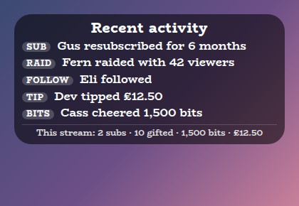
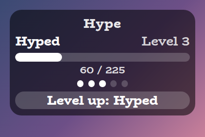
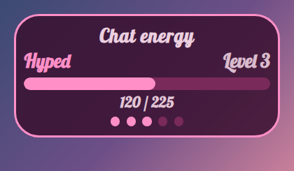
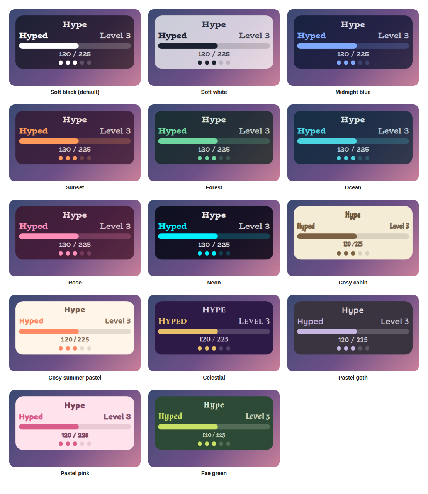

# Hype Meter Overlay

A StreamElements custom widget that turns chat energy into a meter. Messages, subs, gifted subs, bits, tips, follows and raids fill a bar, and each full bar is a new level with a name, a banner and a sound. When the stream goes quiet the meter slowly falls.

<p align="center"></p>

It is a single self-contained widget in plain JavaScript, with no dependencies and nothing to install. Twitch has its own Hype Train; this one is yours to style and tune, and it works on any stream.

## Features

- Levels: up to 12, each with a name, and each bigger than the last by an amount you choose.
- Everything can earn: chat messages, new and gifted subs by tier, bits, tips, follows and raids, each with its own number of points.
- Spam resistant: a person earns from chat once per cooldown, commands and listed bots earn nothing.
- Gift bombs counted once: a gift of 20 earns 20 gifts' worth, not once per recipient (see [How earning works](#how-earning-works)).
- Decay: the meter falls when it goes quiet, at a rate and after a delay you set, and can optionally drop a level.
- Level-ups: a banner, a sound and a flash when a level is reached, with a bigger one at the top.
- Chat control: add points, jump to a level, reset, pause and resume from chat.
- Customisable: around 70 settings cover the levels, earning, decay, wording, shape, outline, colours, fonts, sounds and animation.
- Saved: the level, points and pause survive a browser-source refresh.
- Tests and a dev harness: a local harness with a time machine and an automated test script, so decay can be watched in seconds.

## Screenshots

**A level-up.** Reaching a level shows a banner under the bar and lights the next dot.

<p></p>

**Your own look.** Choose Custom for the style preset and every colour, the font, the outline and the wording are settings.

<p></p>

## Style presets

One setting picks the look. The same fourteen presets, with the same colours, are in every overlay in this set, so overlays from this set match whichever you choose. This is how each one looks in this overlay.

<p></p>

| Preset | Look |
| --- | --- |
| Soft black (default) | See-through black with white text. |
| Soft white | Frosted white with dark text. |
| Midnight blue | Deep navy with a periwinkle accent. |
| Sunset | Deep plum with orange and coral. |
| Forest | Deep green with a mint accent. |
| Ocean | Deep teal with an aqua accent. |
| Rose | Deep berry with a pink accent. |
| Neon | Near black with cyan and magenta. |
| Cosy cabin | Cream and brown, in Chicle. |
| Cosy summer pastel | Warm cream and coral, in Baloo 2. |
| Celestial | Deep purple and gold, in Cinzel. |
| Pastel goth | Charcoal and lilac, in Quicksand. |
| Pastel pink | Soft blush pink with rose, in Fredoka. |
| Fae green | Mossy green with a firefly lime accent, in Almendra. |

Choose **Custom** to use the colour pickers and font instead. They are ignored while a preset is chosen.

## Quick start

1. In StreamElements, edit your overlay and add **+ Add Widget, Static/Custom, Custom Widget**.
2. Select the widget, open **Settings, Open Editor**, and paste each file from `widget/` into the matching tab: `widget.html` into HTML, `widget.css` into CSS, `widget.js` into JS, and `fields.json` into Fields.
3. Click **Done**. The settings are grouped into Commands, Levels, Earning, Decay, Meter, Manual controls, Look, Custom colours, Sounds and Troubleshooting.
4. Size and position the widget. The text and bar scale with the box.

The widget reads Twitch chat and events through StreamElements, so it works as soon as it is on an active overlay.

## How earning works

Every event adds points to the current level's bar. These are the defaults, and all of them are settings.

| Event | Default |
| --- | --- |
| A chat message | 1 point, once per person every 10 seconds |
| New sub or resub, tier 1 and Prime | 20 |
| New sub or resub, tier 2 | 40 |
| New sub or resub, tier 3 | 100 |
| Each gifted sub | 20 |
| Bits | 5 per 100 |
| Tips | 5 per unit of currency |
| Follows | 5 |
| Raids | 25 |

StreamElements reports a gift bomb as one announcement where `amount` is the real number of subs, then one follow-up per recipient where `amount` is a streak or lifetime figure (for example 170). The widget counts only the announcement, so a gift of 20 earns 20 gifts' worth once. Tick **debug** in Troubleshooting to log every event to the browser-source console.

## Levels

The first level takes **Points to fill the first level** (100 by default). Each level after it is that much bigger again by the **growth** factor, so with the defaults the levels take 100, 150, 225, 338 and 506 points. Points left over after filling a level carry into the next. At the top level the bar fills and shows **MAX**, and stays there until the meter falls.

## Decay

When nothing has happened for the **delay** (30 seconds by default), the meter starts losing points at the **rate** you set (10 a minute by default). By default it stops at the bottom of the current level, so a level once reached is kept. Tick **Let the meter fall back a level when it empties** if you want it to be earned again. A rate of 0 turns decay off.

## Chat commands

The command word is a setting. Viewers can type the bare `!hype` to make the title pop, and everything else needs the broadcaster or, by default, a moderator.

| Command | What it does |
| --- | --- |
| `!hype add 50` | Adds 50 points. |
| `!hype level 3` | Jumps to level 3 with an empty bar. |
| `!hype reset` | Back to level 1. |
| `!hype pause` and `!hype resume` | Stops earning and falling, for example between games. |

## Configuration

Every setting has a plain label in StreamElements, grouped as follows.

| Group | What it covers |
| --- | --- |
| Commands | The command word and who may use it. |
| Levels | How many levels, how big, their names, the level word and the text at the top, and whether it can fall back a level. |
| Earning | Points for a chat message with its cooldown, commands and ignored chatters, each sub tier, gifted subs, bits, tips, follows and raids. |
| Decay | How fast it falls when quiet, and how long it waits first. |
| Meter | The points, dots and level number, the level-up banner, text and bar sizes. |
| Manual controls | Buttons to add points, change level, reset, pause and resume. |
| Look | Title, the style preset, font, boldness, corners, padding, outline, shadow and Animate. |
| Custom colours | Panel, text, accent, bar and alert colours, used when the style preset is Custom. |
| Sounds | A sound and volume for a level, the top level and losing a level, with Test buttons and a master mute. |
| Troubleshooting | A debug log of every event to the browser-source console. |

The full list, with defaults, is in [`widget/fields.json`](widget/fields.json). The colour and font pickers apply only when the style preset is **Custom**.

## Local development

There is no build step and no dependencies. Serve the project root and open the dev harness:

```sh
npm run dev
# then open http://localhost:8000/dev/
```

The harness stands in for StreamElements. It sends subs, gift bombs of any size (with the per-recipient follow-ups StreamElements sends), bits, tips, follows and raids, and chat commands as a viewer, moderator or broadcaster. A **time machine** skips the clock forward so you can watch the meter fall without waiting. Its **Every setting** section is generated from `widget/fields.json`, so it offers exactly what StreamElements will.

At the top of the harness, **Look and export** switches the style preset on the live widget, and can download or copy a `fields.json` with your current settings as its defaults. Paste that into the Fields tab of a new custom widget in StreamElements and it starts out looking the way it does here.

The harness must be served over http rather than opened as a file, and fonts come from Google Fonts. It also shows a Ko-fi support button in the corner. That button belongs to the harness only and is not part of the widget, so it never appears on stream.

## Testing

```sh
npm test
```

This runs the real `widget/widget.js` headlessly against a small mock of the page and StreamElements, with a clock the test controls, and exits non-zero on any failure. It covers the levels and their carry-over, every way of earning including the gift bomb case, the chat cooldown, level-ups and banners, decay with its delay and the level drop, pausing, every chat command and permission, saving across a refresh, every look setting and the sounds. It also checks the style presets against the shared palette, and that every setting in `fields.json` is read by the widget and every button does something.

## Project layout

```
widget/   the widget: HTML, CSS, JS and the StreamElements fields
dev/      the local dev harness
test/     the automated tests
docs/     screenshots used in this README
```

## Compatibility and limitations

The widget uses the StreamElements events `onWidgetLoad` and `onEventReceived` with `message`, `subscriber-latest`, `cheer-latest`, `tip-latest`, `follower-latest`, `raid-latest` and `widget-button`, and `SE_API.store`.

The meter only falls while the widget is on screen and running, so time spent with the browser source closed does not count as quiet.

A StreamElements widget can read chat but cannot write to it, so `!hype` makes the title pop rather than replying.

The JavaScript is plain ES5, so it can be pasted straight into the StreamElements editor.

## Related overlays

These overlays share the same default look and the same fourteen style presets, so they sit together on one stream.

- [Sub Goals Overlay](https://github.com/jordan-lee-code/sub-goals-overlay): sub and bits goals that fill as chat reaches them.
- [Subathon Overlay](https://github.com/jordan-lee-code/subathon-overlay): a subathon clock with a cap, power-ups and sub goals.
- [Spin Wheel Overlay](https://github.com/jordan-lee-code/spin-wheel-overlay): a wheel for giveaways, raffles and forfeits.
- [Chat Poll Overlay](https://github.com/jordan-lee-code/chat-poll-overlay): quick polls voted on by typing an option.
- [Squat Tracker Overlay](https://github.com/jordan-lee-code/squat-tracker-overlay): a running count driven by gifted sub bombs.
- [Rage Bar Overlay](https://github.com/jordan-lee-code/rage-bar-overlay): a bar chat fills with subs, bits and channel points.
- [Chat Counter Overlay](https://github.com/jordan-lee-code/counter-overlay): a counter chat commands change, for deaths, wins and anything else.
- [Leaderboard Overlay](https://github.com/jordan-lee-code/leaderboard-overlay): top gifters, cheerers and tippers.
- [Recent Activity Overlay](https://github.com/jordan-lee-code/recent-activity-overlay): the latest subs, gifts, bits, tips, follows and raids.
- [Stream Goals Overlay](https://github.com/jordan-lee-code/stream-goals-overlay): sub and bits goals that start again for each stream.

## Support

If this saves you time, you can support its development on Ko-fi:

[](https://ko-fi.com/journeyingjordan)

Thanks for using it.

## Contributing

Contributions are welcome. See [CONTRIBUTING.md](CONTRIBUTING.md).

## License

[MIT](LICENSE). The copyright notice, including the Ko-fi link, must be kept in copies and substantial portions of the code.
