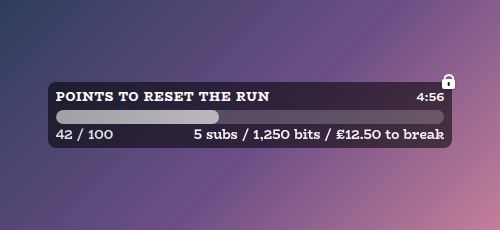

# Squat Tracker Overlay

A StreamElements custom widget that keeps a running squat count, driven by gifted sub bombs. For every whole block of gifted subs (5 by default) it adds a block of squats (5 by default), and the streamer or a moderator can adjust it from chat.

<p align="center"></p>

It is a single self-contained widget in plain JavaScript, with no dependencies and nothing to install.

## Features

- Gift bombs become squats: counted in whole blocks and rounded down, so a gift of 16 subs adds 15 squats and a gift of 27 adds 25.
- Gift bombs counted once: not once per recipient (see [How counting works](#how-counting-works)).
- Chat control: adjust, set, reset, lock and unlock the count from chat, for the broadcaster or moderators.
- A lock for the workout: stop new gifts adding to the pile while squats are being done, while manual changes keep working.
- Scales to its box: the number fills whatever size you draw the widget in StreamElements.
- A shared look: the default is a see-through black panel with white text in BioRhyme, the same as the other overlays in this set.
- Customisable: around 60 settings cover the shape, spacing, outline, shadows, tilt, sizes, weights and colours of every part of the sticker, the floating text, sounds and animation.
- Counting options: carry leftover subs between gifts, count single gifts, new subs and resubs, and cap the count.
- Sounds: optional sounds when a gift adds squats and when the count is locked or unlocked.
- Saved: the count and the lock survive a browser-source refresh.
- Testable offline: a local dev harness and an automated test script, no live stream needed.

## Screenshots

**Locked.** `!squatslock` stops new gifts adding to the count and shows a padlock, so chat can see why a bomb did not move the number.

<p></p>

**Your own look.** Every part is a setting. This one uses custom colours, an outline, rounder corners, a tilt, a lighter caption and a tail. You can also pick any of the twelve [style presets](#style-presets) with one setting.

<p></p>

## Style presets

One setting picks the look. The same twelve presets, with the same colours, are in every overlay in this set, so overlays from this set match whichever you choose. This is how each one looks in this overlay.

<p></p>

| Preset | Look |
| --- | --- |
| Soft black (default) | See-through black with white text. |
| Soft white | Frosted white with dark text. |
| Midnight blue | Deep navy with a periwinkle accent. |
| Sunset | Deep plum with orange and coral. |
| Forest | Deep green with a mint accent. |
| Ocean | Deep teal with an aqua accent. |
| Rose | Deep berry with a pink accent. |
| Neon | Near black with cyan and magenta. |
| Cosy cabin | Cream and brown, in Chicle. |
| Cosy summer pastel | Warm cream and coral, in Baloo 2. |
| Celestial | Deep purple and gold, in Cinzel. |
| Pastel goth | Charcoal and lilac, in Quicksand. |

Choose **Custom** to use the colour pickers and font instead. They are ignored while a preset is chosen.

## Quick start

1. In StreamElements, edit your overlay and add **+ Add Widget, Static/Custom, Custom Widget**.
2. Select the widget, open **Settings, Open Editor**, and paste each file from `widget/` into the matching tab: `widget.html` into HTML, `widget.css` into CSS, `widget.js` into JS, and `fields.json` into Fields.
3. Click **Done**. The settings are grouped into Commands, Squat rule, Look, Sticker, Text, Theme, Animation, Sounds and Manual controls.
4. Size and position the widget. The number scales with the box.

The widget reads Twitch chat and sub events through StreamElements, so the counting and commands work as soon as it is on an active overlay.

If you would rather import, `npm run build` writes `dist/squat-tracker.overlay.json`. StreamElements does not document its overlay import format, so pasting the files in (above) is the reliable route.

## How counting works

Gifted subs are counted in whole blocks and rounded down:

- a gift of **5** subs adds **5** squats
- a gift of **16** subs adds **15** squats (three whole blocks of five)
- a gift of **27** subs adds **25** squats (five whole blocks)
- a gift of **4** subs, or a single gifted sub, adds nothing, because it has not filled a block

Both numbers are settings. Only **gifted** subs move the counter. Someone subscribing themselves, or resubbing, leaves the count where it is.

StreamElements reports a gift bomb as several events: one announcement where `amount` is the real number of subs, then one follow-up per recipient where `amount` is a streak or lifetime figure (for example 170). The widget counts only the announcement, so a gift of 16 adds 15 squats once. Tick **debug** in the Squat rule group to log every event to the browser-source console.

## Chat commands

Every command word is configurable. The defaults are:

| Command | Who | What it does |
| --- | --- | --- |
| `!squats` | anyone | Gives the sticker a small pop. It is always on screen. |
| `!squats -5` | broadcaster, mods | Takes 5 off. |
| `!squats +5` or `!squats 5` | broadcaster, mods | Adds 5. |
| `!squats set 30` or `!squats =30` | broadcaster, mods | Sets the count to an exact number. |
| `!squatsreset` | broadcaster, mods | Puts the count back to zero. |
| `!squatslock` | broadcaster, mods | Stops gifted subs adding to the count. |
| `!squatsunlock` | broadcaster, mods | Lets gifted subs count again. |

Any whole number works after `!squats`. Whether moderators can adjust, lock and reset, or only the broadcaster, is a setting.

## Locking the count

While locked, gifted subs add nothing and a small padlock appears on the sticker. Everything done by hand keeps working: `!squats -5` takes squats off as they are completed, `!squats set 20` corrects the number, and `!squatsreset` clears it. `!squatsunlock` lets the pile grow again. The lock is saved with the count, and the padlock can be hidden in the Look group while the lock still holds.

## Configuration

Every setting has a plain label in StreamElements, grouped as follows.

| Group | What it covers |
| --- | --- |
| Commands | The command words and who may use them. |
| Squat rule | Subs per block, squats per block, a starting count and an upper limit, whether leftover subs carry over, whether single gifts and new subs or resubs count, and a debug log. |
| Look | A caption under the number, the floating `+N` (its prefix, suffix and how long it stays), the padlock, and the tail. |
| Sticker | The size of the number, caption and floating text, corner roundness, padding, the gap between number and caption, tilt, an outline and shadows. |
| Text | The boldness of the number, caption and floating text, and the caption's opacity and letter spacing. |
| Theme | One of the twelve shared style presets (Soft black by default) or Custom colours and font, with separate colours for the box, number, caption, outline, padlock and floating text, and an opacity for the box. |
| Animation | One switch for all animation, how far the sticker swells when the count changes, and how long that takes. |
| Sounds | A sound and volume for a gift adding squats, for locking and for unlocking, plus a master mute. |
| Manual controls | Buttons to simulate a gift, adjust, lock and reset, and to test each sound. |

The full list, with defaults, is in [`widget/fields.json`](widget/fields.json). The colour and font pickers apply only when the style preset is **Custom**.

## Chat replies and reminders

A StreamElements widget can read chat but cannot write to it, so `!squats` shows a pop on the sticker rather than replying. If you would like chat to see the number, add a StreamElements **chatbot command** with the same name that reads it out.

A recurring reminder such as "It's time for 20 squats!" also comes from the chatbot, as a **Timer** under Chatbot, Timers, with an interval of 60 minutes. A Timer fires on an interval from when the bot is active, so it lands roughly every hour of stream rather than on the clock hour.

## Local development

There is no build step and no dependencies. Serve the project root and open the dev harness:

```sh
npm run dev
# then open http://localhost:8000/dev/
```

The harness stands in for StreamElements. It can gift bombs of any size and send chat commands as a viewer, moderator or broadcaster. Its **Every setting** section is generated from `widget/fields.json`, so it offers exactly what StreamElements will, and each sound setting has a **Use a test beep** button. It must be served over http rather than opened as a file, and fonts come from Google Fonts. The local dev page also shows a Ko-fi support button in the corner. That button belongs to the harness only and is not part of the widget, so it never appears on stream.

At the top of the harness, **Look and export** switches the style preset on the live widget, and can download or copy a `fields.json` with your current settings as its defaults. Paste that into the Fields tab of a new custom widget in StreamElements and it starts out looking the way it does here.

## Testing

```sh
npm test
```

This runs the real `widget/widget.js` headlessly against a small mock of the page and StreamElements, and exits non-zero on any failure. It covers the gift maths, the no-double-counting guard, every chat command, permissions, the lock, persistence, themes and the caption, every counting option, every look setting, the sounds and the animation switch. It also checks that every field in `fields.json` is read by the widget.

## Project layout

```
widget/   the widget: HTML, CSS, JS and the StreamElements fields
dev/      the local dev harness
test/     the automated test script
build/    builds the optional overlay import file into dist/
docs/     screenshots used in this README
```

## Compatibility and limitations

The widget uses the StreamElements events `onWidgetLoad`, `onEventReceived` with `subscriber-latest`, `message` and `widget-button`, and `SE_API.store`. Gift counting follows the `bulkGifted` announcement event, so a client that never sent it would undercount. StreamElements does send it.

The JavaScript is plain ES5, so it can be pasted straight into the StreamElements editor.

## Related overlays

These overlays share the same default look, so they sit together on one stream.

- [Sub Goals Overlay](https://github.com/jordan-lee-code/sub-goals-overlay): sub and bits goals that fill as chat reaches them.
- [Spin Wheel Overlay](https://github.com/jordan-lee-code/spin-wheel-overlay): a wheel for giveaways, raffles and forfeits.
- [Chat Poll Overlay](https://github.com/jordan-lee-code/chat-poll-overlay): quick polls voted on by typing an option.
- [Rage Bar Overlay](https://github.com/jordan-lee-code/rage-bar-overlay): a bar chat fills with subs, bits and channel points.

## Support

If this saves you time, you can support its development on Ko-fi:

[](https://ko-fi.com/journeyingjordan)

Thanks for using it.

## Contributing

Contributions are welcome. See [CONTRIBUTING.md](CONTRIBUTING.md).

## License

[MIT](LICENSE). The copyright notice, including the Ko-fi link, must be kept in copies and substantial portions of the code.
