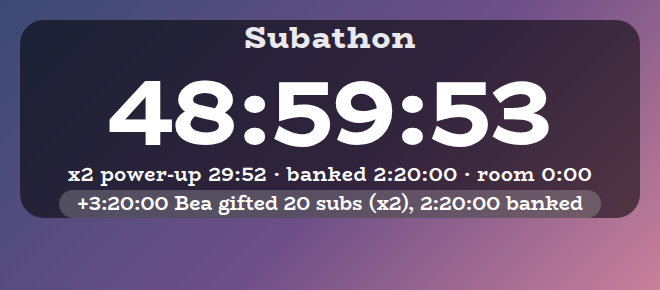
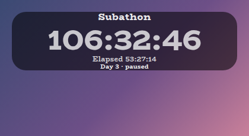

# Subathon Overlay

A StreamElements custom widget that runs a whole subathon: a countdown clock that subs, bits, tips, follows and raids add time to, an optional cap that holds the stream to the length you promised, power-ups and a sleep mode, and sub goals underneath that fill as chat reaches them.

<p align="center"></p>

A subathon runs for days, and the clock is what everyone watches. Time that cannot go on the clock is banked and shown instead of being dropped, a gift bomb is counted once, and anything you might need to change mid-stream is a setting or a chat command.

It is one widget with no dependencies and nothing to install. The sub goals are the [Sub Goals Overlay](https://github.com/jordan-lee-code/sub-goals-overlay), included as it is rather than copied, so the clock and the goals count subs the same way.

## Features

- A clock that chat tops up: new subs and resubs, gifted subs, bits, tips, follows and raids each add an amount of time you choose, with separate values for each sub tier.
- Correct on gift bombs: a gift of 30 subs adds 30 gifts' worth of time once, not once per recipient (see [How time is earned](#how-time-is-earned)).
- A cap that banks the overflow: hold the whole subathon to a total length, start time included. Time beyond the cap is banked and shown, never discarded, and subtracting time hands the allowance back.
- Power-ups and sleep mode: multiply what comes in for a while, or for a number of events, and slow it overnight.
- Elapsed time and day number: the big clock can count up instead of down, or show the other time on a line under it, and the status line can say which day it is (see [Elapsed time and the day number](#elapsed-time-and-the-day-number)).
- Lock and pause: pause the clock, or lock it so new time is banked while you decide what to do.
- Chat control: add, subtract, set, pause, resume, lock, power up and more, from chat, for the broadcaster or moderators.
- Sub goals underneath: the same goals as `!incentive add 15 chat confessions`, filling as subs and bits land, in the same panel style.
- Fourteen style presets: one setting styles the clock and the goals together, and the same fourteen presets are in every overlay in this set.
- Customisable: over 170 settings cover values, commands, sizes, colours, fonts, sounds and animation.
- Saved: the clock, the cap, banked time, power-ups and lock all survive a browser-source refresh, and a refresh while running keeps counting through the gap.
- Tests and a dev harness: a local harness with a time machine and an automated test script, so a 200 hour subathon can be tried in a minute.

## Screenshots

**The cap.** Here the subathon is held to 49 hours and a gift bomb of 20 would have gone well past it. The clock stops on the cap, the rest is banked, and the status line says so.

<p></p>

**Your own look.** Choose Custom for the style preset and the clock follows the goals panel's colour, outline, corner roundness and font, with its own pickers for the digits, the status line and the warning colour.

<p></p>

## Style presets

One setting picks the look, for the clock and the goals together. The same fourteen presets, with the same colours, are in every overlay in this set, so overlays from this set match whichever you choose. This is how each one looks here.

<p></p>

| Preset | Look |
| --- | --- |
| Soft black (default) | See-through black with white text. |
| Soft white | Frosted white with dark text. |
| Midnight blue | Deep navy with a periwinkle accent. |
| Sunset | Deep plum with orange and coral. |
| Forest | Deep green with a mint accent. |
| Ocean | Deep teal with an aqua accent. |
| Rose | Deep berry with a pink accent. |
| Neon | Near black with cyan and magenta. |
| Cosy cabin | Cream and brown, in Chicle. |
| Cosy summer pastel | Warm cream and coral, in Baloo 2. |
| Celestial | Deep purple and gold, in Cinzel. |
| Pastel goth | Charcoal and lilac, in Quicksand. |
| Pastel pink | Soft blush pink with rose, in Fredoka. |
| Fae green | Mossy green with a firefly lime accent, in Almendra. |

Choose **Custom** to use the colour pickers and font instead. They are ignored while a preset is chosen.

## Quick start

1. In StreamElements, edit your overlay and add **+ Add Widget, Static/Custom, Custom Widget**.
2. Select the widget, open **Settings, Open Editor**, and paste each file from `widget/` into the matching tab: `widget.html` into HTML, `widget.css` into CSS, `widget.js` into JS, and `fields.json` into Fields.
3. Click **Done**. The settings are grouped into Clock: Commands, Time, Cap, Time per event, Power-ups and sleep, Look, Custom colours, Manual controls, Sounds and Troubleshooting, followed by Goals: Commands, Counting, Bits, Goals and the rest of the goals settings.
4. Under **Clock: Time**, set the start time and click **Apply start time**. The clock starts paused, so nothing drains until you click **Resume the clock** (or type `!subathon resume`).
5. Size and position the widget. The clock and the goals scale with the box, and the goals take whatever height is left under the clock.

The widget reads Twitch chat and events through StreamElements, so it works as soon as it is on an active overlay.

## How time is earned

Every event adds a number of minutes you choose. These are the defaults, and all of them are settings.

| Event | Default |
| --- | --- |
| New sub or resub, tier 1 and Prime | 5 minutes |
| New sub or resub, tier 2 | 10 minutes |
| New sub or resub, tier 3 | 25 minutes |
| Each gifted sub, tier 1, 2 and 3 | 5, 10 and 25 minutes |
| Bits | 1 minute per 100 |
| Tips | 1 minute per unit of currency |
| Follows and raids | nothing until you give them a value |

Times can be written as `5m`, `1h 30m`, `90`, `1:30:00` or `1d 12h`. A bare number is minutes, and `5:00` is five minutes.

Subs and bits are not read from StreamElements a second time. The goals module has already worked out how many subs an event was worth, and the clock listens to that answer, so the two agree. StreamElements reports a gift bomb as one announcement with the real number of subs, followed by one event per recipient carrying a streak figure such as 170. Only the announcement counts, so a gift of 30 adds 30 gifts' worth of time once.

Tips, follows and raids come straight from their own StreamElements events.

## The cap, and banked time

Turn on **Hold the subathon to a total length** and enter the whole commitment, start time included. If you type `200:00:00` that is two hundred hours, and the clock will stop on that number and not a minute past it.

The allowance is the total length minus the time the clock started on. When an event brings more time than the allowance has room for, the clock takes what fits and the rest is **banked**. The status line shows what is banked and how much room is left, and the line under the clock says how much of each event was banked. Nothing is discarded, and the clock keeps running.

Subtracting time hands its allowance back, `!subathon release` moves banked time onto the clock as far as the allowance allows, and **Count the cap from the clock as it is now** starts the allowance afresh from wherever the clock is. Time you add by hand ignores the cap, because you are the authority on your own stream, but it still uses up the allowance.

## Power-ups and sleep mode

A power-up multiplies everything that comes in. Start one from chat with `!subathon powerup 2 30m` for double time for half an hour, or `!subathon powerup 3 0 10` for triple time for the next ten events. The status line counts it down.

Sleep mode is a second, steadier multiplier (0.5 by default) for the hours when fewer people are around. It is switched on with `!subathon sleep` and off with `!subathon wake`, and it multiplies with a power-up, so double time while asleep at half speed is a plain 1x.

## Elapsed time and the day number

By default the clock counts down, but two options show how long the subathon has been going.

- **What the big clock shows** can be *Time elapsed*, so the big digits count up (`53:27:14`) and the countdown moves to the line underneath.
- **Show the other time on a line under the clock** adds a small line with the other one, for example `Elapsed 53:27:14` under a countdown. Both labels are settings.

Elapsed time is how long the clock has actually been running. Time while it was paused does not count, nothing counts after it reaches zero, and adding or subtracting time leaves it alone. Applying the start time sets it back to zero.

<p></p>

**The day number.** Tick **Show the day number in the status line** for a `Day 3` beside the status. What a day means differs from one subathon to the next, so **How the day number counts** has four choices:

- *Each calendar day the clock runs* (the default) is for a subathon streamed a few hours at a time over several days. The first day the clock runs is Day 1, and the next day it runs is Day 2. A day when the clock does not run does not count, so skipping a Tuesday does not make Wednesday Day 4. A new day starts at the **rollover hour** (4 by default, meaning 4am) rather than at midnight, so a stream that runs past midnight is still the same day. The date comes from the computer running the overlay.
- *Calendar days since the first day* counts dates instead, so days off count. The first day the clock runs is Day 1, and from then on the number is how many calendar days it has been, whether or not you streamed. Skipping a Tuesday makes Wednesday Day 4 if Monday was Day 2. It uses the same rollover hour, and it keeps counting while the clock is paused.
- *Every 24 hours of running time* is for one long continuous stream, where Day 2 starts after 24 hours elapsed.
- *Only when I change it* never changes by itself.

In every mode you can set it by hand, and the number carries on counting from what you set with `!subathon day 3`, `!subathon day +1` or `!subathon day -1`, or with the **Next day** and **Previous day** buttons, and it never goes below 1. Applying the start time puts it back to Day 1.

## Chat commands

The base word is a setting. The defaults are below, and every command needs the broadcaster or, by default, a moderator.

| Command | What it does |
| --- | --- |
| `!subathon add 2h 30s` | Adds time. |
| `!subathon subtract 10m` | Takes time off. |
| `!subathon set 5:00:00` | Sets the clock to an exact time. |
| `!subathon pause` and `!subathon resume` | Pause and resume the clock. |
| `!subathon lock` and `!subathon unlock` | New time is banked while locked. |
| `!subathon release` | Moves banked time onto the clock, as far as the cap allows. |
| `!subathon capreset` | Counts the cap from the clock as it is now. |
| `!subathon powerup 2 30m [events]` | Starts a power-up. |
| `!subathon powerup off` | Ends it. |
| `!subathon sleep` and `!subathon wake` | Sleep mode on and off. |
| `!subathon day 3`, `day +1`, `day -1` | Sets the day number, or moves it by one. |
| `!subathon reset` | Puts the clock back on the start time. Broadcaster only. |

The goals have their own commands, such as `!incentive add 15 chat confessions` and `!incentive stop`. They are listed in the [Sub Goals Overlay](https://github.com/jordan-lee-code/sub-goals-overlay#chat-commands) README.

## Configuration

Every setting has a plain label in StreamElements. The clock's settings sit under groups starting with "Clock:" and the goals' under groups starting with "Goals:".

| Group | What it covers |
| --- | --- |
| Clock: Commands | The command word and who may use it. |
| Clock: Time | The start time and Apply button, the warning time, whether time is banked once the clock reaches zero, and the text shown then. |
| Clock: Cap | The cap, whether to show the room left, and the buttons to count the cap afresh and release banked time. |
| Clock: Time per event | Minutes for each sub tier, gifted sub, 100 bits, unit of tip, follow and raid. |
| Clock: Power-ups and sleep | The power-up multiplier, length and event count with Start and End buttons, and the sleep multiplier with its buttons. |
| Clock: Look | Title, which parts are shown, order, whether the big clock counts down or up, the elapsed line and its labels, the day number and how it counts, clock size, boldness, spacing, the gap to the goals, how long the time-added line stays, and Animate. |
| Clock: Custom colours | Colours for the digits, status line, time-added chip and warning, used when the style preset is Custom. |
| Clock: Manual controls | Buttons to resume, pause, add, subtract, lock, unlock, and move the day number. |
| Clock: Sounds | Sounds and volumes for time added, reaching zero and a power-up starting, with Test buttons and a master mute. |
| Clock: Troubleshooting | A debug log of every event to the browser-source console. |
| Goals: Panel and the rest | The style preset, the panel, text, bars, sounds, the thank-you message and everything else from the goals module. |

The full list, with defaults, is in [`widget/fields.json`](widget/fields.json). The colour pickers apply only when the style preset is **Custom**.

## How it is built

StreamElements takes one HTML, one CSS, one JavaScript and one fields file per widget, so the goals module is not loaded at run time. `npm run build` composes it into `widget/` byte for byte and adds the clock around it. Nothing in the module is edited, which means its sub counting, goals and look are exactly what that project ships, and a fix there reaches this widget by moving to its next version.

The module's settings keep their names, so a style preset chosen once styles both halves. The module is installed from GitHub at a fixed version (see `package.json`), and `widget/` is generated and committed so you can paste it straight into StreamElements without installing anything.

## Local development

```sh
npm install
npm run dev
# then open http://localhost:8000/dev/
```

The harness stands in for StreamElements. It can fire subs, gift bombs of any size, bits, tips, follows and raids, send chat commands as a viewer, moderator or broadcaster, and show the saved state. It has a **time machine** that skips the clock forward by a minute, ten minutes, an hour or ten hours, so you can watch a cap or a power-up run out without waiting. Its **Every setting** section is generated from `widget/fields.json`, so it offers exactly what StreamElements will. It must be served over http rather than opened as a file, and fonts come from Google Fonts. The local dev page also shows a Ko-fi support button in the corner. That button belongs to the harness only and is not part of the widget, so it never appears on stream.

At the top of the harness, **Look and export** switches the style preset on the live widget, and can download or copy a `fields.json` with your current settings as its defaults. Paste that into the Fields tab of a new custom widget in StreamElements and it starts out looking the way it does here.

## Testing

```sh
npm test
```

This builds the widget, then runs the real `widget/widget.js` headlessly against a small mock of the page and StreamElements with a clock the test controls. It covers every way time is earned, elapsed time and the day number (in every timezone), the gift bomb case, the cap and banked time, locking, power-ups and sleep, reaching zero, every chat command and permission, saving across a refresh, the style presets against the shared palette, the sounds, and that the goals module is included unchanged. It also checks that every clock setting is read by the widget and every clock button does something.

## Project layout

```
src/      the clock: HTML, CSS, JS and settings
widget/   the built widget you paste into StreamElements (generated)
build/    composes the clock and the goals module into widget/
dev/      the local dev harness, with a time machine
test/     the automated test script
docs/     screenshots used in this README
```

## Compatibility and limitations

The widget uses the StreamElements events `onWidgetLoad` and `onEventReceived` with `message`, `subscriber-latest`, `cheer-latest`, `tip-latest`, `follower-latest`, `raid-latest` and `widget-button`, and `SE_API.store`. The JavaScript is plain ES5, so it can be pasted straight into the StreamElements editor.

Subs and bits reach the clock through the goals module, so `!incentive stop`, which pauses goal tracking before a stream begins, also stops subs and bits adding time, while tips, follows and raids still do. `!incentive start` lets them through again. Time added while the clock is paused is kept, and it is still there when you resume.

A StreamElements widget can read chat but cannot write to it, so the clock cannot reply. If you would like chat to see the time, add a StreamElements chatbot command that reads it out.

## Related overlays

These overlays share the same default look and the same fourteen style presets, so they sit together on one stream.

- [Sub Goals Overlay](https://github.com/jordan-lee-code/sub-goals-overlay): sub and bits goals that fill as chat reaches them.
- [Spin Wheel Overlay](https://github.com/jordan-lee-code/spin-wheel-overlay): a wheel for giveaways, raffles and forfeits.
- [Chat Poll Overlay](https://github.com/jordan-lee-code/chat-poll-overlay): quick polls voted on by typing an option.
- [Squat Tracker Overlay](https://github.com/jordan-lee-code/squat-tracker-overlay): a running count driven by gifted sub bombs.
- [Rage Bar Overlay](https://github.com/jordan-lee-code/rage-bar-overlay): a bar chat fills with subs, bits and channel points.
- [Chat Counter Overlay](https://github.com/jordan-lee-code/counter-overlay): a counter chat commands change, for deaths, wins and anything else.
- [Leaderboard Overlay](https://github.com/jordan-lee-code/leaderboard-overlay): top gifters, cheerers and tippers.
- [Hype Meter Overlay](https://github.com/jordan-lee-code/hype-meter-overlay): a meter that chat activity fills, with levels.
- [Recent Activity Overlay](https://github.com/jordan-lee-code/recent-activity-overlay): the latest subs, gifts, bits, tips, follows and raids.
- [Stream Goals Overlay](https://github.com/jordan-lee-code/stream-goals-overlay): sub and bits goals that start again for each stream.
- [Reminder Overlay](https://github.com/jordan-lee-code/reminder-overlay): reminders you set from chat, which stay on screen until cleared.

## Support

If this saves you time, you can support its development on Ko-fi:

[](https://ko-fi.com/journeyingjordan)

Thanks for using it.

## Contributing

Contributions are welcome. See [CONTRIBUTING.md](CONTRIBUTING.md).

## License

[MIT](LICENSE). The copyright notice, including the Ko-fi link, must be kept in copies and substantial portions of the code.
