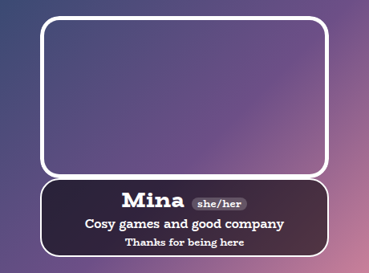
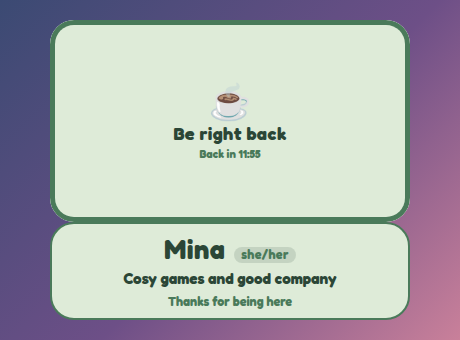
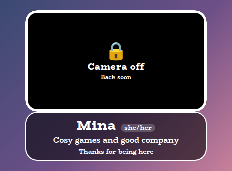
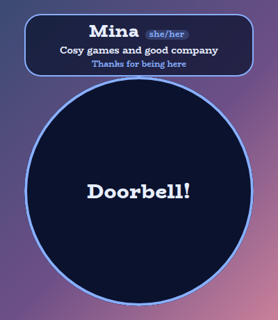
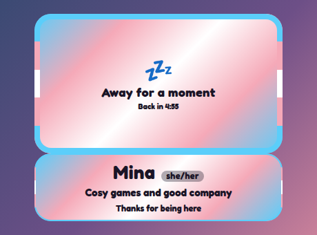
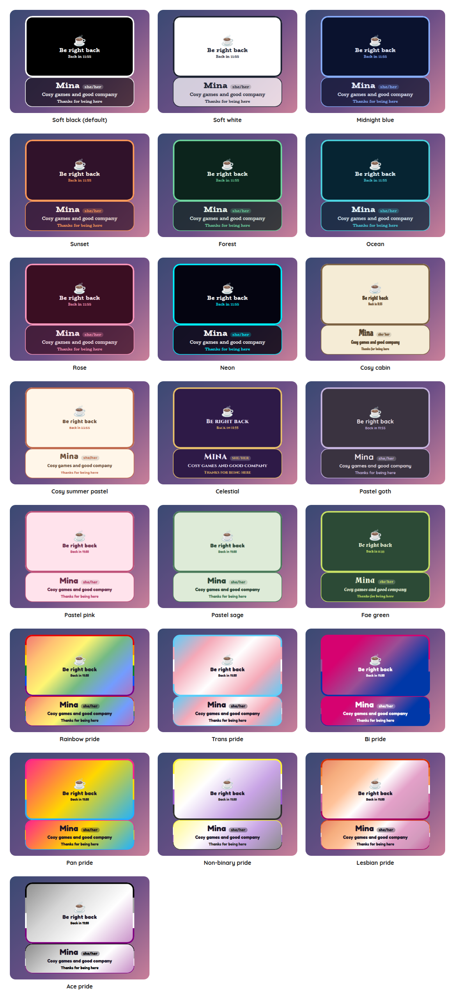

# Camera Overlay

A StreamElements custom widget for your camera. It sits in front of the camera as a framed window the camera shows through, with a nameplate joined to it, and when you need privacy you, or a moderator, type `!camera off` in chat and the window is covered at once, so you can protect yourself in a sensitive moment or step away without leaving a frozen face on screen. `!camera on` brings the camera back.

<p align="center"></p>

It is a single self-contained widget in plain JavaScript, with no dependencies and nothing to install. It uses the same style presets as the rest of the set, so it sits with your other overlays and matches them. It replaces the Over Camera and Under Camera overlays, which did the two halves of this separately, as two widgets in two layers.

## Features

- A window for the camera, framed: the widget goes in front of your camera, and the window is where the camera shows through. It takes whatever room the nameplate leaves, or keeps a shape you choose (16 by 9, 4 by 3, 3 by 2, square or portrait), and resizing the box resizes the window, the frame and the nameplate together. It can be a rounded rectangle or a circle.
- A frame in any preset: a ring round the window in the preset's accent colour, in its flag's stripes for a pride preset, in the panel's colour, or in any colour you pick, with a thickness you choose.
- Cover from chat: `!camera off`, `!camera brb`, `!camera away` or `!camera cover` with a message of your own, and `!camera on` to uncover. The cover fills the window, inside the frame, and the nameplate stays on screen. Only you and your moderators can use the commands.
- Covers instantly, uncovers gently: a cover that faded in would show the camera while it ran, so it appears at once, and only lifting it eases away.
- A nameplate: your name, your pronouns as a small tag, in brackets or as plain text, a line about your stream, and up to twenty rotating lines, above or below the window.
- Countdowns: `!camera brb 5m` puts a countdown on the cover. It never lifts the cover by itself unless you ask it to.
- Safe by default: it starts covered and stays covered until it knows what state it was in, and a refresh of the browser source cannot flash the camera. Every protection is described below, and tested.
- Sounds, icons and wording: a sound for covering and uncovering, an icon for each cover, and every message is a setting.
- Remembers: a covered camera is still covered after a refresh, with its message and countdown.
- All twenty-two style presets, including the seven pride flags.
- Scales with the box: the text scales with the window, and if the box is too short for the nameplate, it shrinks to fit.
- Customisable: around sixty settings cover the commands, safety, wording, icons, nameplate, window, frame, sizes, shape, outline, colours, fonts, sounds and animation.
- An outer frame in the accent colour, on by default in every preset, and switched off with one checkbox (the flag's stripes in the pride presets).

## Screenshots

**Covered.** `!camera brb 12m` fills the window with the cover, here in Pastel sage. The frame stays round it, and the nameplate stays below.

<p></p>

**Off.** `!camera off` in the default look.

<p></p>

**A message of your own, in a circle.** For a round camera, with the nameplate above.

<p></p>

**A flag for the frame.** In a pride preset the frame is the flag, in stripes.

<p></p>

## Style presets

One setting picks the look. The same twenty-two presets, with the same colours, are in every overlay in this set, so overlays from this set match whichever you choose. This is how each one looks in this overlay. The presets are defined once, in the [kit](../../kit), and a test keeps this overlay in step with it.

<p></p>

| Preset | Look |
| --- | --- |
| Soft black (default) | See-through black with white text. |
| Soft white | Frosted white with dark text. |
| Midnight blue | Deep navy with a periwinkle accent. |
| Sunset | Deep plum with orange and coral. |
| Forest | Deep green with a mint accent. |
| Ocean | Deep teal with an aqua accent. |
| Rose | Deep berry with a pink accent. |
| Neon | Near black with cyan and magenta. |
| Cosy cabin | Cream and brown, in Chicle. |
| Cosy summer pastel | Warm cream and coral, in Baloo 2. |
| Celestial | Deep purple and gold, in Cinzel. |
| Pastel goth | Charcoal and lilac, in Quicksand. |
| Pastel pink | Soft blush pink with rose, in Fredoka. |
| Pastel sage | Soft sage green with deep green, in Fredoka. |
| Fae green | Mossy green with a firefly lime accent, in Almendra. |
| Rainbow pride | A soft wash of the six rainbow stripes, in Fredoka. |
| Trans pride | Light blue, pink and white. |
| Bi pride | Magenta, purple and blue, with white text. |
| Pan pride | Pink, yellow and light blue. |
| Non-binary pride | Yellow, white, purple and black, softened so the text stays readable. |
| Lesbian pride | The orange to pink stripes. |
| Ace pride | Black, grey, white and purple, softened so the text stays readable. |

The last seven are pride presets, built from the stripes of the rainbow, trans, bi, pan, non-binary, lesbian and ace flags. The card or panel wears the flag as its background, with only as much of a wash over it as the text needs to stay readable, so flags with a black stripe come out softer. A bar is striped like the flag where an overlay has one, and the slices of a wheel and the options of a poll take their colours from the stripes in order. The colours follow each flag's published design,.

Choose **Custom** to use the colour pickers and font instead. They are ignored while a preset is chosen.

## Quick start

1. In StreamElements, edit your overlay and add **+ Add Widget, Static/Custom, Custom Widget**.
2. Select the widget, open **Settings, Open Editor**, and paste each file from `widget/` into the matching tab: `widget.html` into HTML, `widget.css` into CSS, `widget.js` into JS, and `fields.json` into Fields.
3. Click **Done**. The settings are grouped into Commands, Safety, Wording, Icons, Plate, Rotating lines, Camera window, Frame, Size, Look, Custom colours, Manual controls, Sounds and Troubleshooting.
4. Put the widget **in front of your camera** in the layer order, and size it so the window is exactly where the camera is. Resize the box and the window follows, so drag it until the window is the size of your camera. If you want the window to keep the camera's shape, choose it under Camera window.
5. Type your name and pronouns under Plate, and your lines under Rotating lines.
6. **Test it before you go live.** Type `!camera off` as yourself and look at your stream. The cover should fill the window, edge to edge, with no strip of camera showing. Then `!camera on`.

## The camera window and the frame

The widget is laid out as a column: the window and its frame, and the nameplate joined to it, the same width as the window. The nameplate is **below** the window by default, and **Where the nameplate goes** under Plate puts it **above** instead. The window takes whatever room the nameplate leaves, so **resizing the widget in StreamElements resizes everything with it**.

- **Free** (the default) fills the room, so the box's shape is the window's shape.
- **A shape** (16 by 9, 4 by 3, 3 by 2, square or portrait) keeps that shape and centres the window and nameplate in the box, as large as will fit.
- **Shape of the window and its cover** is a rounded rectangle, with corners set by the Look group's corner setting, or a circle for a round camera.

The window is empty while the camera is live, so your camera shows through it, and the cover fills it when the camera is covered. The frame is a ring drawn round the window, over the cover and the camera, and has the same settings in every preset:

| Setting | What it does |
| --- | --- |
| A frame around the window | On or off, in any preset. It is on by default. |
| How thick the frame is | A percent of the window's width, so it scales with the window. |
| The frame's colour | **The preset's**: its accent colour, or its flag in stripes for a pride preset. **The panel's colour**, made solid. Or **a colour you pick**. |

The cover takes up the window and nothing more, so **the window has to be exactly over your camera**. A window smaller than the camera leaves a strip of it uncovered, so size the box until the window is at least as large as the camera, and check it with `!camera off` before you go live.

## Commands

The command word is a setting. Only the broadcaster and, by default, moderators can use these. Nothing a viewer types does anything.

| Command | What it does |
| --- | --- |
| `!camera off` | Covers the camera, at once, and keeps it covered until someone says `on`. It never lifts itself. |
| `!camera on` | Uncovers the camera. `!camera live` does the same. |
| `!camera brb` | Covers it with a be right back message. |
| `!camera brb 5m` | The same, with a countdown. A time can be `5m`, `90s`, `1h30m`, `2:30` (minutes and seconds) or a bare `5` for minutes, up to twelve hours. |
| `!camera away 10m` | Covers it with an away message, with or without a countdown. |
| `!camera cover Doorbell!` | Covers it with a message you choose, up to 120 characters. With nothing after it, it covers as `off` would. |

The bare `!camera` does nothing, because there is nothing to show while the camera is live.

**A command that covers always covers.** If you type a time that cannot be read, such as `!camera brb soon`, or one that cannot be right, such as 99999 hours, the camera is still covered, just without a countdown. Covering the camera should never fail because of a typing mistake.

A StreamElements widget can read chat but cannot write to it, so nothing is said back. If you want chat to see what happened, add a chatbot command of your own that says it.

## How it protects you

- **Solid.** The cover is the preset's panel colour with the transparency taken out, in all twenty-two presets and for a custom colour however see-through it is set, and a test checks every one.
- **Instant.** Covering has no fade, because a fade would show the camera while it ran. Uncovering fades away over a third of a second.
- **No flash on a refresh.** The widget is covered, over the whole of its box and not just the window, from the first moment, and stays covered until the saved state and the fonts have loaded. If the saved state is that the camera was covered, it stays covered, and if it was showing, the cover lifts. A moderator's command that arrives before the state is known waits and cannot uncover the camera by accident.
- **The window cannot move under the cover.** The size of the window depends on the height of the nameplate, so the whole-box cover waits for the fonts, which decide that height, and every rotating line shares the same space, so a longer line never changes the nameplate's height and moves the window the camera sits in.
- **A silent store stays covered.** If the saved state has not arrived after three seconds, it stops waiting but stays covered, because it cannot know whether it was safe to show the camera. `!camera on` lifts it. Untick **Stay covered until the saved state and the fonts have loaded** under Safety if you would rather it showed the camera in that case, which also means a refresh can show the camera for a moment.
- **Fonts that never load.** If the fonts have not loaded after three seconds, and the saved state said the camera was showing, it is shown, so a blocked font service cannot keep your camera covered for good. A camera that was covered stays covered.
- **Countdowns do not lift the cover.** At zero it says you are back any moment and stays covered, until a moderator or you say `on`. Tick **lift the cover by itself** under Safety if you want a brb to end on its own.

I checked these in a real browser, sampling the widget's computed style every 20 milliseconds from the first paint, with a saved state that was covered, one that was showing, and a store that never answered, and with fonts that never load: the camera was never visible while it should have been covered. I also measured the layout for every window shape, with the nameplate above and below, in four box sizes, and the cover lay exactly on the window each time.

## The rotating lines

Write the lines in one setting, separated by a vertical bar (`|`), for example:

```
!discord to join us | Hydrate and stretch | Be kind in chat
```

- Spaces around a bar are ignored, and blank lines are left out.
- Up to twenty lines take turns. **Seconds each line stays** is between 2 and 600.
- With Animate on, a line fades out as the next fades in. With Animate off it simply changes.
- All the lines share the same space, and the nameplate is as tall as the tallest of them, so a longer line never changes its height. That matters here, because the height of the nameplate decides the size of the window, and the window has to stay where your camera is.
- With one line, nothing moves. With none, nothing shows, and if the nameplate has nothing else on it either, it goes, and the window takes the whole box.

Everything you type is shown exactly as typed, and never as markup.

## What it cannot do

It is a cover, not a guarantee, and it is worth knowing its limits.

- **It does not hide your microphone.** It is only a picture over the camera.
- **If the overlay is not loaded, the camera is not covered.** That includes StreamElements being unavailable, the browser source not being added, or it being in the wrong layer order. Test it before you go live, and for a moment that really matters, hide the camera source in your broadcasting software, which does not depend on a web page.
- **It cannot act on its own.** It covers only when someone it trusts types the command, so make sure your moderators know it is there, and keep the moderator list to people you trust with that.
- **Viewers can see what you tell it to say.** The message is yours to choose, and a plain one such as Camera off says nothing about why.

## Configuration

Every setting has a plain label in StreamElements, grouped as follows.

| Group | What it covers |
| --- | --- |
| Commands | The command word and who may use it. |
| Safety | Where it starts the first time, whether it stays covered until the saved state and the fonts have loaded, and whether a countdown lifts the cover. |
| Wording | The message for camera off, be right back and away, the line under camera off, the countdown line and what it says at zero. |
| Icons | An emoji or symbol for each cover. |
| Plate | Your name, your pronouns and how they are written, the line under your name, where the text sits, and whether the nameplate is above or below the window. |
| Rotating lines | The lines, whether they show, and how long each stays. |
| Camera window | The window's shape, and whether it and its cover are a rounded rectangle or a circle. |
| Frame | Whether there is a frame, how thick it is, and its colour. |
| Size | The cover's text size, the nameplate's text size, the size of your name and the space between the lines. |
| Look | The style preset, font, boldness, corners, padding, outer frame, outline, shadow, Animate and whether the nameplate shrinks to fit the box. |
| Custom colours | Panel, text, accent and tag colours, used when the style preset is Custom. |
| Manual controls | Buttons to cover the camera, cover it as be right back or away, and uncover it. |
| Sounds | A sound when the camera is covered and another when it is uncovered, each with a volume and a Test button, and a master mute. |
| Troubleshooting | A debug log of every event to the browser-source console. |

The **outer frame** is a border round the nameplate in the preset's accent colour, on by default in every preset, beside the frame round the window, which has its own settings under Frame. Untick **An outer frame** under Look for none, or set the outline thickness to change how thick it is, since at 0 it has a default thickness that grows with the box. With the frame unticked, the outline is whatever you set, as before, in the outline colour. In a pride preset the frame is the flag's stripes, as a ring that follows the panel's corners.

The full list, with defaults, is in [`widget/fields.json`](widget/fields.json). The colour and font pickers apply only when the style preset is **Custom**.

## Moving from the Over Camera and Under Camera overlays

This overlay does what the two of them did together, in one widget, so the two are gone. To move over, add this one in front of your camera, remove the other two, and set it up from the Quick start. Your settings do not carry over, because they are different widgets, but they are nearly the same: the Over Camera's text size is now **Cover text size** under Size, and the nameplate's is **Nameplate text size**. The Under Camera's option of a nameplate with no window is gone, since a window is the point of this overlay.

## Local development

There is no build step and no dependencies. Serve this overlay's folder and open the dev harness:

```sh
npm run dev
# then open http://localhost:8000/dev/
```

The harness stands in for StreamElements. It fires the cover commands as the broadcaster, a moderator or a viewer, so you can check that a viewer is ignored, and its **time machine** skips ahead so a countdown does not have to be waited for, and the lines under your name take their turns. Its **Every setting** section is generated from `widget/fields.json`, so it offers exactly what StreamElements will, and the Test buttons play the sounds.

At the top of the harness, **Look and export** switches the style preset on the live widget, and can download or copy a `fields.json` with your current settings as its defaults. The page also has the **Copy into StreamElements** panel, which copies each of the four files so nobody has to download the repository.

The **box-size bar** at the bottom of the stage sets the size of the widget's box in pixels, from two number boxes or a list of common sizes, and remembers it for next time. A StreamElements widget fills whatever box you draw for it, so drawing it in different boxes is the quickest way to see how it behaves. It is the same bar on every overlay's dev page.

The harness must be served over http rather than opened as a file, and fonts come from Google Fonts. It also shows a Ko-fi support button in the corner. That button belongs to the harness only and is not part of the widget, so it never appears on stream.

## Testing

```sh
npm test
```

This runs the real `widget/widget.js` headlessly against a small mock of the page and StreamElements, with a clock the test controls, and exits non-zero on any failure. It covers every command and who may use it, the times it reads and the ones it cannot, what a countdown does at zero, the sounds, what is kept over a refresh and how a damaged save is read, the cover never being see-through in any preset, the hold over the whole box while the saved state and the fonts load, the window's shapes, the frame in every preset including a flag's stripes for the pride ones, the nameplate and its rotating lines, and settings and events of the wrong type. The layout and the first moments of a load are checked in a real browser, because they are geometry and timing, not logic.

## Project layout

```
widget/   the widget: HTML, CSS, JS and the StreamElements fields
dev/      the local dev harness
test/     the automated tests
docs/     screenshots used in this README
```

## Compatibility and limitations

The widget uses the StreamElements events `onWidgetLoad`, `onEventReceived` (chat messages and the manual buttons) and `SE_API.store` to remember its state.

It has not been run on a live stream. Test it with `!camera off` before you go live, as described above, and check that the cover lies edge to edge over your camera.

The JavaScript is plain ES5, so it can be pasted straight into the StreamElements editor.

## Related overlays

These overlays share the same default look and the same twenty-two style presets, so they sit together on one stream.

- [Sub Goals Overlay](../sub-goals): sub and bits goals that fill as chat reaches them.
- [Subathon Overlay](../subathon): a subathon clock with a cap, power-ups and sub goals.
- [Spin Wheel Overlay](../spin-wheel): a wheel for giveaways, raffles and forfeits.
- [Chat Poll Overlay](../chat-poll): quick polls voted on by typing an option.
- [Squat Tracker Overlay](../squat-tracker): a running count driven by gifted sub bombs.
- [Rage Bar Overlay](../rage-bar): a bar chat fills with subs, bits and channel points.
- [Chat Counter Overlay](../counter): a counter chat commands change, for deaths, wins and anything else.
- [Leaderboard Overlay](../leaderboard): top gifters, cheerers and tippers.
- [Hype Meter Overlay](../hype-meter): a meter that chat activity fills, with levels.
- [Stream Goals Overlay](../stream-goals): sub and bits goals that start again for each stream.
- [Reminder Overlay](../reminder): reminders you set from chat, which stay on screen until cleared.
- [Chat Feed Overlay](../chat-feed): on-screen chat with profile pictures and pronouns.

- [Recent Activity Overlay](../recent-activity): the latest subs, gifts, bits, tips, follows and raids.

## Support

If this saves you time, you can support its development on Ko-fi:

[](https://ko-fi.com/journeyingjordan)

Thanks for using it.

## Contributing

Contributions are welcome. See [CONTRIBUTING.md](../../CONTRIBUTING.md).

## License

[MIT](../../LICENSE). The copyright notice, including the Ko-fi link, must be kept in copies and substantial portions of the code.
