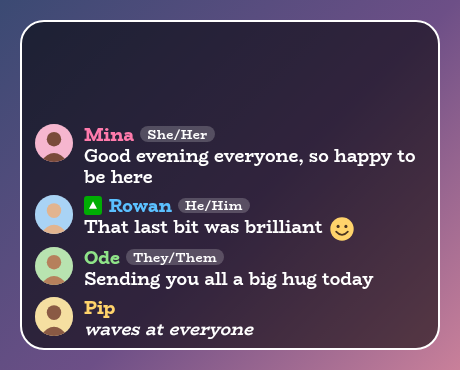
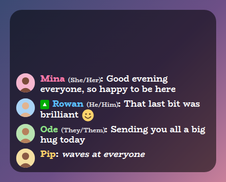
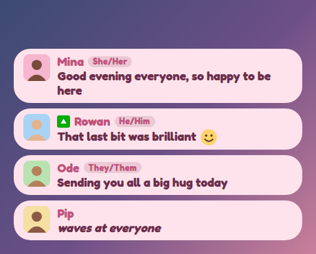
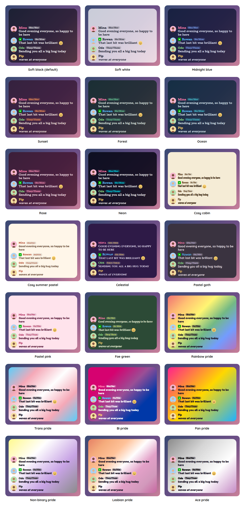

# Chat Feed Overlay

A StreamElements custom widget that shows your chat on screen, with each person's profile picture and their pronouns beside their name. It uses the same style presets as the rest of the set, so it can sit next to your other overlays and match them.

<p align="center"></p>

It is a single self-contained widget in plain JavaScript, with no dependencies and nothing to install. The pictures and pronouns come from two free public services, described under [Where the pictures and pronouns come from](#where-the-pictures-and-pronouns-come-from), and each can be switched off.

## Features

- Chat on screen: names in each person's chat colour, their badges, and emotes as pictures, with `/me` messages in italics.
- GIFs: the GIFs that Twitch now lets higher tier subscribers send in chat are shown in the message, at a height you choose, and can be switched off.
- Profile pictures: a round, rounded or square picture beside each message, or the person's initial when there is none.
- Pronouns: shown beside the name as a small tag, in brackets, or as plain text, with a way to set them by hand.
- Readable names: a chat colour that would be hard to read on your panel is swapped for the accent colour.
- Two layouts: the name above the message or on the same line, and one panel behind everything or a card for each message.
- Scrolls like chat: a new message arrives at the bottom, the older ones glide up and fade out through the top edge, and how many show depends on how tall you make the box in StreamElements. With the newest at the top it scrolls the other way.
- Tidy by default: chat commands, and the usual bots, are left out, and you can add names of your own.
- Moderation: `!chatfeed hide name` takes someone off the screen, and a message StreamElements deletes disappears from it too.
- Fading: messages stay until newer ones push them off, or you can have them fade away after a number of seconds.
- Customisable: around 45 settings cover how many messages show, the layout, pictures, pronouns, sizes, shape, outline, colours, fonts, sounds and animation.
- Tests and a dev harness: a local harness where you can type a real Twitch login and see their real picture and pronouns, and an automated test script, so nothing needs a live stream.

## Screenshots

**Name and message on one line,** with the pronouns in brackets.

<p></p>

**A card for each message,** here in the Pastel pink preset with rounded pictures.

<p></p>

The pictures in these screenshots are drawn examples, not real profiles.

## Style presets

One setting picks the look. The same twenty-two presets, with the same colours, are in every overlay in this set, so overlays from this set match whichever you choose. This is how each one looks in this overlay. The presets are defined once, in the [kit](../../kit), and a test keeps this overlay in step with it.

<p></p>

| Preset | Look |
| --- | --- |
| Soft black (default) | See-through black with white text. |
| Soft white | Frosted white with dark text. |
| Midnight blue | Deep navy with a periwinkle accent. |
| Sunset | Deep plum with orange and coral. |
| Forest | Deep green with a mint accent. |
| Ocean | Deep teal with an aqua accent. |
| Rose | Deep berry with a pink accent. |
| Neon | Near black with cyan and magenta. |
| Cosy cabin | Cream and brown, in Chicle. |
| Cosy summer pastel | Warm cream and coral, in Baloo 2. |
| Celestial | Deep purple and gold, in Cinzel. |
| Pastel goth | Charcoal and lilac, in Quicksand. |
| Pastel pink | Soft blush pink with rose, in Fredoka. |
| Pastel sage | Soft sage green with deep green, in Fredoka. |
| Fae green | Mossy green with a firefly lime accent, in Almendra. |
| Rainbow pride | A soft wash of the six rainbow stripes, in Fredoka. |
| Trans pride | Light blue, pink and white. |
| Bi pride | Magenta, purple and blue, with white text. |
| Pan pride | Pink, yellow and light blue. |
| Non-binary pride | Yellow, white, purple and black, softened so the text stays readable. |
| Lesbian pride | The orange to pink stripes. |
| Ace pride | Black, grey, white and purple, softened so the text stays readable. |

The last seven are pride presets, built from the stripes of the rainbow, trans, bi, pan, non-binary, lesbian and ace flags. The card or panel wears the flag as its background, with only as much of a wash over it as the text needs to stay readable, so flags with a black stripe come out softer. A bar is striped like the flag where an overlay has one, and the slices of a wheel and the options of a poll take their colours from the stripes in order. The colours follow each flag's published design,.

Choose **Custom** to use the colour pickers and font instead. They are ignored while a preset is chosen.

## Quick start

1. In StreamElements, edit your overlay and add **+ Add Widget, Static/Custom, Custom Widget**.
2. Select the widget, open **Settings, Open Editor**, and paste each file from `widget/` into the matching tab: `widget.html` into HTML, `widget.css` into CSS, `widget.js` into JS, and `fields.json` into Fields.
3. Click **Done**. The settings are grouped into Commands, Feed, Messages, Avatars, Pronouns, Size, Look, Custom colours, Manual controls, Sounds and Troubleshooting.
4. Size and position the widget. It fills the box you draw and the text scales with the box. The newest message sits at the bottom and older ones scroll up and out, so a taller box shows more of the conversation.
5. Press **Show example messages** under Manual controls to see how it looks before anyone has said anything.

The widget reads Twitch chat through StreamElements, so it works as soon as it is on an active overlay.

## Where the pictures and pronouns come from

StreamElements does not send a chatter's profile picture or pronouns with their message, so the widget looks them up the first time each person speaks.

| What | From | What is sent |
| --- | --- | --- |
| Profile pictures | [decapi.me](https://decapi.me), which answers with the address of the person's Twitch profile picture | The person's Twitch login. |
| Pronouns | [pronouns.alejo.io](https://pr.alejo.io/), the service behind the Twitch chat pronouns extension, where people choose theirs | The person's Twitch login. |
| GIFs | [giphy.com](https://giphy.com), where Twitch hosts the GIFs chatters send | Nothing about the person. Your browser source asks for the GIF's address, as any page showing a GIF would. |

Neither request carries the message, and neither service is run by this project. Both requests are made from the browser source on your machine, so those services can see your address as they would for any web page. If you would rather not use one, untick **Show profile pictures** or **Show pronouns** under Avatars or Pronouns, and nothing is asked of that service.

What the widget does to be a good neighbour:

- Each person is looked up once. Pictures are remembered for six hours, a person with no picture is not asked about again for ten minutes, and the pronoun service asks for a five minute cache, which is what it gets.
- What is remembered is saved with StreamElements, so refreshing the browser source does not ask again about everyone who has already spoken.
- Several messages from someone new make one request, not one each.
- Only an address on Twitch's own image host is ever used as a picture, whatever a service answers, and anything that is not a valid Twitch login is never sent anywhere.
- If a service is down, slow or refuses, the message still shows straight away, with the person's initial and no pronouns.

People choose their pronouns on the pronoun service itself, so someone who has not set any shows none. You can set pronouns by hand for anyone under **Pronouns**, for example `alice=She/Her, bram=He/Him`. A pronoun you set by hand is used instead of a lookup, and it is also the way to cover someone while the service is unavailable.

## Messages

- **What is left out.** Messages that start with `!` are chat commands and are not shown, unless you untick that. The usual bots (Nightbot, StreamElements, Streamlabs, Moobot, Fossabot and Wizebot) are left out, and **Never show these chatters** is a list you can change. The widget's own command is never shown.
- **Name colours.** By default a name uses the colour the chatter chose. If that colour would be hard to read on your panel, tried over a black and a grey backdrop, the name uses the accent colour instead. You can always use the accent or the text colour.
- **Emotes** appear as pictures where they were typed, using the emotes StreamElements sends with the message. A Twitch emote is placed by its position in the message, and any other emote is found by its name, as a whole word. An animated picture is handed to the browser as it is, so it animates if the address StreamElements sends is an animated one. An emote with no picture on a secure address stays as the word.
- **Third-party emotes.** The widget does not look emotes up itself. Whether 7TV, BTTV and FrankerFaceZ emotes show depends on StreamElements including them in the message for your channel, which I have not been able to confirm. Turn on `debug` and look at the `emotes` list for one of them to see what arrives.
- **GIFs.** Twitch sends a GIF as a `gifs` tag on the message, with its position in the text, and the text holds a placeholder such as `[Yes GIF by someone]`. The widget puts the GIF where the placeholder is. Twitch asks that the address is used exactly as given, so it is never changed, and only a secure address on Giphy's own domain is shown, so a message cannot make the widget load anything else. Untick **Show GIFs** under Messages, or turn the size down, if you want them off or smaller. Twitch limits who can send GIFs and lets a streamer switch them off, and `!chatfeed hide name` takes someone's messages off the screen if you need to.
- **Deleted messages.** When StreamElements reports a message deleted, or all of a banned person's messages deleted, they disappear from the screen.
- **Length.** The box decides how many messages show, and a message is removed once it has scrolled completely out of view. **Most messages kept on screen** (thirty at most, and thirty by default) is only a ceiling. A long message wraps inside the box.

## Chat commands

The command word is a setting. Viewers can type the bare `!chatfeed` to make the panel pop, and everything else needs the broadcaster or, by default, a moderator.

| Command | What it does |
| --- | --- |
| `!chatfeed clear` | Empties the screen. |
| `!chatfeed hide name` | Removes that person's messages from the screen and keeps them off it. This is remembered when the browser source refreshes. |
| `!chatfeed unhide name` | Lets them back. |

## Configuration

Every setting has a plain label in StreamElements, grouped as follows.

| Group | What it covers |
| --- | --- |
| Commands | The command word and who may use it. |
| Feed | How many messages show, whether they fade away after a time (they do not by default, and stay until newer messages push them off), which end the newest goes, commands and names to leave out. |
| Messages | One panel or a card for each message, where the name goes, the name colour, badges and emotes. |
| Avatars | Whether pictures show, their shape and their size. |
| Pronouns | Whether they show, how they are written, and pronouns set by hand. |
| Size | Text size and the space between messages. |
| Look | Title, the style preset, font, boldness, corners, padding, outline, shadow and Animate. |
| Custom colours | Panel, text, accent, tag and alert colours, used when the style preset is Custom. |
| Manual controls | Buttons to show example messages and to clear the screen. |
| Sounds | A sound and volume for a message arriving, with a Test button and a master mute. |
| Troubleshooting | A debug log of every event to the browser-source console. |

The full list, with defaults, is in [`widget/fields.json`](widget/fields.json). The colour and font pickers apply only when the style preset is **Custom**.

## Local development

There is no build step and no dependencies. Serve this overlay's folder and open the dev harness:

```sh
npm run dev
# then open http://localhost:8000/dev/
```

The harness stands in for StreamElements. Under **Say something as a chatter** you can type any Twitch login and a message, and the widget looks that person up for real, so you can try your own login and see your picture and pronouns. The example buttons use made up names, so they show initials. It also sends messages with emotes, a moderator badge, a hard to read colour and a `/me`, and chat commands as a viewer, moderator or broadcaster. A **time machine** skips ahead so you can watch messages fade without waiting.

At the top of the harness, **Look and export** switches the style preset on the live widget, and can download or copy a `fields.json` with your current settings as its defaults. Paste that into the Fields tab of a new custom widget in StreamElements and it starts out as you have it.

The **box-size bar** at the bottom of the stage sets the size of the widget's box in pixels, from two number boxes or a list of common sizes, and remembers it for next time. A StreamElements widget fills whatever box you draw for it, so drawing it in different boxes is the quickest way to see how it behaves. It is the same bar on every overlay's dev page.

The harness must be served over http rather than opened as a file, fonts come from Google Fonts, and the lookups need a network connection. It also shows a Ko-fi support button in the corner. That button belongs to the harness only and is not part of the widget, so it never appears on stream.

## Testing

```sh
npm test
```

This runs the real `widget/widget.js` headlessly against a small mock of the page, StreamElements and the network, with a clock the test controls, and exits non-zero on any failure. It covers messages and their order, fading, what is left out, emotes (by position and by name, including animated and non-Twitch ones), GIFs (including addresses that are not on Giphy, that are not secure, or that are malformed) and badges, the picture and pronoun lookups (what is cached, retried and refused, a service being down, and an answer that is not the shape expected), name colours, layout, every command, deleted messages, the style presets, sounds and malformed events.

## Project layout

```
widget/   the widget: HTML, CSS, JS and the StreamElements fields
dev/      the local dev harness
test/     the automated tests
docs/     screenshots used in this README
```

## Compatibility and limitations

The widget uses the StreamElements events `onWidgetLoad` and `onEventReceived` with `message`, `delete-message`, `delete-messages` and `widget-button`, and `SE_API.store`. It makes `fetch` requests to the two lookup services above, and the browser loads GIFs from Giphy.

The pronoun record and the picture lookup were checked against the live services. The shape of a message, its badges and emotes, and the events for deleted messages match the sample message and chat widget that StreamElements publishes, but the widget has not been run on a live stream. I do not know which non-Twitch emotes StreamElements includes in a message, whether an animated Twitch emote arrives with an animated picture, or whether StreamElements passes Twitch's newer `gifs` tag along with the rest of a message's tags. The widget reads it from the message's `tags` (or from a `gifs` list on the message, if StreamElements adds one), so a GIF appears only if it is there, and otherwise you see the placeholder text. Tick **debug** in Troubleshooting for your first stream to log each event, and please open an issue if something differs.

It shows messages as they arrive while it is running and does not read earlier chat, so a freshly added widget starts empty. It is not a chat box for typing in, and a widget cannot write to chat, so `!chatfeed` makes the panel pop rather than replying.

Picture and pronoun lookups depend on two services that are not part of this project. If one changes or goes away, the widget carries on without it.

The JavaScript is plain ES5, so it can be pasted straight into the StreamElements editor.

## Related overlays

These overlays share the same default look and the same twenty-two style presets, so they sit together on one stream.

- [Sub Goals Overlay](../sub-goals): sub and bits goals that fill as chat reaches them.
- [Subathon Overlay](../subathon): a subathon clock with a cap, power-ups and sub goals.
- [Spin Wheel Overlay](../spin-wheel): a wheel for giveaways, raffles and forfeits.
- [Chat Poll Overlay](../chat-poll): quick polls voted on by typing an option.
- [Squat Tracker Overlay](../squat-tracker): a running count driven by gifted sub bombs.
- [Rage Bar Overlay](../rage-bar): a bar chat fills with subs, bits and channel points.
- [Chat Counter Overlay](../counter): a counter chat commands change, for deaths, wins and anything else.
- [Leaderboard Overlay](../leaderboard): top gifters, cheerers and tippers.
- [Hype Meter Overlay](../hype-meter): a meter that chat activity fills, with levels.
- [Stream Goals Overlay](../stream-goals): sub and bits goals that start again for each stream.
- [Reminder Overlay](../reminder): reminders you set from chat, which stay on screen until cleared.
- [Recent Activity Overlay](../recent-activity): the latest subs, gifts, bits, tips, follows and raids.
- [Over Camera Overlay](../over-camera): a cover for your camera that you and your moderators control from chat.
- [Under Camera Overlay](../under-camera): a nameplate for under your camera, with your name, pronouns and rotating lines.
- [Now Playing Overlay](../now-playing): what you are playing, from Last.fm, Tuna, Spotify or Pear Desktop, with album art and a progress bar.

## Support

If this saves you time, you can support its development on Ko-fi:

[](https://ko-fi.com/journeyingjordan)

Thanks for using it.

## Contributing

Contributions are welcome. See [CONTRIBUTING.md](../../CONTRIBUTING.md).

## License

[MIT](../../LICENSE). The copyright notice, including the Ko-fi link, must be kept in copies and substantial portions of the code.
