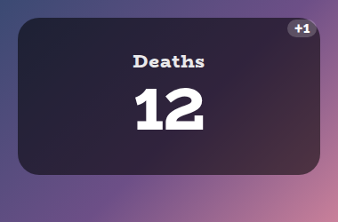
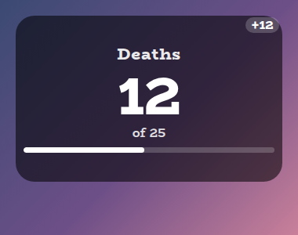
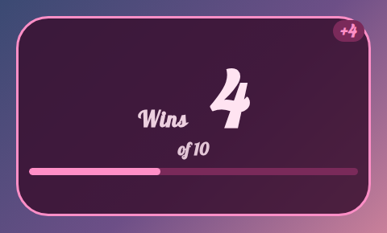
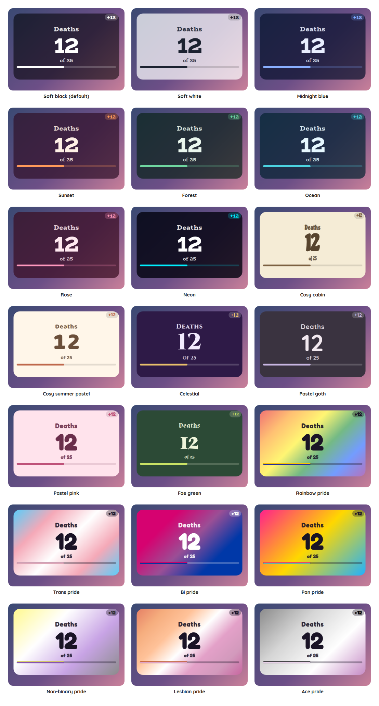

# Chat Counter Overlay

A StreamElements custom widget: a counter that chat commands change, for deaths, wins, fails or anything else worth counting. The streamer or a moderator types `!count +1`, and the number pops.

<p align="center"></p>

It is a single self-contained widget in plain JavaScript, with no dependencies and nothing to install. Add one widget per thing you want to count, and give each its own command word.

## Features

- Chat commands: `!count +1`, `-1`, `+5`, `set 50`, `reset`, `undo`, `lock` and `unlock`, for the broadcaster or moderators.
- Undo: the last 20 changes can be taken back, so a mistyped number is easy to fix.
- A goal and a bar: optionally count towards a number, with a bar under it and a message when it is reached.
- Milestones: a message and a sound every 10, 25 or whatever you choose.
- Limits: optionally stop at zero or at a highest value.
- Lock: stop any change while you are not looking, such as during a cutscene.
- Sounds: optional sounds for going up, going down, a milestone and the goal.
- Scales to its box: the number fills whatever size you draw the widget in StreamElements.
- Customisable: around 60 settings cover the wording, number, layout, shape, outline, colours, fonts, sounds and animation.
- Saved: the number, the lock and the undo history survive a browser-source refresh.
- Tests and a dev harness: a local harness and an automated test script, so nothing needs a live stream.

## Screenshots

**A goal.** With a goal set, the number gets an "of 25" line and a bar that fills.

<p></p>

**Your own look.** Choose Custom for the style preset and every colour, the font, the outline and the layout are settings. This one puts the title beside the number.

<p></p>

## Style presets

One setting picks the look. The same twenty-two presets, with the same colours, are in every overlay in this set, so overlays from this set match whichever you choose. This is how each one looks in this overlay. The presets are defined once, in the [kit](../../kit), and a test keeps this overlay in step with it.

<p></p>

| Preset | Look |
| --- | --- |
| Soft black (default) | See-through black with white text. |
| Soft white | Frosted white with dark text. |
| Midnight blue | Deep navy with a periwinkle accent. |
| Sunset | Deep plum with orange and coral. |
| Forest | Deep green with a mint accent. |
| Ocean | Deep teal with an aqua accent. |
| Rose | Deep berry with a pink accent. |
| Neon | Near black with cyan and magenta. |
| Cosy cabin | Cream and brown, in Chicle. |
| Cosy summer pastel | Warm cream and coral, in Baloo 2. |
| Celestial | Deep purple and gold, in Cinzel. |
| Pastel goth | Charcoal and lilac, in Quicksand. |
| Pastel pink | Soft blush pink with rose, in Fredoka. |
| Pastel sage | Soft sage green with deep green, in Fredoka. |
| Fae green | Mossy green with a firefly lime accent, in Almendra. |
| Rainbow pride | A soft wash of the six rainbow stripes, in Fredoka. |
| Trans pride | Light blue, pink and white. |
| Bi pride | Magenta, purple and blue, with white text. |
| Pan pride | Pink, yellow and light blue. |
| Non-binary pride | Yellow, white, purple and black, softened so the text stays readable. |
| Lesbian pride | The orange to pink stripes. |
| Ace pride | Black, grey, white and purple, softened so the text stays readable. |

The last seven are pride presets, built from the stripes of the rainbow, trans, bi, pan, non-binary, lesbian and ace flags. The card or panel wears the flag as its background, with only as much of a wash over it as the text needs to stay readable, so flags with a black stripe come out softer. A bar is striped like the flag where an overlay has one, and the slices of a wheel and the options of a poll take their colours from the stripes in order. The colours follow each flag's published design,.

Choose **Custom** to use the colour pickers and font instead. They are ignored while a preset is chosen.

## Quick start

1. In StreamElements, edit your overlay and add **+ Add Widget, Static/Custom, Custom Widget**.
2. Select the widget, open **Settings, Open Editor**, and paste each file from `widget/` into the matching tab: `widget.html` into HTML, `widget.css` into CSS, `widget.js` into JS, and `fields.json` into Fields.
3. Click **Done**. The settings are grouped into Commands, Counter, Number, Manual controls, Look, Custom colours, Sounds and Troubleshooting.
4. Size and position the widget. The number scales with the box.

The widget reads Twitch chat and events through StreamElements, so it works as soon as it is on an active overlay.

## Chat commands

The command word is a setting. The defaults are below. Viewers can type the bare `!count` to make the number pop, and everything else needs the broadcaster or, by default, a moderator.

| Command | What it does |
| --- | --- |
| `!count +1` or `!count 1` | Adds one. Any whole number works. |
| `!count -3` | Takes three off. |
| `!count +` and `!count -` | Add or take off one step (1 by default, a setting). |
| `!count set 50` or `!count =50` | Sets an exact number. |
| `!count undo` | Reverses the last change, up to 20 of them. |
| `!count reset` | Back to the starting value, and clears the undo history. |
| `!count lock` and `!count unlock` | Stops every change, from chat and from the buttons, until unlocked. |

## Goals and milestones

Set a **Goal** and the number gets an "of 25" line and a bar. Reaching it shows a message and plays a sound, once, when the count crosses it going up. **Celebrate every** does the same on a repeating number, so a death counter can mark every tenth death.

## Limits

By default the number stops at zero. Tick **Allow the count to go below zero** if you want negatives, or set a **Highest value** to stop it at a ceiling.

## Configuration

Every setting has a plain label in StreamElements, grouped as follows.

| Group | What it covers |
| --- | --- |
| Commands | The command word and who may use it. |
| Counter | The starting value, the step, limits, a goal with its bar and text, milestones, and the locked text. |
| Number | Text before and after the number, zero padding, layout, sizes, and the +1 chip. |
| Manual controls | Buttons for add, subtract, undo, reset, lock and unlock. |
| Look | Title, the style preset, font, boldness, corners, padding, outline, shadow and Animate. |
| Custom colours | Panel, text, accent, bar and alert colours, used when the style preset is Custom. |
| Sounds | A sound and volume for up, down, a milestone and the goal, with Test buttons and a master mute. |
| Troubleshooting | A debug log of every event to the browser-source console. |

The full list, with defaults, is in [`widget/fields.json`](widget/fields.json). The colour and font pickers apply only when the style preset is **Custom**.

## Local development

There is no build step and no dependencies. Serve this overlay's folder and open the dev harness:

```sh
npm run dev
# then open http://localhost:8000/dev/
```

The harness stands in for StreamElements. It sends chat commands as a viewer, moderator or broadcaster, with quick buttons for the common ones, and shows the saved state. Its **Every setting** section is generated from `widget/fields.json`, so it offers exactly what StreamElements will.

At the top of the harness, **Look and export** switches the style preset on the live widget, and can download or copy a `fields.json` with your current settings as its defaults. Paste that into the Fields tab of a new custom widget in StreamElements and it starts out looking the way it does here.

The harness must be served over http rather than opened as a file, and fonts come from Google Fonts. It also shows a Ko-fi support button in the corner. That button belongs to the harness only and is not part of the widget, so it never appears on stream.

## Testing

```sh
npm test
```

This runs the real `widget/widget.js` headlessly against a small mock of the page and StreamElements, with a clock the test controls, and exits non-zero on any failure. It covers every command and permission, undo, the limits, the lock, the goal and milestones, the chip, every look setting, the sounds and saving across a refresh. It also checks the style presets against the shared palette, and that every setting in `fields.json` is read by the widget and every button does something.

## Project layout

```
widget/   the widget: HTML, CSS, JS and the StreamElements fields
dev/      the local dev harness
test/     the automated tests
docs/     screenshots used in this README
```

## Compatibility and limitations

The widget uses the StreamElements events `onWidgetLoad` and `onEventReceived` with `message` and `widget-button`, and `SE_API.store`.

A StreamElements widget can read chat but cannot write to it, so `!count` makes the number pop rather than replying. If you would like chat to see the number, add a StreamElements chatbot command with the same name that reads it out.

The number is saved per widget, so two counters need two widgets, each with its own command word.

The JavaScript is plain ES5, so it can be pasted straight into the StreamElements editor.

## Related overlays

These overlays share the same default look and the same twenty-two style presets, so they sit together on one stream.

- [Sub Goals Overlay](../sub-goals): sub and bits goals that fill as chat reaches them.
- [Subathon Overlay](../subathon): a subathon clock with a cap, power-ups and sub goals.
- [Spin Wheel Overlay](../spin-wheel): a wheel for giveaways, raffles and forfeits.
- [Chat Poll Overlay](../chat-poll): quick polls voted on by typing an option.
- [Squat Tracker Overlay](../squat-tracker): a running count driven by gifted sub bombs.
- [Rage Bar Overlay](../rage-bar): a bar chat fills with subs, bits and channel points.
- [Leaderboard Overlay](../leaderboard): top gifters, cheerers and tippers.
- [Hype Meter Overlay](../hype-meter): a meter that chat activity fills, with levels.
- [Recent Activity Overlay](../recent-activity): the latest subs, gifts, bits, tips, follows and raids.
- [Stream Goals Overlay](../stream-goals): sub and bits goals that start again for each stream.
- [Reminder Overlay](../reminder): reminders you set from chat, which stay on screen until cleared.
- [Chat Feed Overlay](../chat-feed): on-screen chat with profile pictures and pronouns.

## Support

If this saves you time, you can support its development on Ko-fi:

[](https://ko-fi.com/journeyingjordan)

Thanks for using it.

## Contributing

Contributions are welcome. See [CONTRIBUTING.md](../../CONTRIBUTING.md).

## License

[MIT](../../LICENSE). The copyright notice, including the Ko-fi link, must be kept in copies and substantial portions of the code.
