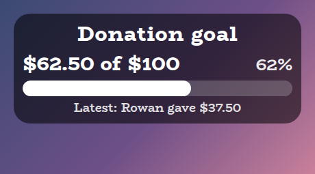
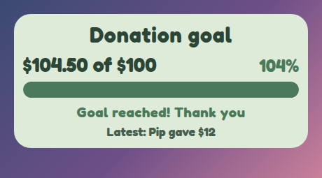
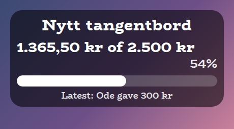
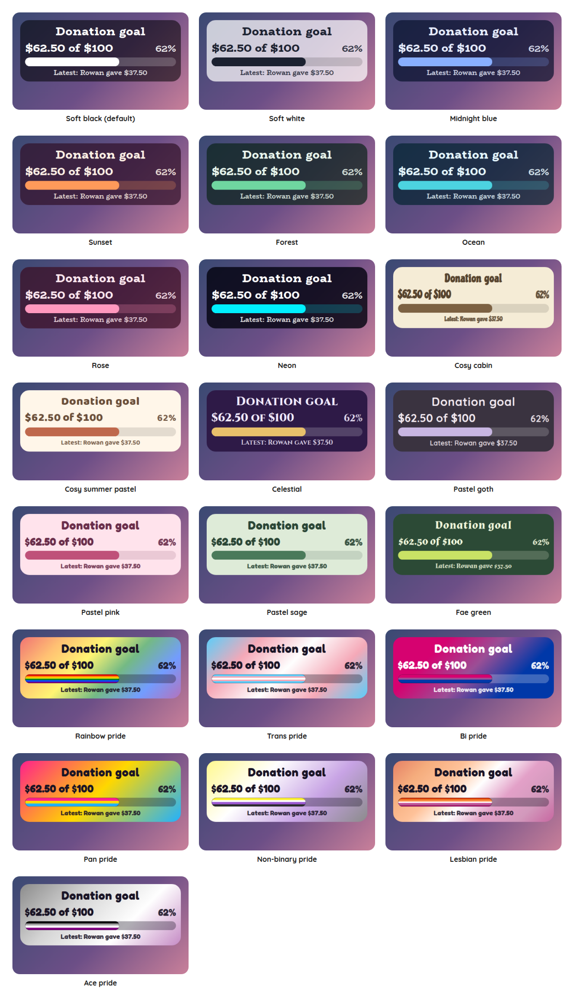

# Donation Goal Overlay

A StreamElements custom widget that shows a goal for donations: a bar that fills as tips arrive, how much has been raised, and who gave the latest one. It is for a goal in money, such as a new keyboard or a charity stream, and it uses the same style presets as the rest of the set.

<p align="center"></p>

It is a single self-contained widget in plain JavaScript, with no dependencies and nothing to install.

## Features

- Tips only: a donation goal counts the tips that StreamElements reports, and nothing else. Bits, subs, follows and raids are left to the overlays built for them, such as the [Stream Goals Overlay](../stream-goals) and the [Sub Goals Overlay](../sub-goals).
- Exact money: amounts are kept in whole cents, so a run of small tips adds up to exactly what was given.
- Two ways to finish: the bar stays full with a message, or the goal stretches by an amount you choose and the bar carries on.
- Latest donor: the name and amount of the most recent tip, with anonymous donors shown under a name you choose.
- Your money, written your way: the currency symbol, before or after the amount, a comma or a point for the decimal, and whether cents always show.
- Your wording: every line is a setting, with tokens for the amounts and the name.
- Chat control: mods can add to the total, set it, change the goal or start again from chat.
- Saved: the total, the goal and the latest donor survive a browser-source refresh.
- Sounds: an optional sound for a donation and another for reaching the goal.
- Customisable: around 50 settings cover the goal, the money format, what shows, the wording, sizes, shape, outline, colours, fonts, sounds and animation.
- Tests and a dev harness: a local harness and an automated test script, so nothing needs a live stream.

## Screenshots

**A goal that has been reached,** here in the Pastel sage preset.

<p></p>

**Money written your way.** A word for a symbol, placed after the amount, with a comma decimal and a title of your own.

<p></p>

## Style presets

One setting picks the look. The same twenty-two presets, with the same colours, are in every overlay in this set, so overlays from this set match whichever you choose. This is how each one looks in this overlay. The presets are defined once, in the [kit](../../kit), and a test keeps this overlay in step with it.

<p></p>

| Preset | Look |
| --- | --- |
| Soft black (default) | See-through black with white text. |
| Soft white | Frosted white with dark text. |
| Midnight blue | Deep navy with a periwinkle accent. |
| Sunset | Deep plum with orange and coral. |
| Forest | Deep green with a mint accent. |
| Ocean | Deep teal with an aqua accent. |
| Rose | Deep berry with a pink accent. |
| Neon | Near black with cyan and magenta. |
| Cosy cabin | Cream and brown, in Chicle. |
| Cosy summer pastel | Warm cream and coral, in Baloo 2. |
| Celestial | Deep purple and gold, in Cinzel. |
| Pastel goth | Charcoal and lilac, in Quicksand. |
| Pastel pink | Soft blush pink with rose, in Fredoka. |
| Pastel sage | Soft sage green with deep green, in Fredoka. |
| Fae green | Mossy green with a firefly lime accent, in Almendra. |
| Rainbow pride | A soft wash of the six rainbow stripes, in Fredoka. |
| Trans pride | Light blue, pink and white. |
| Bi pride | Magenta, purple and blue, with white text. |
| Pan pride | Pink, yellow and light blue. |
| Non-binary pride | Yellow, white, purple and black, softened so the text stays readable. |
| Lesbian pride | The orange to pink stripes. |
| Ace pride | Black, grey, white and purple, softened so the text stays readable. |

The last seven are pride presets, built from the stripes of the rainbow, trans, bi, pan, non-binary, lesbian and ace flags. The card or panel wears the flag as its background, with only as much of a wash over it as the text needs to stay readable, so flags with a black stripe come out softer. A bar is striped like the flag where an overlay has one, and the slices of a wheel and the options of a poll take their colours from the stripes in order. The colours follow each flag's published design,.

Choose **Custom** to use the colour pickers and font instead. They are ignored while a preset is chosen.

## Quick start

1. In StreamElements, edit your overlay and add **+ Add Widget, Static/Custom, Custom Widget**.
2. Select the widget, open **Settings, Open Editor**, and paste each file from `widget/` into the matching tab: `widget.html` into HTML, `widget.css` into CSS, `widget.js` into JS, and `fields.json` into Fields.
3. Click **Done**. The settings are grouped into Commands, Goal, Money, Display, Wording, Size, Look, Custom colours, Manual controls, Sounds and Troubleshooting.
4. Set **The goal** under Goal, and the **Currency symbol** under Money.
5. Size and position the widget. The text scales with the box, and the card grows downwards to fit what it shows.

Press **Add a test donation of 5** under Manual controls to see it move before anyone has tipped.

## What counts

Only tips count. The widget listens for StreamElements' tip events, and each one adds its amount to the total. An amount is taken exactly as StreamElements gives it, in your channel's currency, and there is no conversion from one currency to another.

- **Tips** of nothing, below zero, or that are not a number count for nothing. **Smallest tip that counts** under Goal can leave out small ones.
- **Bits, subs, follows and raids** are ignored. Use the [Stream Goals Overlay](../stream-goals) for a goal in bits or subs.
- **Anonymous tips** count towards the total and show under the name you choose.
- **A tip that reaches the goal** plays the goal sound in place of the donation sound.

## When the goal is reached

Under **When the goal is reached** you choose what happens:

- **Stay full.** The bar fills, the message shows and stays, and the amount carries on counting past the goal (the percentage goes over 100). Reset it from chat or with **Start again** when you are ready for the next goal.
- **Raise the goal.** The goal goes up by **How much a stretched goal goes up each time**, the bar carries on, and the message shows for ten seconds. One big tip raises the goal as many times as it takes to be ahead of the total again.

The message is wording you can change, and `{goal}` in it is the new goal if it stretched.

## Chat commands

The command word is a setting. Viewers can type the bare `!donation` to make the title pop, and everything else needs the broadcaster or, by default, a moderator.

| Command | What it does |
| --- | --- |
| `!donation add 10` | Adds to the total, for money that came another way. Nobody is credited as the latest donor. A minus sign takes money off: `add -4`. |
| `!donation set 42.50` | Puts the total right. |
| `!donation goal 200` | Changes the goal. |
| `!donation reset` | Starts again: the starting amount, the goal from the settings, and no donor. |

An amount can be written `5`, `$5`, `5.50`, `5,50`, `5 kr` or `+3`. A number with a thousands separator, such as `1,250`, is refused, because a comma could mean either a separator or a decimal and a wrong guess would add the wrong money, and so is anything else it cannot read. Anything unreadable changes nothing and says nothing.

## Money

- **Currency symbol** is a setting, and a blank shows none. **Put the symbol after the amount** moves it: a lone sign such as the euro sign sits against the number, and a word such as `kr` gets a space that does not break the line.
- **Use a comma for the decimal** writes `5,50`, and the thousands then use a point: `1.250,50`.
- **Cents** can show only when there are some (`$5` and `$5.50`), always (`$5.00`), or never, rounded to a whole number.

## Wording

Every line is a setting. These tokens can be used in them:

| Token | What it becomes |
| --- | --- |
| `{raised}` | The amount raised so far. |
| `{goal}` | The goal. |
| `{percent}` | The percentage, as a whole number. |
| `{name}` | The latest donor. |
| `{amount}` | The latest donation. |

A line you blank is hidden. Names and text are shown exactly as typed and never as markup.

## Your goal and your settings

The goal and the total are saved with StreamElements, so a refresh keeps them. A goal you change in the settings takes the place of a saved one, so editing **The goal** does what you would expect. **Already raised when it starts** is used the first time, and again when you reset, and is otherwise left alone.

## Configuration

Every setting has a plain label in StreamElements, grouped as follows.

| Group | What it covers |
| --- | --- |
| Commands | The command word and who may use it. |
| Goal | The goal, the starting amount, what happens when it is reached, and the smallest tip that counts. |
| Money | The currency symbol and where it goes, the decimal, and whether cents show. |
| Display | Whether the amounts, the percentage and the latest donor show. |
| Wording | The lines for the amounts, the percentage, the goal reached message and the latest donor, and the name for anonymous donors. |
| Size | Text size, bar thickness and title size. |
| Look | Title, the style preset, font, boldness, corners, padding, outline, shadow and Animate. |
| Custom colours | Panel, text, accent, bar and alert colours, used when the style preset is Custom. |
| Manual controls | Buttons to add a test donation and to start again. |
| Sounds | A sound for a donation and one for reaching the goal, each with a volume and a Test button, and a master mute. |
| Troubleshooting | A debug log of every event to the browser-source console. |

The full list, with defaults, is in [`widget/fields.json`](widget/fields.json). The colour and font pickers apply only when the style preset is **Custom**.

## Local development

There is no build step and no dependencies. Serve this overlay's folder and open the dev harness:

```sh
npm run dev
# then open http://localhost:8000/dev/
```

The harness stands in for StreamElements. It sends tips of several sizes, an anonymous tip, and things the goal ignores (bits and a sub), so you can see that they change nothing, and chat commands as a viewer, moderator or broadcaster. A **time machine** skips ahead so you can watch a stretched goal's message end without waiting.

At the top of the harness, **Look and export** switches the style preset on the live widget, and can download or copy a `fields.json` with your current settings as its defaults. Paste that into the Fields tab of a new custom widget in StreamElements and it starts out as you have it.

The harness must be served over http rather than opened as a file, and fonts come from Google Fonts. It also shows a Ko-fi support button in the corner. That button belongs to the harness only and is not part of the widget, so it never appears on stream.

## Testing

```sh
npm test
```

This runs the real `widget/widget.js` headlessly against a small mock of the page and StreamElements, with a clock the test controls, and exits non-zero on any failure. It covers what counts and what does not, exact amounts, both ways of finishing, every command and the amounts it accepts, saving and reading back a damaged save, every way of writing money, the wording, the style presets, sounds and malformed events.

## Project layout

```
widget/   the widget: HTML, CSS, JS and the StreamElements fields
dev/      the local dev harness
test/     the automated tests
docs/     screenshots used in this README
```

## Compatibility and limitations

The widget uses the StreamElements events `onWidgetLoad` and `onEventReceived` with `message`, `tip-latest` and `widget-button`, and `SE_API.store`. It reads a tip's `amount` and its `name` or `username`.

It has not been run on a live stream. Tick **debug** in Troubleshooting for your first stream to log each event, and please open an issue if a tip arrives in a shape it does not read.

It counts tips as they arrive while it is running and does not read earlier history, so use **Already raised when it starts** for money that came before. There is no conversion between currencies: the goal is in whatever currency your channel uses, and a tip in another one is counted at the amount StreamElements reports.

A StreamElements widget can read chat but cannot write to it, so `!donation` makes the title pop rather than replying.

The JavaScript is plain ES5, so it can be pasted straight into the StreamElements editor.

## Related overlays

These overlays share the same default look and the same twenty-two style presets, so they sit together on one stream.

- [Sub Goals Overlay](../sub-goals): sub and bits goals that fill as chat reaches them.
- [Subathon Overlay](../subathon): a subathon clock with a cap, power-ups and sub goals.
- [Spin Wheel Overlay](../spin-wheel): a wheel for giveaways, raffles and forfeits.
- [Chat Poll Overlay](../chat-poll): quick polls voted on by typing an option.
- [Squat Tracker Overlay](../squat-tracker): a running count driven by gifted sub bombs.
- [Rage Bar Overlay](../rage-bar): a bar chat fills with subs, bits and channel points.
- [Chat Counter Overlay](../counter): a counter chat commands change, for deaths, wins and anything else.
- [Leaderboard Overlay](../leaderboard): top gifters, cheerers and tippers.
- [Hype Meter Overlay](../hype-meter): a meter that chat activity fills, with levels.
- [Stream Goals Overlay](../stream-goals): sub and bits goals that start again for each stream.
- [Reminder Overlay](../reminder): reminders you set from chat, which stay on screen until cleared.
- [Chat Feed Overlay](../chat-feed): on-screen chat with profile pictures and pronouns.
- [Recent Activity Overlay](../recent-activity): the latest subs, gifts, bits, tips, follows and raids.

## Support

If this saves you time, you can support its development on Ko-fi:

[](https://ko-fi.com/journeyingjordan)

Thanks for using it.

## Contributing

Contributions are welcome. See [CONTRIBUTING.md](../../CONTRIBUTING.md).

## License

[MIT](../../LICENSE). The copyright notice, including the Ko-fi link, must be kept in copies and substantial portions of the code.
