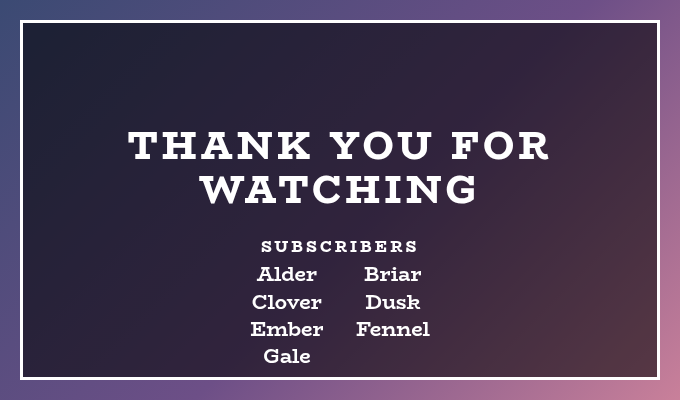
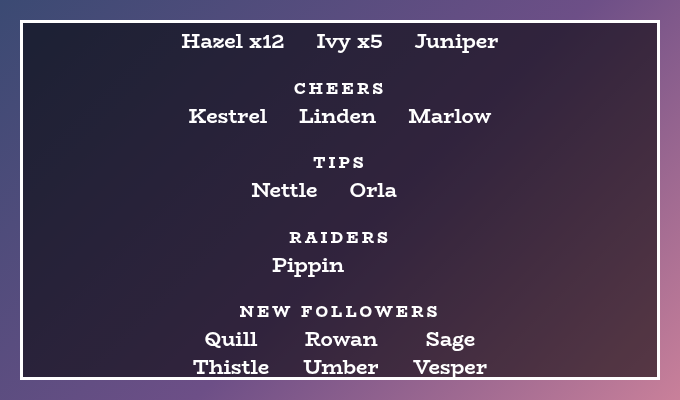
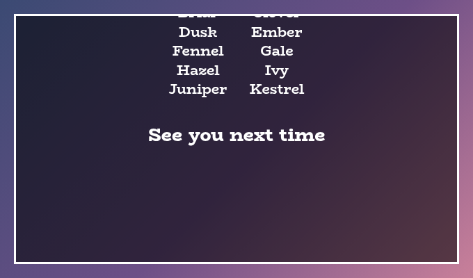
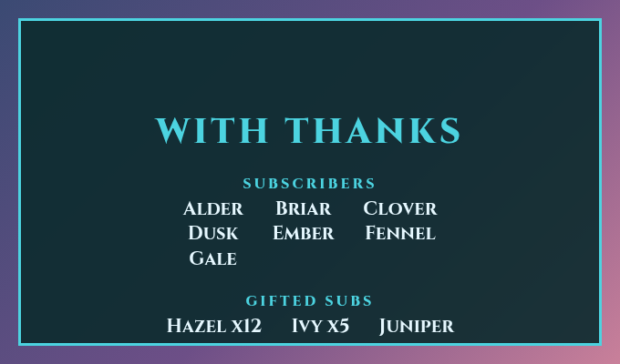
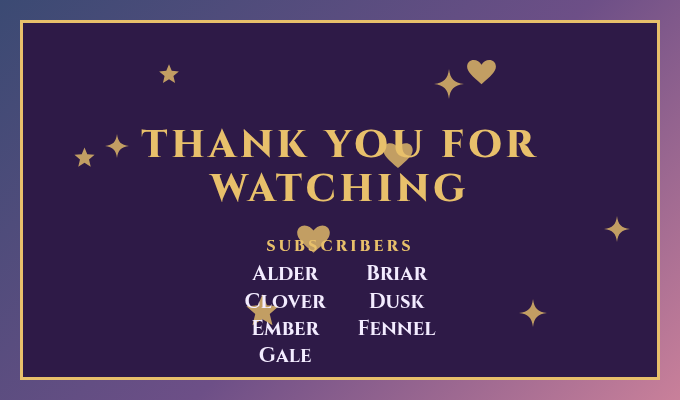
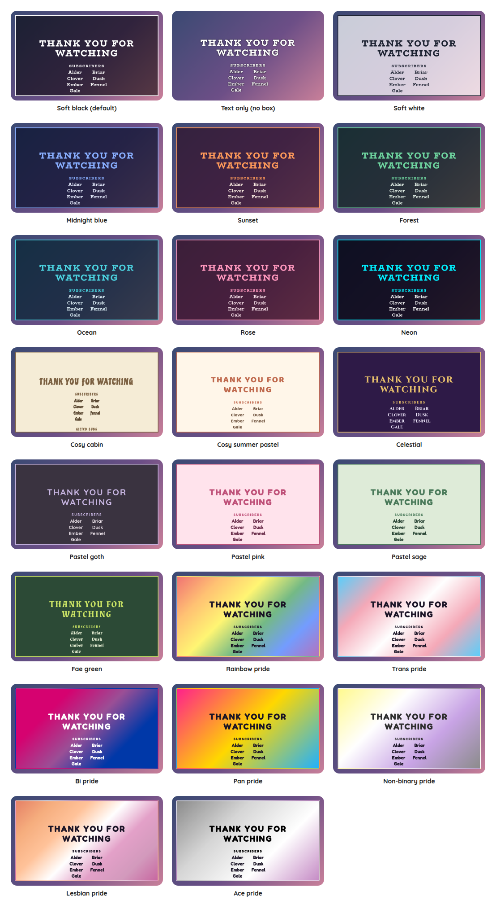

# End Credits Overlay

A StreamElements custom widget that says thank you at the end of a stream, properly, by name. All through the stream it quietly keeps the names of the people who followed, subscribed, gifted, cheered, tipped, raided and chatted, and when you type `!credits roll` it scrolls them all past as the credits of the show.

<p align="center"></p>

It is a single self-contained widget in plain JavaScript, with no dependencies and nothing to install. It is designed around a full 1920 by 1080 scene and stretches to any box. Nothing shows on screen until you roll the credits, so it can sit in your ending scene all the time.

## Features

- Names collected as you stream: followers, subscribers and resubscribers, gifters, cheerers, tippers, raiders and anyone who chats, each kept once however often they appear.
- Gifters counted properly: a gift bomb counts once at its real size, for the person who gave it, and the follow-ups StreamElements sends for each recipient are ignored. A gifter shows with their count, as in Hazel x12, biggest first.
- Special thanks of your own: names you always want in, such as the people who help you, ahead of everyone else.
- Rolled when you ask: `!credits roll` from you or a moderator, or a button in the editor. The roll scrolls up from the bottom of the box and the widget disappears when it has gone.
- A sample to set it up by: `!credits sample` rolls made-up names and keeps nothing, so you can try the look before anyone has followed.
- Yours to shape: a heading for each list, which lists to include, columns of names, the title, a last line, the speed and the sizes.
- Made for a full screen, and happy in any box: every size is a share of the box's width at 16 by 9, or of its height if the box is short for its width.
- Saved: the names survive a refresh, and you decide when to start again, with `!credits reset` or by ticking a setting to start again once the credits have rolled through.
- Moderator control: the streamer, and by default moderators, can roll and reset. Viewers cannot.
- Customisable: around 50 settings cover the wording, sizes, colours, fonts and the lists.
- Tests and a dev harness: a local harness with buttons for every kind of event, and an automated test script.
- An outer frame in the accent colour, on by default in every preset, and switched off with one checkbox (the flag's stripes in the pride presets).
- Decorations: sparkles, hearts, stars, flowers, moons, snowflakes, bubbles, butterflies, clouds, leaves, paw prints, music notes or bows behind the words, scattered, along the edges, in the corners, a little way in from the corners or on the border, in the accent colour, a pride flag's colours or a colour of your own, twinkling, drifting or still. Off by default.

## Screenshots

**More names.** Choose how many columns the names sit in. The roll is the same however long it is, and its time grows with the number of names.

<p></p>

**The last line.** The credits end with a line of your own, then scroll away.

<p></p>

**Your own look.** Choose Custom for the style preset and every colour, the font, the title and the wording are settings.

<p></p>

## Quick start

1. In StreamElements, edit your overlay and add **+ Add Widget, Static/Custom, Custom Widget**.
2. Select the widget, open **Settings, Open Editor**, and paste each file from `widget/` into the matching tab: `widget.html` into HTML, `widget.css` into CSS, `widget.js` into JS, and `fields.json` into Fields.
3. Click **Done**. The settings are grouped into Commands, Credits, Roll, Size, Manual controls, Look, Custom colours and Troubleshooting.
4. Make the widget as big as your scene, 1920 by 1080 for a full screen, and put it at the front of your ending scene. Press **Roll a sample** to see it.

The widget reads Twitch chat and events through StreamElements, so it works as soon as it is on an active overlay. It can only collect names while it is loaded, so keep it in a scene that is always part of your overlay, even though nothing shows until you roll.

## Chat commands

The command word is a setting. The bare `!credits` does nothing, and everything else needs the broadcaster or, by default, a moderator.

| Command | What it does |
| --- | --- |
| `!credits roll` | Rolls the credits. Rolling again starts over. |
| `!credits stop` | Ends the roll early, keeping every name. |
| `!credits sample` | Rolls made-up names to show the look, keeping nothing. |
| `!credits reset` | Forgets every name, ready for the next stream. `clear` does the same. |

## What goes in the credits

Names are collected from StreamElements events, and each person appears once in each list whatever the capitals, however many times they follow, subscribe or chat.

| List | Who is in it |
| --- | --- |
| Special thanks | The names you write in the settings, first. |
| Subscribers | New subscribers and resubscribers. |
| Gifted subs | People who gave subs, with how many, biggest first. |
| Cheers | People who cheered bits. |
| Tips | People who tipped. |
| Raiders | Channels that raided you. |
| New followers | People who followed. |
| Chatters | Anyone who sent a message, other than you and the bots in the list of names to leave out. |

A list with nobody in it is left out, and any list can be switched off. Anonymous gifters and cheerers have no name to thank and are left out. A long list is cut at the number you choose, with "and 40 more" after it.

## The roll

The credits start below the bottom of the box and scroll up until they have gone past the top, then the widget disappears. The speed is a share of the box height per second, and a longer list of names simply takes longer, so every name is on screen for the same time however many there are.

The small motions, such as a pop, follow the **Animate** setting. The roll itself always scrolls, since a roll that stood still would not be one.

**Decorations.** A mix of sparkles, hearts and stars behind the words, here in the Celestial preset.

<p></p>

## Style presets

One setting picks the look. The same twenty-two presets, with the same colours, are in every overlay in this set, so overlays from this set match whichever you choose. This is how each one looks in this overlay. The presets are defined once, in the [kit](../../kit), and a test keeps this overlay in step with it.

<p></p>

| Preset | Look |
| --- | --- |
| Soft black (default) | See-through black with white text. |
| Soft white | Frosted white with dark text. |
| Midnight blue | Deep navy with a periwinkle accent. |
| Sunset | Deep plum with orange and coral. |
| Forest | Deep green with a mint accent. |
| Ocean | Deep teal with an aqua accent. |
| Rose | Deep berry with a pink accent. |
| Neon | Near black with cyan and magenta. |
| Cosy cabin | Cream and brown, in Chicle. |
| Cosy summer pastel | Warm cream and coral, in Baloo 2. |
| Celestial | Deep purple and gold, in Cinzel. |
| Pastel goth | Charcoal and lilac, in Quicksand. |
| Pastel pink | Soft blush pink with rose, in Fredoka. |
| Pastel sage | Soft sage green with deep green, in Fredoka. |
| Fae green | Mossy green with a firefly lime accent, in Almendra. |
| Rainbow pride | A soft wash of the six rainbow stripes, in Fredoka. |
| Trans pride | Light blue, pink and white. |
| Bi pride | Magenta, purple and blue, with white text. |
| Pan pride | Pink, yellow and light blue. |
| Non-binary pride | Yellow, white, purple and black, softened so the text stays readable. |
| Lesbian pride | The orange to pink stripes. |
| Ace pride | Black, grey, white and purple, softened so the text stays readable. |

The last seven are pride presets, built from the stripes of the rainbow, trans, bi, pan, non-binary, lesbian and ace flags. The card or panel wears the flag as its background, with only as much of a wash over it as the text needs to stay readable, so flags with a black stripe come out softer. A bar is striped like the flag where an overlay has one, and the slices of a wheel and the options of a poll take their colours from the stripes in order. The colours follow each flag's published design,.

Choose **Custom** to use the colour pickers and font instead. They are ignored while a preset is chosen.

## Configuration

Every setting has a plain label in StreamElements, grouped as follows.

| Group | What it covers |
| --- | --- |
| Commands | The command word and who may use it. |
| Credits | Special thanks, which lists to include, each list's heading, whether a gifter shows their count, the longest list, who to leave out and the last line. |
| Roll | The speed, the columns of names, and whether the lists start again after a full roll. |
| Size | The title, list heading and name sizes, and the space between the lists, in units of the box. |
| Manual controls | Buttons to roll, roll a sample, stop and start the lists again. |
| Look | Title, the style preset, font, boldness, corners, outer frame, outline, shadow and Animate. |
| Custom colours | Panel, text and accent colours, used when the style preset is Custom. A checkbox there also lets the Panel opacity apply to any preset, not only Custom. |
| Decorations | The shape, where they go, how many, how big, how solid (the Decoration opacity, which is its own setting and not the panel's, and 1 is fully solid), their colour, and how they move. |
| Troubleshooting | A debug log of every event to the browser-source console. |

**Sizes.** A unit is a hundredth of the box's width at 16 by 9, so the default name size, 3.2 units, is about a thirtieth of a 1920 by 1080 screen's width. In a box that is short for its width, a unit is smaller so that everything still fits.

The **outer frame** is a border round the widget in the preset's accent colour, on by default in every preset. Untick **An outer frame** under Look for none, or set the outline thickness to change how thick it is, since at 0 it has a default thickness that grows with the box. In a pride preset the frame is the flag's stripes, as a ring that follows the panel's corners.

The **decorations** are small shapes drawn behind the words: sparkles, hearts, stars, flowers, moons, snowflakes, bubbles, butterflies, clouds, leaves, paw prints, music notes, bows, or a mix of sparkles, hearts and stars. Choose one under **Decorations**, then where they go (scattered, along the inside of the edges, in the corners, a little way in from the corners (a couple of small shapes dotted near the top right and bottom right is a gentle look), or on the border with half of each outside it), how many (up to 24), how big, how solid, and whether they twinkle in place, drift upwards or stay still. They take the accent colour, or in a pride preset the colours of the flag in turn, or you can ask for the text colour, both in turn, or a colour of your own. On the border they need a little room round the widget in its box, since StreamElements shows only what is inside the box, and a panel that fills its box has none. Here the panel pulls in a little when they are on the border, so the outer halves show. Twinkling dips a little and drifting fades in and out, so choose Stay still, or turn Animate off, to keep them fully solid. With Animate off they stay still. They are off by default. They sit behind the roll, and stay put while the names scroll past.

The full list, with defaults, is in [`widget/fields.json`](widget/fields.json). The colour and font pickers apply only when the style preset is **Custom**.

## Local development

There is no build step and no dependencies. Serve this overlay's folder and open the dev harness:

```sh
npm run dev
# then open http://localhost:8000/dev/
```

The harness stands in for StreamElements. It sends chat commands as a viewer, moderator or broadcaster, with quick buttons for the common ones, and a button for each kind of event, from a new follower to a gift bomb, so a stream's worth of names takes a few clicks. Its **Every setting** section is generated from `widget/fields.json`, so it offers exactly what StreamElements will.

At the top of the harness, **Look and export** switches the style preset on the live widget, and can download or copy a `fields.json` with your current settings as its defaults. Paste that into the Fields tab of a new custom widget in StreamElements and it starts out looking the way it does here.

The **Design** panel under the copy buttons carries a look from one overlay to the next, so it only has to be set up once. Set the style preset, font, colours, shape, frame and decorations here, press **Save this design**, then open another overlay's dev page and press **Use saved design**. It can also be copied, downloaded as `design.json` or pasted in, and **Use my saved design whenever I open an overlay** applies it for you. Only the design travels, so each overlay's own wording and behaviour settings are left as they are, and anything an overlay does not have is skipped.

The **Troubleshooting import** panel brings a problem seen on stream into the dev page. In the StreamElements widget editor open the **Data** tab, copy everything in it, paste it into the panel and press **Load this**: the settings come across as they are on stream, and anything the Data tab does not hold stays as it was. A Data tab that holds another widget's settings changes nothing.

The **box-size bar** at the bottom of the stage sets the size of the widget's box in pixels, from two number boxes or a list of common sizes, and remembers it for next time. A StreamElements widget fills whatever box you draw for it, so drawing it in different boxes is the quickest way to see how it behaves. It is the same bar on every overlay's dev page.

The harness must be served over http rather than opened as a file, and fonts come from Google Fonts. It also shows a Ko-fi support button in the corner. That button belongs to the harness only and is not part of the widget, so it never appears on stream.

## Testing

```sh
npm test
```

This runs the real `widget/widget.js` headlessly against a small mock of the page and StreamElements, with a clock the test controls, and exits non-zero on any failure. It covers how names are collected (gift bombs counted once, anonymous gifters left out, bots ignored), the order and headings of the lists, the roll's timing and early stop, starting again, who may do what, a damaged save and every look setting. It also checks the style presets against the shared palette, and that every setting in `fields.json` is read by the widget and every button does something.

## Project layout

```
widget/   the widget: HTML, CSS, JS and the StreamElements fields
dev/      the local dev harness
test/     the automated tests
docs/     screenshots used in this README
```

## Compatibility and limitations

The widget uses the StreamElements events `onWidgetLoad` and `onEventReceived` with `message`, `subscriber-latest`, `cheer-latest`, `tip-latest`, `follower-latest`, `raid-latest` and `widget-button`, and `SE_API.store`, which keeps the names.

It can only collect a name while it is loaded in an active overlay, so a person who follows while the widget is not in your overlay is not in the credits. A follower is recorded when StreamElements announces the follow, which depends on the follow being sent to your overlay.

A StreamElements widget cannot write to chat, so a command gives no reply there. You see the result on screen straight away.

The JavaScript is plain ES5, so it can be pasted straight into the StreamElements editor.

## Related overlays

These overlays share the same default look and the same twenty-two style presets, so they sit together on one stream.

- [Recent Activity Overlay](../recent-activity): the latest subs, gifts, bits, tips, follows and raids, as they happen.
- [Stream Start Countdown Overlay](../start-countdown): a full-screen starting soon countdown you set from chat.
- [Sub Goals Overlay](../sub-goals): sub and bits goals that fill as chat reaches them.
- [Subathon Overlay](../subathon): a subathon clock with a cap, power-ups and sub goals.
- [Spin Wheel Overlay](../spin-wheel): a wheel for giveaways, raffles and forfeits.
- [Chat Poll Overlay](../chat-poll): quick polls voted on by typing an option.
- [Squat Tracker Overlay](../squat-tracker): a running count driven by gifted sub bombs.
- [Rage Bar Overlay](../rage-bar): a bar chat fills with subs, bits and channel points.
- [Chat Counter Overlay](../counter): a counter chat commands change, for deaths, wins and anything else.
- [Leaderboard Overlay](../leaderboard): top gifters, cheerers and tippers.
- [Hype Meter Overlay](../hype-meter): a meter that chat activity fills, with levels.
- [Recent Activity Overlay](../recent-activity): the latest subs, gifts, bits, tips, follows and raids.
- [Stream Goals Overlay](../stream-goals): sub and bits goals that start again for each stream.
- [Chat Feed Overlay](../chat-feed): on-screen chat with profile pictures and pronouns.
- [Camera Overlay](../camera): a framed window for your camera with a nameplate, and a cover that you and your moderators control from chat.
- [Now Playing Overlay](../now-playing): what you are playing, from Last.fm, Tuna, Spotify or Pear Desktop, with album art and a progress bar.

## Support

If this saves you time, you can support its development on Ko-fi:

[](https://ko-fi.com/journeyingjordan)

Thanks for using it.

## Contributing

Contributions are welcome. See [CONTRIBUTING.md](../../CONTRIBUTING.md).

## License

[MIT](../../LICENSE). The copyright notice, including the Ko-fi link, must be kept in copies and substantial portions of the code.
