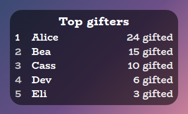
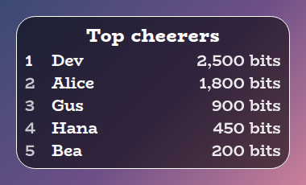
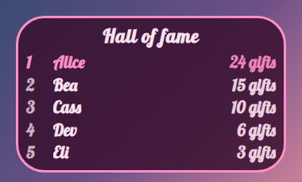
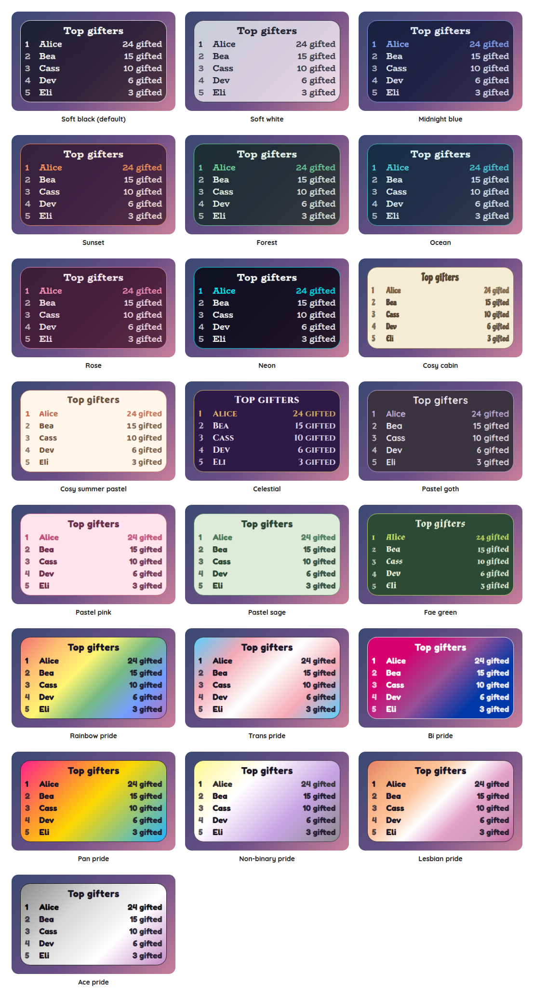

# Leaderboard Overlay

A StreamElements custom widget that keeps leaderboards for your top gifters, cheerers and tippers, and rotates through them on stream. People like seeing their name on one.

<p align="center"></p>

It is a single self-contained widget in plain JavaScript, with no dependencies and nothing to install. Totals are kept per person across streams until you reset them.

## Features

- Three boards: top gifters (gifted subs), top cheerers (bits) and top tippers, shown one at a time, rotating, or pinned to one.
- Gift bombs counted once: a gift of 10 credits the gifter 10, not once per recipient (see [How counting works](#how-counting-works)).
- Names matched ignoring case: `alice` and `Alice` are one person, and the latest spelling is shown.
- Anonymous gifters: left out by default, or counted together as one Anonymous entry.
- Ignore list: leave out bots or yourself.
- Chat control: add to a total, remove someone, reset one board or all of them, and pin a board from chat.
- Wording: the titles, how each total reads, and the currency symbol are settings.
- Pops: a row pops when its total changes, and first place can be highlighted.
- Sounds: optional sounds when a total changes and when someone takes first place.
- Customisable: around 50 settings cover the boards, wording, rows, shape, outline, colours, fonts, sounds and animation.
- Saved: totals survive a browser-source refresh, and a tie keeps whoever got there first.
- Tests and a dev harness: a local harness and an automated test script, so nothing needs a live stream.
- An outer frame in the accent colour, on by default in every preset, and switched off with one checkbox.

## Screenshots

**Other boards.** The same card shows the cheerers and tippers boards, with their own titles and wording.

<p></p>

**Your own look.** Choose Custom for the style preset and every colour, the font, the outline and the wording are settings.

<p></p>

## Style presets

One setting picks the look. The same twenty-two presets, with the same colours, are in every overlay in this set, so overlays from this set match whichever you choose. This is how each one looks in this overlay. The presets are defined once, in the [kit](../../kit), and a test keeps this overlay in step with it.

<p></p>

| Preset | Look |
| --- | --- |
| Soft black (default) | See-through black with white text. |
| Soft white | Frosted white with dark text. |
| Midnight blue | Deep navy with a periwinkle accent. |
| Sunset | Deep plum with orange and coral. |
| Forest | Deep green with a mint accent. |
| Ocean | Deep teal with an aqua accent. |
| Rose | Deep berry with a pink accent. |
| Neon | Near black with cyan and magenta. |
| Cosy cabin | Cream and brown, in Chicle. |
| Cosy summer pastel | Warm cream and coral, in Baloo 2. |
| Celestial | Deep purple and gold, in Cinzel. |
| Pastel goth | Charcoal and lilac, in Quicksand. |
| Pastel pink | Soft blush pink with rose, in Fredoka. |
| Pastel sage | Soft sage green with deep green, in Fredoka. |
| Fae green | Mossy green with a firefly lime accent, in Almendra. |
| Rainbow pride | A soft wash of the six rainbow stripes, in Fredoka. |
| Trans pride | Light blue, pink and white. |
| Bi pride | Magenta, purple and blue, with white text. |
| Pan pride | Pink, yellow and light blue. |
| Non-binary pride | Yellow, white, purple and black, softened so the text stays readable. |
| Lesbian pride | The orange to pink stripes. |
| Ace pride | Black, grey, white and purple, softened so the text stays readable. |

The last seven are pride presets, built from the stripes of the rainbow, trans, bi, pan, non-binary, lesbian and ace flags. The card or panel wears the flag as its background, with only as much of a wash over it as the text needs to stay readable, so flags with a black stripe come out softer. A bar is striped like the flag where an overlay has one, and the slices of a wheel and the options of a poll take their colours from the stripes in order. The colours follow each flag's published design,.

Choose **Custom** to use the colour pickers and font instead. They are ignored while a preset is chosen.

## Quick start

1. In StreamElements, edit your overlay and add **+ Add Widget, Static/Custom, Custom Widget**.
2. Select the widget, open **Settings, Open Editor**, and paste each file from `widget/` into the matching tab: `widget.html` into HTML, `widget.css` into CSS, `widget.js` into JS, and `fields.json` into Fields.
3. Click **Done**. The settings are grouped into Commands, Board, Wording, Rows, Manual controls, Look, Custom colours, Sounds and Troubleshooting.
4. Size and position the widget. The text scales with the box, and the card grows downwards as boards fill. If the box is too short for everything, the card shrinks to fit instead of running off the bottom (untick **Shrink to fit the box** under Look to turn that off).

The widget reads Twitch chat and events through StreamElements, so it works as soon as it is on an active overlay.

## How counting works

- **Gifters.** A gift bomb credits the gifter once, for its real size. StreamElements reports a gift bomb as one announcement where `amount` is the real number of subs, then one follow-up per recipient where `amount` is a streak or lifetime figure (for example 170). The widget counts only the announcement, so a gift of 10 adds 10. A single gifted sub adds 1 to the gifter. Someone subscribing for themselves, or resubscribing, is not a gift and does not count.
- **Cheerers.** Every cheer adds its bits to the person who sent it.
- **Tippers.** Every tip adds its amount, in whatever currency your StreamElements account uses. Set the symbol under **Wording**.

Names are matched ignoring case. Anonymous gifters and cheerers are left out unless you tick **Count anonymous gifters and cheerers together as Anonymous**. Tick **debug** in Troubleshooting to log every event to the browser-source console.

## Chat commands

The command word is a setting. Viewers can type the bare `!leaderboard` to make the title pop, and everything else needs the broadcaster or, by default, a moderator.

| Command | What it does |
| --- | --- |
| `!leaderboard add gifts Alice 5` | Adds 5 to Alice's gifts. Use `bits` or `tips` for the other boards, and a negative number to take some off. |
| `!leaderboard remove Alice` | Takes Alice off every board. |
| `!leaderboard reset` | Clears every board. |
| `!leaderboard reset bits` | Clears one board. |
| `!leaderboard show tips` | Pins one board, so it stops rotating. |
| `!leaderboard rotate` | Starts rotating again. |

## Rotating

In **Rotate** mode the widget moves through the boards you have included, spending the set number of seconds on each. Choose one board under **What to show** if you only want that one.

## Configuration

Every setting has a plain label in StreamElements, grouped as follows.

| Group | What it covers |
| --- | --- |
| Commands | The command word and who may use it. |
| Board | What to show, how long each board stays, how many names, which boards rotate, anonymous gifters, names to ignore and the empty text. |
| Wording | The three titles, how each total reads, and the currency symbol. |
| Rows | Rank numbers, first place highlight, longest name, text sizes, row spacing and the pop. |
| Manual controls | Buttons to show the next board, go back to rotating, and clear every board. |
| Look | A title that replaces the boards' own, the style preset, font, boldness, corners, padding, outer frame, outline, shadow, Animate and whether it shrinks to fit the box. |
| Custom colours | Panel, text, accent, bar and alert colours, used when the style preset is Custom. |
| Sounds | A sound and volume for a total changing and for taking first place, with Test buttons and a master mute. |
| Troubleshooting | A debug log of every event to the browser-source console. |

The **outer frame** is a border round the widget in the preset's accent colour, on by default in every preset. Untick **An outer frame** under Look for none, or set the outline thickness to change how thick it is, since at 0 it has a default thickness that grows with the box. With the frame unticked, the outline is whatever you set, as before, in the outline colour.

The full list, with defaults, is in [`widget/fields.json`](widget/fields.json). The colour and font pickers apply only when the style preset is **Custom**.

## Local development

There is no build step and no dependencies. Serve this overlay's folder and open the dev harness:

```sh
npm run dev
# then open http://localhost:8000/dev/
```

The harness stands in for StreamElements. It sends single gifts, gift bombs of any size (with the per-recipient follow-ups StreamElements sends), cheers and tips from a rotating cast of names, and chat commands as a viewer, moderator or broadcaster. Its **Every setting** section is generated from `widget/fields.json`, so it offers exactly what StreamElements will.

At the top of the harness, **Look and export** switches the style preset on the live widget, and can download or copy a `fields.json` with your current settings as its defaults. Paste that into the Fields tab of a new custom widget in StreamElements and it starts out looking the way it does here.

The **box-size bar** at the bottom of the stage sets the size of the widget's box in pixels, from two number boxes or a list of common sizes, and remembers it for next time. A StreamElements widget fills whatever box you draw for it, so drawing it in different boxes is the quickest way to see how it behaves. It is the same bar on every overlay's dev page.

The harness must be served over http rather than opened as a file, and fonts come from Google Fonts. It also shows a Ko-fi support button in the corner. That button belongs to the harness only and is not part of the widget, so it never appears on stream.

## Testing

```sh
npm test
```

This runs the real `widget/widget.js` headlessly against a small mock of the page and StreamElements, with a clock the test controls, and exits non-zero on any failure. It covers the gift bomb case, every kind of event, ranking and ties, anonymous and ignored names, rotating and pinning, every chat command and permission, saving across a refresh, every look setting and the sounds. It also checks the style presets against the shared palette, and that every setting in `fields.json` is read by the widget and every button does something.

## Project layout

```
widget/   the widget: HTML, CSS, JS and the StreamElements fields
dev/      the local dev harness
test/     the automated tests
docs/     screenshots used in this README
```

## Compatibility and limitations

The widget uses the StreamElements events `onWidgetLoad` and `onEventReceived` with `message`, `subscriber-latest`, `cheer-latest`, `tip-latest` and `widget-button`, and `SE_API.store`. Gifts are credited to the `sender` of the event, so a client that did not send it would not count them. StreamElements does.

Totals are kept until you reset them, so a board covers every stream since then. Use `!leaderboard reset` at the start of a subathon or a month if you want a fresh one.

A StreamElements widget can read chat but cannot write to it, so `!leaderboard` makes the title pop rather than replying.

The JavaScript is plain ES5, so it can be pasted straight into the StreamElements editor.

## Related overlays

These overlays share the same default look and the same twenty-two style presets, so they sit together on one stream.

- [Sub Goals Overlay](../sub-goals): sub and bits goals that fill as chat reaches them.
- [Subathon Overlay](../subathon): a subathon clock with a cap, power-ups and sub goals.
- [Spin Wheel Overlay](../spin-wheel): a wheel for giveaways, raffles and forfeits.
- [Chat Poll Overlay](../chat-poll): quick polls voted on by typing an option.
- [Squat Tracker Overlay](../squat-tracker): a running count driven by gifted sub bombs.
- [Rage Bar Overlay](../rage-bar): a bar chat fills with subs, bits and channel points.
- [Chat Counter Overlay](../counter): a counter chat commands change, for deaths, wins and anything else.
- [Hype Meter Overlay](../hype-meter): a meter that chat activity fills, with levels.
- [Recent Activity Overlay](../recent-activity): the latest subs, gifts, bits, tips, follows and raids.
- [Stream Goals Overlay](../stream-goals): sub and bits goals that start again for each stream.
- [Reminder Overlay](../reminder): reminders you set from chat, which stay on screen until cleared.
- [Chat Feed Overlay](../chat-feed): on-screen chat with profile pictures and pronouns.
- [Camera Overlay](../camera): a framed window for your camera with a nameplate, and a cover that you and your moderators control from chat.
- [Now Playing Overlay](../now-playing): what you are playing, from Last.fm, Tuna, Spotify or Pear Desktop, with album art and a progress bar.

## Support

If this saves you time, you can support its development on Ko-fi:

[](https://ko-fi.com/journeyingjordan)

Thanks for using it.

## Contributing

Contributions are welcome. See [CONTRIBUTING.md](../../CONTRIBUTING.md).

## License

[MIT](../../LICENSE). The copyright notice, including the Ko-fi link, must be kept in copies and substantial portions of the code.
