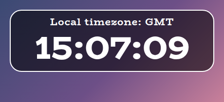
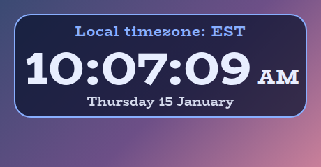
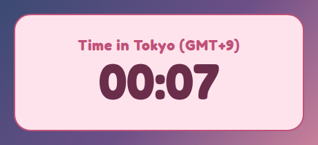
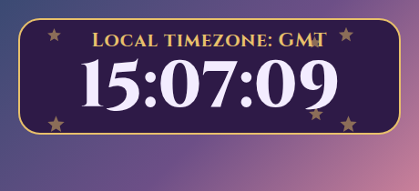
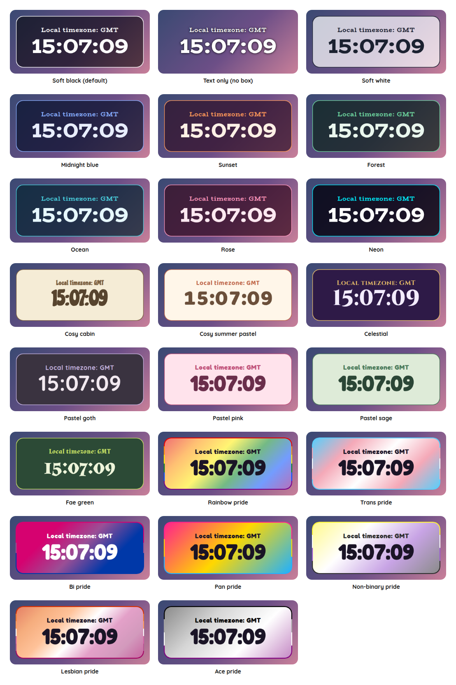

# Local Time Overlay

A StreamElements custom widget that shows the time. A small line above it says which timezone it is in, such as `Local timezone: GMT`, and the time sits below it. It is for the streamer whose chat is spread across the world, and who is tired of being asked what time it is for them.

<p align="center"></p>

It is a single self-contained widget in plain JavaScript, with no dependencies and nothing to install, and nothing in it needs the internet except the font.

## Features

- A timezone of your choice: GMT, UTC, the UK, around fifty places across the world from a list, this computer's own timezone, or any timezone's own name typed in, such as `Asia/Kathmandu`.
- A line that says where it is: `Local timezone: GMT` by default, and in your own words if you like. `{zone}` becomes the short name (GMT, BST, EST), `{offset}` how far from GMT it is (GMT+1), and `{city}` the place (London).
- Right all year: it knows when the clocks change, so London says GMT in winter and BST in summer, and the time moves on an hour without a reload.
- 24-hour or 12-hour with AM and PM, with the seconds if you want them and the day and date under the time if you want that.
- A time that stays still: the digits are a fixed width, so the time does not jiggle sideways as the seconds change.
- Scales with the box: the text scales with the width of the box you draw, and if the box is too short for the card it shrinks to fit.
- Stays put in OBS: the panel is always as tall as the box you draw, with its content in the middle, so it does not grow or shrink as entries come and go. Untick Fill the height of the box for a panel as tall as its content.
- Customisable: around forty settings cover the timezone, the wording, sizes, shape, outline, colours, fonts and animation.
- All twenty-three style presets, including the seven pride flags.
- An outer frame in the accent colour, on by default in every preset, and switched off with one checkbox (the flag's stripes in the pride presets).
- Decorations: sparkles, hearts, stars, flowers, moons, snowflakes, bubbles, butterflies, clouds, leaves, paw prints, music notes or bows behind the words, scattered, along the edges, in the corners, a little way in from the corners or on the border, in the accent colour, a pride flag's colours or a colour of your own, twinkling, drifting or still. Off by default.
- Tests and a dev harness: a local harness with quick timezone buttons and a time machine, so the clocks changing in spring is a click away, and an automated test script.

## Screenshots

The time in New York on a 12-hour clock, with the date, in the Midnight blue preset.

<p></p>

Your own wording, here with the place and its offset, in Tokyo with the seconds off, in the Pastel pink preset.

<p></p>

**Decorations.** Stars, a little way in from the corners, here in the Celestial preset.

<p></p>

## Style presets

One setting picks the look. The same twenty-three presets, with the same colours, are in every overlay in this set, so overlays from this set match whichever you choose. This is how each one looks in this overlay. The presets are defined once, in the [kit](../../kit), and a test keeps this overlay in step with it.

<p></p>

| Preset | Look |
| --- | --- |
| Soft black (default) | See-through black with white text. |
| Text only (no box) | No box, frame or shadow: just the words, with a soft dark halo so they read over any picture. |
| Soft white | Frosted white with dark text. |
| Midnight blue | Deep navy with a periwinkle accent. |
| Sunset | Deep plum with orange and coral. |
| Forest | Deep green with a mint accent. |
| Ocean | Deep teal with an aqua accent. |
| Rose | Deep berry with a pink accent. |
| Neon | Near black with cyan and magenta. |
| Cosy cabin | Cream and brown, in Chicle. |
| Cosy summer pastel | Warm cream and coral, in Baloo 2. |
| Celestial | Deep purple and gold, in Cinzel. |
| Pastel goth | Charcoal and lilac, in Quicksand. |
| Pastel pink | Soft blush pink with rose, in Fredoka. |
| Pastel sage | Soft sage green with deep green, in Fredoka. |
| Fae green | Mossy green with a firefly lime accent, in Almendra. |
| Rainbow pride | A soft wash of the six rainbow stripes, in Fredoka. |
| Trans pride | Light blue, pink and white. |
| Bi pride | Magenta, purple and blue, with white text. |
| Pan pride | Pink, yellow and light blue. |
| Non-binary pride | Yellow, white, purple and black, softened so the text stays readable. |
| Lesbian pride | The orange to pink stripes. |
| Ace pride | Black, grey, white and purple, softened so the text stays readable. |

The last seven are pride presets, built from the stripes of the rainbow, trans, bi, pan, non-binary, lesbian and ace flags. The card or panel wears the flag as its background, with only as much of a wash over it as the text needs to stay readable, so flags with a black stripe come out softer. A bar is striped like the flag where an overlay has one, and the slices of a wheel and the options of a poll take their colours from the stripes in order. The colours follow each flag's published design,.

Choose **Custom** to use the colour pickers and font instead. They are ignored while a preset is chosen.

## Quick start

1. In StreamElements, edit your overlay and add **+ Add Widget, Static/Custom, Custom Widget**.
2. Select the widget, open **Settings, Open Editor**, and paste each file from `widget/` into the matching tab: `widget.html` into HTML, `widget.css` into CSS, `widget.js` into JS, and `fields.json` into Fields.
3. Click **Done**. The settings are grouped into Time, Wording, Size, Look, Custom colours, Decorations and Troubleshooting.
4. Choose your timezone under **Time**, then size and position the widget. A box about twice as wide as it is tall suits it well. If the box is too short for everything, the card shrinks to fit instead of running off the bottom (untick **Shrink to fit the box** under Look to turn that off).

The widget does not read chat or events. It only reads the clock of the computer running the overlay, so it works as soon as it is on an overlay.

## Choosing a timezone

Pick one from the **Timezone to show** list. **This computer's own timezone** is the default, and is whatever the computer running your overlay is set to. If yours is not in the list, type its own name, such as `Asia/Kathmandu`, into **Or type a timezone's own name**, which wins over the list. A name the browser does not know is ignored, and the list is used instead, so a typing slip never leaves the clock blank.

The short name on the line above the time comes from the browser, so it says GMT or BST for London and EST or EDT for New York. Where the browser has no short name for a place, it says how far from GMT it is, such as `GMT+9`. If you choose **GMT** from the list it says GMT all year, which is not the same as London, whose clocks go forward in summer.

## Configuration

Every setting has a plain label in StreamElements, grouped as follows.

| Group | What it covers |
| --- | --- |
| Time | The timezone, a timezone's own name typed in, 24-hour or 12-hour, the seconds and the date. |
| Wording | Whether to show the line above the time, and what it says. |
| Size | Text size, and how big the line, the time and the date are. |
| Look | The style preset, font, boldness, corners, padding, outer frame, outline, shadow, Animate and whether it fills the height of the box and whether it shrinks to fit it. |
| Custom colours | Panel, text and accent colours, used when the style preset is Custom. A checkbox there also lets the Panel opacity apply to any preset, not only Custom. |
| Decorations | The shape, where they go, how many, how big, how solid (the Decoration opacity, which is its own setting and not the panel's, and 1 is fully solid), their colour, and how they move. Twinkling dips a little and drifting fades in and out, so choose Stay still, or turn Animate off, to keep them fully solid. |
| Troubleshooting | A debug line in the browser-source console saying which timezone is in use. |

## Local development

There is no build step and no dependencies. Serve this overlay's folder and open the dev harness:

```sh
npm run dev
# then open http://localhost:8000/dev/
```

The harness stands in for StreamElements. **Quick timezones** switch the Timezone setting for you, **Quick formats** try the 12-hour clock, the seconds and the date, and the **time machine** skips the clock forward by a minute, an hour, a day or half a year, so the clocks changing in spring or autumn can be watched without waiting. Its **Every setting** section is generated from `widget/fields.json`, so it offers exactly what StreamElements will.

At the top of the harness, **Look and export** switches the style preset on the live widget, and can download or copy a `fields.json` with your current settings as its defaults. Paste that into the Fields tab of a new custom widget in StreamElements and it starts out looking the way it does here.

The **Design** panel under the copy buttons carries a look from one overlay to the next, so it only has to be set up once. Set the style preset, font, colours, shape, frame and decorations here, press **Save this design**, then open another overlay's dev page and press **Use saved design**. It can also be copied, downloaded as `design.json` or pasted in, and **Use my saved design whenever I open an overlay** applies it for you. Only the design travels, so each overlay's own wording and behaviour settings are left as they are, and anything an overlay does not have is skipped.

The **Troubleshooting import** panel brings a problem seen on stream into the dev page. In the StreamElements widget editor open the **Data** tab, copy everything in it, paste it into the panel and press **Load this**: the settings come across as they are on stream, and anything the Data tab does not hold stays as it was. A Data tab that holds another widget's settings changes nothing.

The **box-size bar** at the bottom of the stage sets the size of the widget's box in pixels, from two number boxes or a list of common sizes, and remembers it for next time. A StreamElements widget fills whatever box you draw for it, so drawing it in different boxes is the quickest way to see how it scales.

The harness must be served over http rather than opened as a file, and fonts come from Google Fonts. It also shows a Ko-fi support button in the corner. That button belongs to the harness only and is not part of the widget, so it never appears on stream.

## Testing

```sh
npm test
```

This runs the real `widget/widget.js` headlessly against a small mock of the page and StreamElements, with a clock the test controls, and exits non-zero on any failure. It covers the time in many timezones in winter and summer, the short names, 12-hour and 24-hour at midnight and noon, the seconds and the date, the wording, a timezone that does not exist, the clocks changing without a reload, the sizes, every style preset, the frame and the decorations.

## Project layout

```
widget/   the widget: HTML, CSS, JS and the StreamElements fields
dev/      the local dev harness
test/     the automated tests
docs/     screenshots used in this README
```

## Compatibility and limitations

The widget uses the StreamElements event `onWidgetLoad`, and the browser's own `Intl` timezone support, which is in every browser OBS and StreamElements use. It reads no chat and stores nothing.

The time comes from the clock of the computer running the overlay, so if that clock is wrong the overlay is wrong too. The timezone names and their daylight saving rules come from the browser, and are as current as the browser is.

The JavaScript is plain ES5, so it can be pasted straight into the StreamElements editor.

## Related overlays

These overlays share the same default look and the same twenty-three style presets, so they sit together on one stream.

- [Sub Goals Overlay](../sub-goals): sub and bits goals that fill as chat reaches them.
- [Subathon Overlay](../subathon): a subathon clock with a cap, power-ups and sub goals.
- [Spin Wheel Overlay](../spin-wheel): a wheel for giveaways, raffles and forfeits.
- [Chat Poll Overlay](../chat-poll): quick polls voted on by typing an option.
- [Squat Tracker Overlay](../squat-tracker): a running count driven by gifted sub bombs.
- [Rage Bar Overlay](../rage-bar): a bar chat fills with subs, bits and channel points.
- [Chat Counter Overlay](../counter): a counter chat commands change, for deaths, wins and anything else.
- [Leaderboard Overlay](../leaderboard): top gifters, cheerers and tippers.
- [Hype Meter Overlay](../hype-meter): a meter that chat activity fills, with levels.
- [Recent Activity Overlay](../recent-activity): the latest subs, gifts, bits, tips, follows and raids.
- [Stream Goals Overlay](../stream-goals): sub and bits goals that start again for each stream.
- [Chat Feed Overlay](../chat-feed): on-screen chat with profile pictures and pronouns.
- [Camera Overlay](../camera): a framed window for your camera with a nameplate, and a cover that you and your moderators control from chat.
- [Now Playing Overlay](../now-playing): what you are playing, from Last.fm, Tuna, Spotify or Pear Desktop, with album art and a progress bar.
- [Reminder Overlay](../reminder): reminders set from chat, with a countdown that turns to due and stays until cleared.

## Support

If this saves you time, you can support its development on Ko-fi:

[](https://ko-fi.com/journeyingjordan)

Thanks for using it.

## Contributing

Contributions are welcome. See [CONTRIBUTING.md](../../CONTRIBUTING.md).

## License

[MIT](../../LICENSE). The copyright notice, including the Ko-fi link, must be kept in copies and substantial portions of the code.
