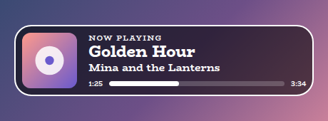
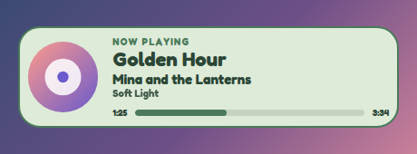
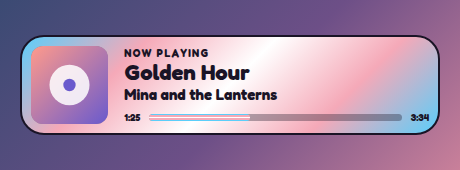
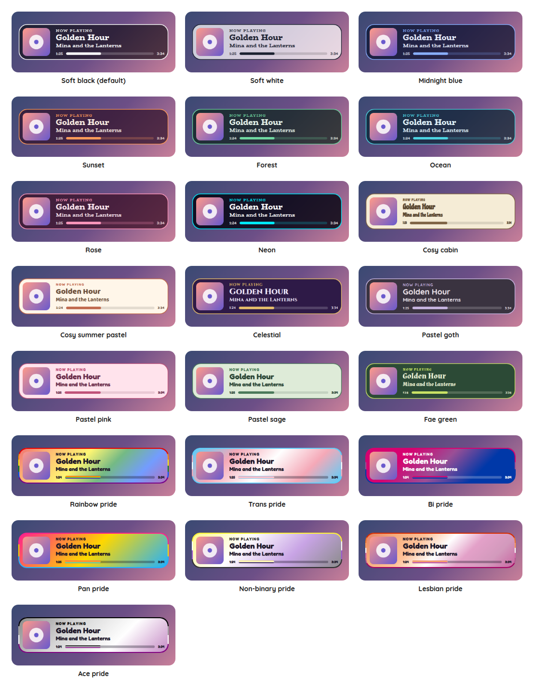

# Now Playing Overlay

A StreamElements custom widget that shows what you are playing: the track, the artist, the album art and how far through it you are, in the same style presets as the rest of the set. It reads from Last.fm, from the Tuna plugin for OBS, from Spotify directly, or from Pear Desktop for YouTube Music, so whichever player you use, there is a way in.

<p align="center"></p>

It is a single self-contained widget in plain JavaScript, with no dependencies and nothing to install. Moderators and you can hide it from chat for a song you would rather not have on screen. It does not play, control or record any music: it only reads what is playing.

## Features

- Four ways to read what is playing: Last.fm, Tuna, Spotify and Pear Desktop, chosen with one setting. Each is explained below, and which one suits you depends on the player and on whether you want to sign in to anything.
- The album art, the title, the artist and, if you like, the album, with a small line above that says Now playing or Paused in your own words.
- A progress bar with the times, which keeps moving between reads, so it stays smooth. It needs a source that says how far through the track it is, which is every source except Last.fm.
- A track that is paused can stay on the card with its own line, or count as nothing playing. When nothing is playing the card fades away, or says what you choose, such as "Nothing on right now".
- Hide and show it from chat: `!nowplaying off` and `!nowplaying on`, for you and your moderators. It stays hidden if the overlay is refreshed.
- All twenty-two style presets, including the seven pride flags, which also stripe the progress bar.
- Round or square album art, and sizes you can set.
- Scales with the box: the text scales with the width of the box you draw, and if the box is too short for the card it shrinks to fit.
- Customisable: around forty settings cover the source, the card, sizes, shape, outline, colours, fonts and animation.

## Screenshots

**Pastel sage,** with round album art and the album's name.

<p></p>

**A flag for the bar.** In a pride preset the card wears the flag, and the progress bar takes its stripes.

<p></p>

## Style presets

One setting picks the look. The same twenty-two presets, with the same colours, are in every overlay in this set, so overlays from this set match whichever you choose. This is how each one looks in this overlay. The presets are defined once, in the [kit](../../kit), and a test keeps this overlay in step with it.

<p></p>

| Preset | Look |
| --- | --- |
| Soft black (default) | See-through black with white text. |
| Soft white | Frosted white with dark text. |
| Midnight blue | Deep navy with a periwinkle accent. |
| Sunset | Deep plum with orange and coral. |
| Forest | Deep green with a mint accent. |
| Ocean | Deep teal with an aqua accent. |
| Rose | Deep berry with a pink accent. |
| Neon | Near black with cyan and magenta. |
| Cosy cabin | Cream and brown, in Chicle. |
| Cosy summer pastel | Warm cream and coral, in Baloo 2. |
| Celestial | Deep purple and gold, in Cinzel. |
| Pastel goth | Charcoal and lilac, in Quicksand. |
| Pastel pink | Soft blush pink with rose, in Fredoka. |
| Pastel sage | Soft sage green with deep green, in Fredoka. |
| Fae green | Mossy green with a firefly lime accent, in Almendra. |
| Rainbow pride | A soft wash of the six rainbow stripes, in Fredoka. |
| Trans pride | Light blue, pink and white. |
| Bi pride | Magenta, purple and blue, with white text. |
| Pan pride | Pink, yellow and light blue. |
| Non-binary pride | Yellow, white, purple and black, softened so the text stays readable. |
| Lesbian pride | The orange to pink stripes. |
| Ace pride | Black, grey, white and purple, softened so the text stays readable. |

The last seven are pride presets, built from the stripes of the rainbow, trans, bi, pan, non-binary, lesbian and ace flags. The card or panel wears the flag as its background, with only as much of a wash over it as the text needs to stay readable, so flags with a black stripe come out softer. A bar is striped like the flag where an overlay has one, and the slices of a wheel and the options of a poll take their colours from the stripes in order. The colours follow each flag's published design,.

Choose **Custom** to use the colour pickers and font instead. They are ignored while a preset is chosen.

## Quick start

1. In StreamElements, edit your overlay and add **+ Add Widget, Static/Custom, Custom Widget**.
2. Select the widget, open **Settings, Open Editor**, and paste each file from `widget/` into the matching tab: `widget.html` into HTML, `widget.css` into CSS, `widget.js` into JS, and `fields.json` into Fields.
3. Click **Done**. The settings are grouped into Source, Last.fm, Tuna, Pear Desktop, Spotify, Commands, Card, Size, Look, Custom colours, Manual controls and Troubleshooting.
4. Choose where to read from under **Source**, and fill in the group with that source's name. Each is described below.
5. Switch on **Show a note on the card when the source cannot be read** under Troubleshooting while you set up. If something is wrong, the card says what, and you can switch it off again for stream.
6. Size and position the widget. A box about three times as wide as it is tall suits it well, and the text scales with the box.

## Choosing where to read from

| Source | Best for | What you need | How quickly it follows |
| --- | --- | --- | --- |
| Last.fm | Almost any player, and the least to set up | A free Last.fm API key and your username, and your player connected to Last.fm | A few seconds behind |
| Tuna | Almost any player, on the PC you stream from | The Tuna plugin in OBS, with its web server on | Within a few seconds |
| Spotify | Spotify, without anything extra installed | A Spotify developer app, and a one-off sign-in | Within a few seconds |
| Pear Desktop | YouTube Music | The Pear Desktop app, with its API Server plugin on | Within a few seconds |

How often it asks is a setting, every five seconds by default, and never faster than every three.

### Last.fm

1. Make a free Last.fm account if you do not have one, and connect your player to it so that it scrobbles. Spotify connects from Last.fm's settings. For YouTube Music you need a scrobbler such as a browser extension or an app, because YouTube Music does not scrobble by itself.
2. At `last.fm/api/account/create`, make an API account. Only a name is needed, and it gives you an API key.
3. Put your username and the key into the Last.fm group.

Last.fm only reports a track as playing while your scrobbler says so, so it can be a few seconds late, and it does not say how far through a track you are, so there is no progress bar.

### Tuna

Tuna is a plugin for OBS that reads what is playing from many players. This overlay reads from Tuna's built-in web server, so the web server has to be on, and the overlay has to be shown by a browser source on the same PC that runs Tuna, because the address it reads is `localhost`. Put the port into the Tuna group if you changed it from 1608.

### Pear Desktop (YouTube Music)

Pear Desktop is a desktop app for YouTube Music. Turn on its **API Server** plugin, and set its authorization to none, so that the overlay can read from it without a token. If you prefer to keep authorization on, paste the access token into the Pear Desktop group instead. The overlay has to be shown on the same PC that runs the app, because the address it reads is `localhost`. The port is in the same group, 26538 unless you changed it.

### Spotify

This one takes the most setting up, once, and is the most exact. It needs a Spotify developer app and a sign-in:

1. At `developer.spotify.com/dashboard`, create an app. Spotify's rules for developer apps change from time to time, so read what the dashboard says about who may use one.
2. Open this overlay's sign-in page, `dev/spotify-token.html`, which is on the overlay's website next to its dev page (or serve this folder yourself, as under Local development, and use `http://127.0.0.1:8000/dev/spotify-token.html`). It shows the exact address to add under your app's redirect URIs. Add it and save.
3. Paste your app's client ID into the page and sign in. It asks only for permission to see what is playing, and gives you a refresh token.
4. Put the client ID and the refresh token into the Spotify group.

The refresh token is a key, and the settings of a StreamElements widget can be read by anyone who has your overlay's address, so keep the address to yourself. The token can only read what you are playing. You can take it back at any time from your Spotify account's apps page, and a new one is made the same way.

## Hiding it from chat

| Command | What it does |
| --- | --- |
| `!nowplaying off` (or `hide`) | Hides the card. It stays hidden, even after the overlay is refreshed. |
| `!nowplaying on` (or `show`) | Shows it again. |
| `!nowplaying refresh` (or `now`) | Reads what is playing straight away. |

You and your moderators can use it, or only you, with **Who can hide and show the card**, and the command word is a setting. The bare word does nothing, and viewers cannot use any of it. The same three things are buttons under Manual controls.

While the card waits to learn whether it was left switched off, it stays hidden, so a refresh never flashes it for a moment. If the saved state never arrives, it is shown after a few seconds, so that a broken store cannot hide it for good.

## What leaves your machine

The widget only reads, and only from the source you choose:

| Source | What it asks | Of whom |
| --- | --- | --- |
| Last.fm | Your latest track, with your username and API key | `ws.audioscrobbler.com` |
| Tuna | What is playing | `localhost` on your PC |
| Pear Desktop | What is playing | `localhost` on your PC |
| Spotify | An access token, using your client ID and refresh token, and then what is playing | `accounts.spotify.com` and `api.spotify.com` |

Album art is loaded from wherever the source says it is: Last.fm's or Spotify's servers, YouTube's, or your own PC for Tuna. Fonts come from Google Fonts, as in the rest of the set. Nothing is sent anywhere else, and nothing is kept except whether you switched the card off, and, for Spotify, a new refresh token if Spotify hands one back.

## Configuration

Every setting has a plain label in StreamElements, grouped as follows.

| Group | What it covers |
| --- | --- |
| Source | Which source to read from, and how often. |
| Last.fm, Tuna, Pear Desktop, Spotify | The details each source needs. |
| Commands | The command word and who may use it. |
| Card | The art and its shape, the album, the progress bar, the lines above the title, what to do when paused, and what to say when nothing is playing. |
| Size | Text size, the title's size and the art's size. |
| Look | The style preset, font, boldness, corners, padding, outline, shadow, Animate and whether the card shrinks to fit the box. |
| Custom colours | Panel, text, accent, bar track and note colours, used when the style preset is Custom. |
| Manual controls | Buttons to hide, show and read now. |
| Troubleshooting | A note on the card when the source cannot be read, and a debug log of every event to the browser-source console. |

The full list, with defaults, is in [`widget/fields.json`](widget/fields.json). The colour and font pickers apply only when the style preset is **Custom**.

## Local development

There is no build step and no dependencies. Serve this overlay's folder and open the dev harness:

```sh
npm run dev
# then open http://localhost:8000/dev/
```

The harness stands in for StreamElements, and also for the music. A **pretend player** answers as Last.fm, Tuna, Pear Desktop and Spotify would, so you can try every source without any of them running: change tracks, pause, stop, skip ahead, and take the player offline to see what the card does. Choose the source under **Source** in Every setting. The sign-in details in the harness are stand-ins, and are not put into the `fields.json` you copy out.

At the top of the harness, **Look and export** switches the style preset on the live widget, and can download or copy a `fields.json` with your current settings as its defaults. The page also has the **Copy into StreamElements** panel, which copies each of the four files so nobody has to download the repository.

The **box-size bar** at the bottom of the stage sets the size of the widget's box in pixels, from two number boxes or a list of common sizes, and remembers it for next time. A StreamElements widget fills whatever box you draw for it, so drawing it in different boxes is the quickest way to see how it behaves. It is the same bar on every overlay's dev page.

The harness must be served over http rather than opened as a file, and fonts come from Google Fonts. It also shows a Ko-fi support button in the corner. That button belongs to the harness only and is not part of the widget, so it never appears on stream.

## Testing

```sh
npm test
```

This runs the real `widget/widget.js` headlessly against a small mock of the page and StreamElements, with a pretend network and a clock the test controls, and exits non-zero on any failure. It covers each source's reading, in the shape that source answers in, including a track that is paused, nothing playing, and answers that are empty or odd; the progress moving between reads; how often it asks, and slowing down when a source is unreachable or Spotify says to; the Spotify access token being kept, renewed and replaced, and a new refresh token being kept; the card and what each setting does; the chat command; the card staying hidden while its saved state loads; the sign-in calculations against the examples in the PKCE standard; and text that must never be treated as markup.

The layout is also checked in a real browser, at several box sizes, to be sure that nothing runs outside the box.

## Project layout

```
widget/   the widget: HTML, CSS, JS and the StreamElements fields
dev/      the local dev harness, with its pretend player, and the Spotify sign-in page
test/     the automated tests
docs/     screenshots used in this README
```

## Compatibility and limitations

The widget uses the StreamElements events `onWidgetLoad`, `onEventReceived` (chat messages and the manual buttons).

I want to be plain about what has not been checked. The four ways of reading were written from each project's published source and documentation, and tested against pretend services that answer in the shapes those documents describe. They have not been run against a live Spotify account, a running Tuna or a running Pear Desktop, so if one of them does not work for you, the note under Troubleshooting will say what the card was told, and an issue with that note would help a great deal. Tuna's and Pear Desktop's details in particular come from their code, and I would like to hear if a version of either behaves differently.

Tuna and Pear Desktop are read from `localhost`, so they work where the overlay is shown by a browser source on the same PC, such as OBS. They will not work if the overlay is shown on another device, and a web browser may block a page from reading `localhost`, where OBS's browser source does not.

A song's title and artist are shown as the source gives them. Podcasts and adverts on Spotify are not tracks, and show nothing.

The JavaScript is plain ES5, so it can be pasted straight into the StreamElements editor.

## Related overlays

These overlays share the same default look and the same twenty-two style presets, so they sit together on one stream.

- [Sub Goals Overlay](../sub-goals): sub and bits goals that fill as chat reaches them.
- [Subathon Overlay](../subathon): a subathon clock with a cap, power-ups and sub goals.
- [Spin Wheel Overlay](../spin-wheel): a wheel for giveaways, raffles and forfeits.
- [Chat Poll Overlay](../chat-poll): quick polls voted on by typing an option.
- [Squat Tracker Overlay](../squat-tracker): a running count driven by gifted sub bombs.
- [Rage Bar Overlay](../rage-bar): a bar chat fills with subs, bits and channel points.
- [Chat Counter Overlay](../counter): a counter chat commands change, for deaths, wins and anything else.
- [Leaderboard Overlay](../leaderboard): top gifters, cheerers and tippers.
- [Hype Meter Overlay](../hype-meter): a meter that chat activity fills, with levels.
- [Stream Goals Overlay](../stream-goals): sub and bits goals that start again for each stream.
- [Reminder Overlay](../reminder): reminders you set from chat, which stay on screen until cleared.
- [Chat Feed Overlay](../chat-feed): on-screen chat with profile pictures and pronouns.

- [Recent Activity Overlay](../recent-activity): the latest subs, gifts, bits, tips, follows and raids.
- [Camera Overlay](../camera): a framed window for your camera with a nameplate, and a cover that you and your moderators control from chat.

## Support

If this saves you time, you can support its development on Ko-fi:

[](https://ko-fi.com/journeyingjordan)

Thanks for using it.

## Contributing

Contributions are welcome. See [CONTRIBUTING.md](../../CONTRIBUTING.md).

## License

[MIT](../../LICENSE). The copyright notice, including the Ko-fi link, must be kept in copies and substantial portions of the code.
