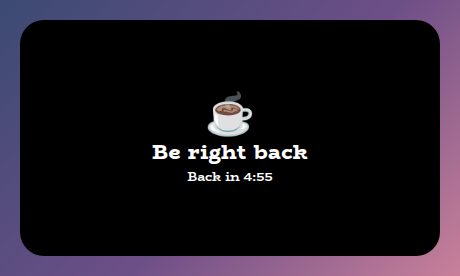
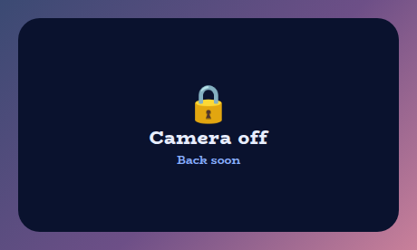
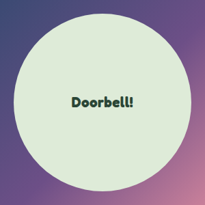
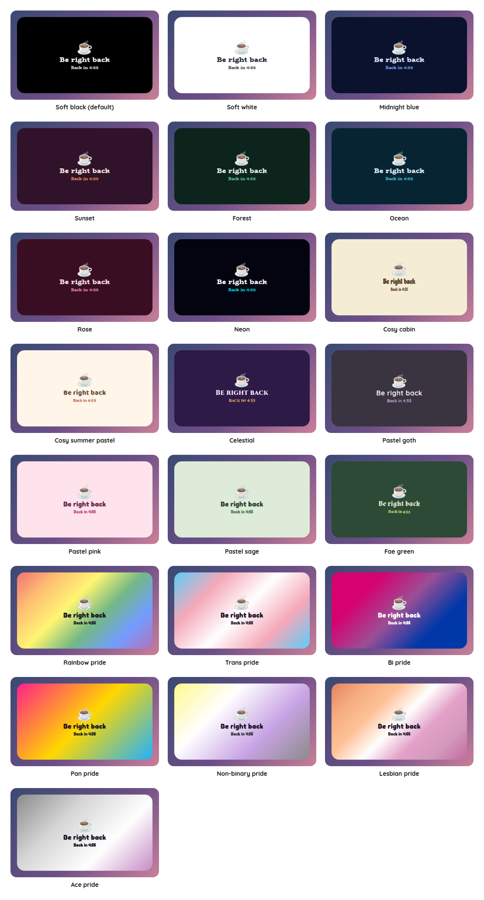
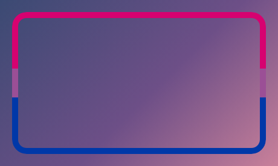

# Over Camera Overlay

A StreamElements custom widget that sits over your camera and covers it when you ask, so you can protect yourself in a sensitive moment or step away without leaving a frozen face on screen. You, or a moderator, type `!camera off` in chat and the camera is covered at once. `!camera on` brings it back.

<p align="center"></p>

It is a single self-contained widget in plain JavaScript, with no dependencies and nothing to install. While the camera is showing it draws nothing at all.

## Features

- Cover from chat: `!camera off`, `!camera brb`, `!camera away` or `!camera cover` with a message of your own, and `!camera on` to uncover. Only you and your moderators can use them.
- Covers instantly, uncovers gently: a cover that faded in would show the camera while it ran, so it appears at once, and only lifting it eases away.
- A solid cover, always: every style preset has a see-through panel, so the cover takes the colour of the panel with its transparency removed, and the camera can never show through it.
- Never flashes the camera: the cover is on in the markup, and stays on until the saved state has loaded, so refreshing the browser source cannot show the camera for a moment (see [How it protects you](#how-it-protects-you)).
- Countdowns that do not lift themselves: `!camera brb 5m` counts down, and at zero it says it is back any moment and stays covered until someone lifts it, unless you choose otherwise.
- Remembers: the cover, its message and its countdown survive a refresh.
- Your wording and icons: every message, line and emoji is a setting.
- A circle for a round camera, or a rounded rectangle.
- An optional frame along the camera's edge, in any preset: the preset's accent colour, its flag in stripes for a pride preset, the panel's colour, or any colour you pick. It stays when the camera is covered. It is off by default, and the [Under Camera Overlay](../under-camera) can draw the same frame round the outside.
- Sounds: an optional sound when the camera is covered and another when it is uncovered.
- Tests and a dev harness: a local harness with a time machine, and an automated test script, so nothing needs a live stream.

## Screenshots

**Camera off,** in the Midnight blue preset.

<p></p>

**A message of your own, on a round camera,** in Pastel sage, from `!camera cover Doorbell!`.

<p></p>

## Style presets

One setting picks the look. The same twenty-two presets, with the same colours, are in every overlay in this set, so overlays from this set match whichever you choose. This is how each one looks in this overlay. The presets are defined once, in the [kit](../../kit), and a test keeps this overlay in step with it.

<p></p>

| Preset | Look |
| --- | --- |
| Soft black (default) | See-through black with white text. |
| Soft white | Frosted white with dark text. |
| Midnight blue | Deep navy with a periwinkle accent. |
| Sunset | Deep plum with orange and coral. |
| Forest | Deep green with a mint accent. |
| Ocean | Deep teal with an aqua accent. |
| Rose | Deep berry with a pink accent. |
| Neon | Near black with cyan and magenta. |
| Cosy cabin | Cream and brown, in Chicle. |
| Cosy summer pastel | Warm cream and coral, in Baloo 2. |
| Celestial | Deep purple and gold, in Cinzel. |
| Pastel goth | Charcoal and lilac, in Quicksand. |
| Pastel pink | Soft blush pink with rose, in Fredoka. |
| Pastel sage | Soft sage green with deep green, in Fredoka. |
| Fae green | Mossy green with a firefly lime accent, in Almendra. |
| Rainbow pride | A soft wash of the six rainbow stripes, in Fredoka. |
| Trans pride | Light blue, pink and white. |
| Bi pride | Magenta, purple and blue, with white text. |
| Pan pride | Pink, yellow and light blue. |
| Non-binary pride | Yellow, white, purple and black, softened so the text stays readable. |
| Lesbian pride | The orange to pink stripes. |
| Ace pride | Black, grey, white and purple, softened so the text stays readable. |

The last seven are pride presets, built from the stripes of the rainbow, trans, bi, pan, non-binary, lesbian and ace flags. The card or panel wears the flag as its background, with only as much of a wash over it as the text needs to stay readable, so flags with a black stripe come out softer. A bar is striped like the flag where an overlay has one, and the slices of a wheel and the options of a poll take their colours from the stripes in order. The colours follow each flag's published design,.

Choose **Custom** to use the colour pickers and font instead. They are ignored while a preset is chosen.

## Quick start

1. In StreamElements, edit your overlay and add **+ Add Widget, Static/Custom, Custom Widget**.
2. Select the widget, open **Settings, Open Editor**, and paste each file from `widget/` into the matching tab: `widget.html` into HTML, `widget.css` into CSS, `widget.js` into JS, and `fields.json` into Fields.
3. Click **Done**. The settings are grouped into Commands, Safety, Wording, Icons, Size, Frame, Look, Custom colours, Manual controls, Sounds and Troubleshooting.
4. Size and position the widget **exactly over your camera**, with the same size and shape, and make sure it is above the camera in the layer order. The text scales with the box.
5. Try it. Type `!camera off`, then `!camera on`, and check that the camera is fully hidden and fully shown.

## The frame

Tick **A frame along the camera's edge** under Frame and a ring is drawn round the edge of the widget, above the camera and above the cover, so it is there whether the camera is showing or covered. It works in every preset:

- **The preset's colour** is its accent colour, and for a pride preset its flag, in stripes.
- **The panel's colour** is the preset's panel colour, made solid.
- **A colour you pick** is any colour at all, in any preset.

Its thickness is a percent of the camera's width, so it scales with the camera. It follows the shape, so a round camera gets a round frame.

<p></p>

The [Under Camera Overlay](../under-camera) draws a frame round the *outside* of the camera, from behind it, and the two are meant to be used together, with one of them showing the frame, as described under [Using it with the Under Camera](#using-it-with-the-under-camera).

## Using it with the Under Camera

The Over Camera and the [Under Camera Overlay](../under-camera) sandwich your webcam: the Under Camera behind it, with a window and a frame and a nameplate, and this one in front of it, covering it when you ask. Put this one the same size and in the same place as the camera, give both the same style preset, and turn the frame on in whichever one you want to draw it. The Over Camera's frame is off by default.

## Commands

The command word is a setting. Only the broadcaster and, by default, moderators can use these. Nothing a viewer types does anything.

| Command | What it does |
| --- | --- |
| `!camera off` | Covers the camera, at once, and keeps it covered until someone says `on`. It never lifts itself. |
| `!camera on` | Uncovers the camera. `!camera live` does the same. |
| `!camera brb` | Covers it with a be right back message. |
| `!camera brb 5m` | The same, with a countdown. A time can be `5m`, `90s`, `1h30m`, `2:30` (minutes and seconds) or a bare `5` for minutes, up to twelve hours. |
| `!camera away 10m` | Covers it with an away message, with or without a countdown. |
| `!camera cover Doorbell!` | Covers it with a message you choose, up to 120 characters. With nothing after it, it covers as `off` would. |

The bare `!camera` does nothing, because there is nothing to show while the camera is live.

**A command that covers always covers.** If you type a time that cannot be read, such as `!camera brb soon`, or one that cannot be right, such as 99999 hours, the camera is still covered, just without a countdown. Covering the camera should never fail because of a typing mistake.

A StreamElements widget can read chat but cannot write to it, so nothing is said back. If you want chat to see what happened, add a chatbot command of your own that says it.

## How it protects you

- **Solid.** The cover is the preset's panel colour with the transparency taken out, in all twenty-two presets and for a custom colour however see-through it is set, and a test checks every one.
- **Instant.** Covering has no fade, because a fade would show the camera while it ran. Uncovering fades away over a third of a second.
- **No flash on a refresh.** The cover is on in the page itself and stays on until the saved state has loaded. If the saved state is that the camera was covered, it stays covered, and if it was showing, the cover lifts. A moderator's command that arrives before the state is known waits and cannot uncover the camera by accident.
- **A silent store stays covered.** If the saved state has not arrived after three seconds, it stops waiting but stays covered, because it cannot know whether it was safe to show the camera. `!camera on` lifts it. Untick **Stay covered until the saved state has loaded** under Safety if you would rather it showed the camera in that case, which also means a refresh can show the camera for a moment.
- **Countdowns do not lift the cover.** At zero it says you are back any moment and stays covered, until a moderator or you say `on`. Tick **lift the cover by itself** under Safety if you want a brb to end on its own.

I checked the first three in a real browser, sampling the cover's computed style from the first paint, with a store that answered slowly and one that answered after the three seconds: the camera was never exposed.

## What it cannot do

It is a cover, not a guarantee, and it is worth knowing its limits.

- **It does not hide your microphone.** It is only a picture over the camera.
- **If the overlay is not loaded, the camera is not covered.** That includes StreamElements being unavailable, the browser source not being added, or it being in the wrong layer order. Test it before you go live, and for a moment that really matters, hide the camera source in your broadcasting software, which does not depend on a web page.
- **It cannot act on its own.** It covers only when someone it trusts types the command, so make sure your moderators know it is there, and keep the moderator list to people you trust with that.
- **Viewers can see what you tell it to say.** The message is yours to choose, and a plain one such as Camera off says nothing about why.

## Configuration

Every setting has a plain label in StreamElements, grouped as follows.

| Group | What it covers |
| --- | --- |
| Commands | The command word and who may use it. |
| Safety | Where it starts the first time, whether it stays covered until the saved state has loaded, and whether a countdown lifts the cover. |
| Wording | The message for camera off, be right back and away, the line under camera off, the countdown line and what it says at zero. |
| Icons | An emoji or symbol for each cover. |
| Size | The text size, as a percent of the smaller side of the box. |
| Frame | Whether there is a frame along the camera's edge, how thick it is, and its colour. |
| Look | The style preset, font, boldness, corners, the shape (a rounded rectangle or a circle), outline, shadow and Animate. |
| Custom colours | The cover colour, the text and the countdown line, used when the style preset is Custom. |
| Manual controls | Buttons to cover the camera, cover it as be right back or away, and uncover it. |
| Sounds | A sound when the camera is covered and another when it is uncovered, each with a volume and a Test button, and a master mute. |
| Troubleshooting | A debug log of every event to the browser-source console. |

The full list, with defaults, is in [`widget/fields.json`](widget/fields.json). The colour and font pickers apply only when the style preset is **Custom**.

## Local development

There is no build step and no dependencies. Serve this overlay's folder and open the dev harness:

```sh
npm run dev
# then open http://localhost:8000/dev/
```

The harness stands in for StreamElements. It sends the commands as the broadcaster, a moderator or a viewer, so you can see that a viewer is ignored, and a **time machine** skips ahead so you can watch a countdown run out. The checkerboard shows through while the camera is showing, because the widget draws nothing then.

At the top of the harness, **Look and export** switches the style preset on the live widget, and can download or copy a `fields.json` with your current settings as its defaults. Paste that into the Fields tab of a new custom widget in StreamElements and it starts out as you have it.

The harness must be served over http rather than opened as a file, and fonts come from Google Fonts. It also shows a Ko-fi support button in the corner. That button belongs to the harness only and is not part of the widget, so it never appears on stream.

## Testing

```sh
npm test
```

This runs the real `widget/widget.js` headlessly against a small mock of the page and StreamElements, with a clock the test controls, and exits non-zero on any failure. It covers every command and who may use it, every way of writing a time and the ones that cannot be read, countdowns and what happens when one ends, messages of your own, saving and reading back a damaged save, the cover being solid in every preset, the held cover while the saved state loads and when it never arrives, sounds and malformed events.

## Project layout

```
widget/   the widget: HTML, CSS, JS and the StreamElements fields
dev/      the local dev harness
test/     the automated tests
docs/     screenshots used in this README
```

## Compatibility and limitations

The widget uses the StreamElements events `onWidgetLoad` and `onEventReceived` with `message` and `widget-button`, and `SE_API.store`.

It has not been run on a live stream. Tick **debug** in Troubleshooting for your first stream to log each event, and please open an issue if a moderator's command does not arrive as expected.

It does not detect anything about your camera, and it is not an alert or a scene switcher: it is a cover that you and your moderators raise and lower.

The JavaScript is plain ES5, so it can be pasted straight into the StreamElements editor.

## Related overlays

These overlays share the same default look and the same twenty-two style presets, so they sit together on one stream.

- [Sub Goals Overlay](../sub-goals): sub and bits goals that fill as chat reaches them.
- [Subathon Overlay](../subathon): a subathon clock with a cap, power-ups and sub goals.
- [Spin Wheel Overlay](../spin-wheel): a wheel for giveaways, raffles and forfeits.
- [Chat Poll Overlay](../chat-poll): quick polls voted on by typing an option.
- [Squat Tracker Overlay](../squat-tracker): a running count driven by gifted sub bombs.
- [Rage Bar Overlay](../rage-bar): a bar chat fills with subs, bits and channel points.
- [Chat Counter Overlay](../counter): a counter chat commands change, for deaths, wins and anything else.
- [Leaderboard Overlay](../leaderboard): top gifters, cheerers and tippers.
- [Hype Meter Overlay](../hype-meter): a meter that chat activity fills, with levels.
- [Stream Goals Overlay](../stream-goals): sub and bits goals that start again for each stream.
- [Reminder Overlay](../reminder): reminders you set from chat, which stay on screen until cleared.
- [Chat Feed Overlay](../chat-feed): on-screen chat with profile pictures and pronouns.

- [Recent Activity Overlay](../recent-activity): the latest subs, gifts, bits, tips, follows and raids.
- [Under Camera Overlay](../under-camera): a nameplate for under your camera, with your name, pronouns and rotating lines.

## Support

If this saves you time, you can support its development on Ko-fi:

[](https://ko-fi.com/journeyingjordan)

Thanks for using it.

## Contributing

Contributions are welcome. See [CONTRIBUTING.md](../../CONTRIBUTING.md).

## License

[MIT](../../LICENSE). The copyright notice, including the Ko-fi link, must be kept in copies and substantial portions of the code.
