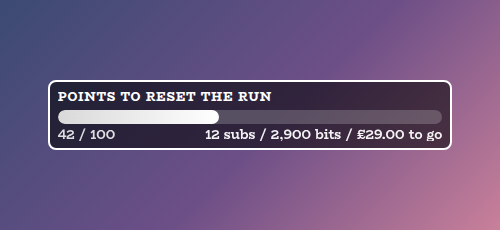
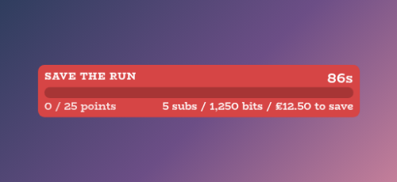
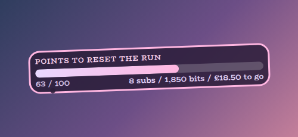
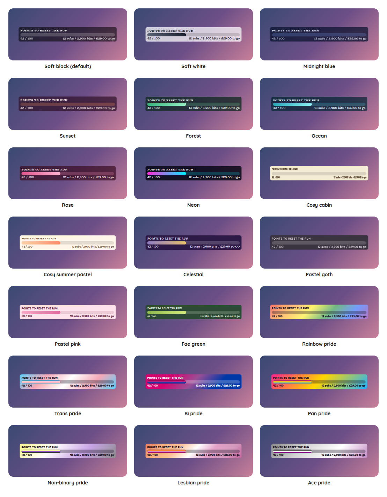

# Rage Bar Overlay

A StreamElements custom widget for a streamer playing something punishing, where chat gets to take the run away. A bar sits on the overlay and fills as people spend subs, bits, donations and channel points. When it fills all the way, the run resets.

<p align="center"></p>

Two things soften it. Chat can spend channel points to **lock** the bar for a few minutes, which freezes it. And when the bar fills, there is a 90 second window in which anyone can **save the run** by subscribing or redeeming a reward, which puts the bar back to zero.

It is one self-contained widget in plain JavaScript, with no dependencies and nothing to install.

## Features

- Fills three ways: subs, bits and donations all fill the same bar, and so do channel point rewards.
- Locks: a channel point reward freezes the bar for a length written in the reward's name, and subs, bits or donations piled up against it break it early.
- A save window: when the bar fills, a countdown starts and chat can save the run with subs, bits, donations or a reward.
- A growing bar: every real reset makes the next bar bigger, and the cost to save it grows by the same share.
- No-saving mode: one huge gift ends a run outright, or triggers a joke banner instead.
- Alarm colour: over the last stretch the fill shifts towards an alarm colour and the track pulses.
- A status line: what is left in subs, bits and money, in whatever state the bar is in.
- Sounds: optional sounds for contributions, locks, a lock breaking, the bar filling, a save and a reset.
- Customisable: around 160 settings cover wording, colours, fonts, sizes, spacing, sounds and every command word.
- Testable offline: a local dev harness and an automated test script.

## Screenshots

**Locked.** A reward freezes the bar. The fill goes quiet and a padlock and countdown appear, and the line under the bar counts what would break the lock.

<p></p>

**The save window.** When the bar fills the card turns red and a separate save bar starts from empty. Chat can buy the run back before the countdown ends.

<p></p>

**Your own look.** Colours, fonts, shape, wording and animation are all settings. This one uses a pink theme with an outline, a tilt and a tail.

<p></p>

## Style presets

One setting picks the look. The same twenty-one presets, with the same colours, are in every overlay in this set, so overlays from this set match whichever you choose. This is how each one looks in this overlay. The presets are defined once, in the [kit](../../kit), and a test keeps this overlay in step with it.

<p></p>

| Preset | Look |
| --- | --- |
| Soft black (default) | See-through black with white text. |
| Soft white | Frosted white with dark text. |
| Midnight blue | Deep navy with a periwinkle accent. |
| Sunset | Deep plum with orange and coral. |
| Forest | Deep green with a mint accent. |
| Ocean | Deep teal with an aqua accent. |
| Rose | Deep berry with a pink accent. |
| Neon | Near black with cyan and magenta. |
| Cosy cabin | Cream and brown, in Chicle. |
| Cosy summer pastel | Warm cream and coral, in Baloo 2. |
| Celestial | Deep purple and gold, in Cinzel. |
| Pastel goth | Charcoal and lilac, in Quicksand. |
| Pastel pink | Soft blush pink with rose, in Fredoka. |
| Fae green | Mossy green with a firefly lime accent, in Almendra. |
| Rainbow pride | A soft wash of the six rainbow stripes, in Fredoka. |
| Trans pride | Light blue, pink and white. |
| Bi pride | Magenta, purple and blue, with white text. |
| Pan pride | Pink, yellow and light blue. |
| Non-binary pride | Yellow, white, purple and black, softened so the text stays readable. |
| Lesbian pride | The orange to pink stripes. |
| Ace pride | Black, grey, white and purple, softened so the text stays readable. |

The last seven are pride presets, built from the stripes of the rainbow, trans, bi, pan, non-binary, lesbian and ace flags. The card or panel wears the flag as its background, with only as much of a wash over it as the text needs to stay readable, so flags with a black stripe come out softer. A bar is striped like the flag where an overlay has one, and the slices of a wheel and the options of a poll take their colours from the stripes in order. The colours follow each flag's published design,.

Choose **Custom** to use the colour pickers and font instead. They are ignored while a preset is chosen.

## Quick start

1. In StreamElements, edit your overlay and add **+ Add Widget, Static/Custom, Custom Widget**.
2. Select the widget, open **Settings, Open Editor**, and paste each file from `widget/` into the matching tab: `widget.html` into HTML, `widget.css` into CSS, `widget.js` into JS, and `fields.json` into Fields.
3. Click **Done**. The settings are grouped into Commands, Bar, Copy, Fill values, Lock, Nope, Wording, Card, Text, Theme, Animation, Sounds and Manual controls.
4. Size the box on the canvas. Everything scales with it.
5. Create the channel point rewards on Twitch (see below), then use **Fill the bar** in Manual controls to rehearse the whole sequence.

If you would rather import, `npm run build` writes `dist/rage-bar.overlay.json`. StreamElements does not document its overlay import format, so pasting the files in (above) is the reliable route.

## How the bar fills

The bar counts points, and the first bar holds 100. The readout counts in the same points, so `37 / 100` means what it looks like.

| What chat does | What it adds |
| --- | --- |
| Tier 1 sub, or a Prime sub | 5 |
| Tier 2 sub | 7 |
| Tier 3 sub | 20 |
| A gifted sub | 5, 7 or 20 each, at the tier it was gifted at |
| 100 bits | 2 |
| 2.50 in donations | 5 (one tier 1 sub's worth) |
| The **Fill the Bar** reward | 5 |

So the first bar is twenty tier 1 subs, or 5,000 bits, or 50 in donations. A gift bomb counts its real size once: StreamElements sends one event for the bomb and then one follow-up per recipient carrying a streak figure (such as 170) in the same `amount` field, and the widget counts only the announcement. A resub counts as one sub, not one per month.

All the numbers are settings, as is the currency symbol used in the line under the bar.

## Every reset makes the bar bigger

Each time a run really does reset, the next bar is 1.5 times as big, and what it costs to save a run grows by the same share. Everything is rounded once, from the exact value, so rounding never builds up.

| Bar | 1 | 2 | 3 | 4 | 5 | 6 |
| --- | --- | --- | --- | --- | --- | --- |
| Points to fill it | 100 | 150 | 225 | 338 | 506 | 759 |
| Points to save it | 25 | 38 | 56 | 84 | 127 | 190 |
| Points to end it outright | 500 | 500 | 500 | 500 | 1,000 | 1,000 |

Only a reset that actually happens counts. A saved run keeps the same bar. A moderator's `!barreset` clears the bar without shrinking it, and `!barreset 1` (or the **Back to the first bar** button) starts the climb over; `!barreset 3` jumps to the third bar. The growth is a setting: 2 doubles each bar, and 1 means they never grow.

## The lock

Chat redeems **Lock the Bar** and the bar freezes. While it is locked nothing fills it, and a fill reward that arrives is turned away with a small shake, so the person who spent can see the widget noticed.

Subs, cheers and donations are the way out: **25 points' worth piled up against a lock breaks it** (five tier 1 subs, 1,250 bits or 12.50 in donations). The line under the bar keeps score while they land, such as `3 subs / 750 bits / £7.50 to break`. The lock only absorbs what it needed, and the rest carries on onto the bar. Channel points cannot break a lock, because a lock that anything could get through would not be worth buying.

The length comes from the reward's name. `Lock the Bar (2 mins)` locks for two minutes whatever it costs, so you can price the rewards however suits the channel. The name is matched on its start, any decoration in front of it is ignored, and the time can be written as `2 min`, `2 mins`, `5 minutes`, `30 sec`, `90s` or `1m30s`. When the name has no time, the price is used instead at a set number of points per minute, and a bare number such as `Lock the Bar 2` is ignored, since it could be anything.

Locks stack, so a second one adds to the first. A single lock is capped at 10 minutes and the running total at 20, so chat cannot keep the bar locked indefinitely. A moderator's lock ignores those caps.

## Saving the run

When the bar fills, the card turns red and a 90 second countdown starts. The big bar is full, so the bar on screen becomes a separate **save bar** that starts empty and fills as chat pays. Everything counts towards the same pot, in the same units as everywhere else:

| What chat does | What it puts in the pot |
| --- | --- |
| Tier 1 sub, or a Prime sub | 5 |
| Tier 2 sub | 7 |
| Tier 3 sub | 20 |
| A gifted sub | 5, 7 or 20 each |
| 250 bits | 5 |
| 2.50 in donations | 5 |
| 10,000 channel points | 5 |

On the first bar the pot target is 25 points, so five tier 1 subs save a bar that twenty filled. That lopsided trade is deliberate: the run usually gets saved and the reset is the exception. Saving a bigger bar costs more by the same share the bar grew.

- **Five Save the Run redeems save the run on any bar.** This is the one thing that does not grow with each reset, so channel points keep mattering on a big bar. Each redeem also adds to the pot, and whichever arrives first, the fifth redeem or the pot target, saves the run.
- **Subs, cheers and donations add five seconds** back onto the clock as well as chipping in. A gift bomb earns the five seconds once.
- **Subs do not count for the first ten seconds** of the window, so someone who subscribed a moment before the bar filled, or the overflow behind a gift bomb, cannot save a run somebody was trying to end. Cheers, donations and redeems count straight away.
- **The reward can be the only way.** Untick the setting that lets subs, cheers and donations help, and only the redeem saves the run. The save bar then counts redeems, such as `3 / 5 redeems`.
- **A lock bought in the window is ignored,** since locking a full bar is not worth paying for.

## The last stretch

Over the last 25 points the fill warms towards the alarm colour and the track starts to breathe, slowly at first and faster over the last five. The breathing stops while a lock is up. How far from the top it starts is a setting, and 0 switches it off.

## When there is no saving it

One person arriving with 500 points' worth in a single go (a hundred gifted tier 1 subs) ends the run outright. There is no countdown: the card says **NO SAVING THIS ONE** and names whoever did it. The amount doubles each time the bar grows up to it, and setting it to 0 turns the whole thing off. It goes straight through a lock, and it does not apply during the save window, where a huge gift saves the run instead.

**A gentler version.** Tick the cosplay setting and the run is untouched. The card takes over in the same way, but the headline is a joke (`You didn't get over it, time to cosplay` by default, and editable), and once it clears the bar picks up exactly where it was.

If nobody saves a run, the card holds `Time to reset!` for ten seconds, then clears and starts taking contributions again. Anything that arrives during those ten seconds is banked and lands on the fresh bar when the banner clears.

## The line under the bar

It always says what is being counted towards and how far off it is, in the three things people give:

| State | Reads |
| --- | --- |
| Filling | `13 subs / 3,250 bits / £32.50 to go` |
| Locked | `3 subs / 750 bits / £7.50 to break` |
| Save window | `1 sub / 250 bits / £2.50 to save`, with `20 / 25 points` beside it |
| Ended outright | `ended by` and the person's name |
| Switched off | `switched off` |

Every word in it is a setting.

## Channel point rewards

Channel point rewards have to be created by hand on Twitch, in the Creator Dashboard, because a moderator cannot reach them. The titles have to match the widget's settings, matched on the start of the name and ignoring any decoration in front of it, so `🔒 Lock the Bar (2 min)` counts. Suggested rewards:

| Reward | Suggested cost | Notes |
| --- | --- | --- |
| Lock the Bar (2 min) | 2,000 | no user text |
| Lock the Bar (5 min) | 5,000 | no user text |
| Lock the Bar (10 min) | 10,000 | no user text |
| Fill the Bar | 2,000 | no user text, short cooldown |
| Save the Run | 10,000 | no user text, **no cooldown**, five save the run on any bar |
| Push Back the Bar | 5,000 | no user text, a cooldown of a few minutes, takes two subs' worth off |

**Push Back the Bar** is the one thing viewers can buy that takes points off the bar, a tenth of a bar's worth each time. It only works while the bar is filling, and setting its amount to 0 turns the reward off. **Save the Run** wants no cooldown at all, since it is useless except inside the window and somebody may need to buy it more than once. Because titles are matched on their start, several rewards can share a title and pool, but each one counts as one of the five whatever it cost.

An overlay widget can ignore a redemption but cannot refund one, so on streams where the bar is not in play, switch the rewards off on Twitch as well as running `!baroff`.

**Before the first stream.** StreamElements has not documented channel point redemptions for custom widgets. The widget is written against the shape a working community widget produces, with the title, cost and username on `event.data` and a fallback to the raw Twitch payload underneath. So the **Log every event to the browser console** setting is on by default. Take one real redeem of each reward on a quiet stream, open the browser source console, look for the `[rage-bar]` lines, and turn the setting off once you can see the title and cost coming through. Subs, bits and donations use documented events and are not in doubt.

## Chat commands

Everything can be driven from chat by the broadcaster and moderators. These skip the pooling and caps that chat plays by, since someone typing a number has already decided. Every command name is a setting.

| Command | What it does |
| --- | --- |
| `!bar` | Anyone: draws the eye to the bar. |
| `!bar +5` or `!bar -5` | Nudges it up or down. |
| `!bar set 30` or `!bar =30` | Sets it outright, decimals allowed. |
| `!barlock 60` | Locks it for a minute. A bare number is seconds, and `90s`, `5m`, `1h` and `1m30s` also work. |
| `!barunlock` | Takes the lock straight off. |
| `!barfill` | Fills it and starts the clock. |
| `!barnope` | Saves the run by hand. |
| `!barreset` | Clears everything to an empty, unlocked bar at its current size. |
| `!barreset 1` | Goes back to the first bar (`!barreset 3` jumps to the third). |
| `!barsub 5` | Pretends five tier 1 subs arrived, through exactly the route a real gift takes (`!barsub 3 t3` for tier 3, `!barsub -1` to take one back). |
| `!barbits 500` | Adds 500 bits by hand, as a real cheer would (`!barbits -500` takes them back off). |
| `!baroff` | Switches the bar off for a stream that is not this game. |
| `!baron` | Switches it back on, carrying on from where it stopped. |

**`!baroff` is for every other stream.** While it is off nothing chat spends reaches the bar: subs, gift bombs, bits, tips and redeems are all ignored, including a gift big enough to end a run. The card fades and says `switched off`, or disappears entirely if **Hide the bar while it is switched off** is ticked. Time stands still while it is off, so a lock with three minutes left still has three minutes left when it comes back, and the frozen state survives a browser-source refresh. Moderator commands still work while it is off.

`!barsub` makes the quickest way to rehearse the whole sequence on the real overlay: `!barsub 99`, then `!barsub` to tip it over, then a few more to save it. Whether moderators can use the commands, or only the broadcaster, is a setting.

## Configuration

Every setting has a plain label in StreamElements, grouped as follows.

| Group | What it covers |
| --- | --- |
| Commands | Every command word, and who may use them. |
| Bar | The first bar's size, how fast bars grow, the save window and reset hold times, the dread distance, no-saving mode and a debug log. |
| Copy | The heading, the save heading, the reset banner and the cosplay banner, and whether to show floating text, the padlock and hide the bar when off. |
| Fill values | What each tier of sub, bits and donations are worth, the currency symbol, and the fill and push back rewards. |
| Lock | The lock reward, price per minute, minimum and maximum lengths, and how many subs break a lock. |
| Nope | The save reward, the pot target, how many redeems save a run, whether money can help, and the reward's cost. |
| Wording | Every word in the line under the bar, the readouts and the floating text. |
| Card | Corner roundness, padding, spacing, tilt, an outline, shadows, the tail and the bar's thickness. |
| Text | The size and boldness of the heading, countdown, readout, line and floating text. |
| Theme | One of the twenty-one shared style presets (Soft black by default) or Custom colours and font, with a colour for every part. |
| Animation | One switch for all animation, and how long the fill, swell, floating text, glow, save window pulse and shake take. |
| Sounds | A sound and volume for a contribution, a lock, a lock breaking, the bar filling, a save and a reset, plus a master mute. |
| Manual controls | Buttons to fill, lock, unlock, save, switch on and off, reset and test each sound. |

The full list, with defaults, is in [`widget/fields.json`](widget/fields.json). The colour and font pickers apply only when the style preset is **Custom**.

## Sounds

The streamer is usually busy playing and cannot watch the overlay, so sounds are how the important moments get noticed. Each of the six has an upload box in the **Sounds** group, so there is nothing to host, and each has its own volume. Leave a box empty for none.

| Sound | When |
| --- | --- |
| Full | The bar fills and the clock starts. |
| Saved | The run is saved. |
| Reset | The run is gone, whether the clock ran out or someone ended it. |
| Contribution | Something lands on the bar. |
| Lock | The bar is locked. |
| Lock broken | Subs, bits or donations break a lock. |

A browser that refuses to autoplay audio is caught and ignored. The **Manual controls** group has a button for each sound.

## When the browser source is not running

If OBS is closed during the save window and comes back later, the bar returns **still full, with a fresh window and whatever chat had already chipped in**, so a run nobody paid for is not thrown away. If it is stale, `!barreset` clears it.

If two copies of the widget run at once, which happens when the StreamElements overlay editor is left open beside OBS, they answer the same events and write to the same saved state. The second to load says so in the browser source console. Close one.

## Local development

There is no build step and no dependencies. Serve this overlay's folder and open the dev harness:

```sh
npm run dev
# then open http://localhost:8000/dev/
```

The harness stands in for StreamElements: it sends subs, gift bombs, cheers, tips and channel point redemptions, types chat commands, and shows what would be saved. Its **Every setting** section is generated from `widget/fields.json`, so it offers exactly what StreamElements will, each sound setting has a **Use a test beep** button, and the **Manual controls** group is the fallback on a live stream. Fill the bar is how to rehearse the save window before anyone is watching. The local dev page also shows a Ko-fi support button in the corner. That button belongs to the harness only and is not part of the widget, so it never appears on stream.

At the top of the harness, **Look and export** switches the style preset on the live widget, and can download or copy a `fields.json` with your current settings as its defaults. Paste that into the Fields tab of a new custom widget in StreamElements and it starts out looking the way it does here.

The harness must be served over http rather than opened as a file, and fonts come from Google Fonts.

## Testing

```sh
npm test
```

This runs the real `widget/widget.js` headlessly against a small mock of the page and StreamElements, with a virtual clock so the lock, the save window and the reset hold can be watched second by second without waiting. It exits non-zero on any failure. It covers sub tiers, gift bombs and the follow-up trap, bits and donations, channel point redemptions in several event shapes, locks and lock breaking, the save window and its grace period, escalation, no-saving mode, switching off and on, persistence, every command, every setting, the sounds and the animation switch, and it checks that every field in `fields.json` is read by the widget.

## Project layout

```
widget/   the widget: HTML, CSS, JS and the StreamElements fields
dev/      the local dev harness
test/     the automated test script
build/    builds the optional overlay import file into dist/
docs/     screenshots used in this README
```

## Compatibility and limitations

- The channel point half is written against an undocumented event shape. It is defensive and it logs what it sees, but it should be confirmed against a real redemption on your channel.
- A lock discards what arrives while it is up. That is the design, but someone will cheer into a locked bar and be disappointed, so the reward description should say so.
- An overlay widget can read chat but cannot post to it, so everything the bar has to say, it says on screen.
- The bar does not know about the game. It cannot tell whether a run was actually restarted.
- Anything chipped into a save pot that never fills is lost when the window runs out.
- Anything spent breaking a lock does not also fill the bar.
- Tips are converted at a flat rate with no idea of the currency, so a channel taking donations in two currencies will see the wrong rate for one of them.
- Floating texts queue five deep and then drop the oldest, so in a very busy minute some names will not get their moment on screen.
- The bar persists across streams, not just within one. Nothing resets it between sessions except the reset commands.

The widget uses the StreamElements events `onWidgetLoad`, `onEventReceived` (`subscriber-latest`, `cheer-latest`, `tip-latest`, `message`, `event` for channel points, `widget-button`) and `SE_API.store`. The JavaScript is plain ES5, so it can be pasted straight into the StreamElements editor.

## Related overlays

These overlays share the same default look and the same twenty-one style presets, so they sit together on one stream.

- [Sub Goals Overlay](../sub-goals): sub and bits goals that fill as chat reaches them.
- [Subathon Overlay](../subathon): a subathon clock with a cap, power-ups and sub goals.
- [Spin Wheel Overlay](../spin-wheel): a wheel for giveaways, raffles and forfeits.
- [Chat Poll Overlay](../chat-poll): quick polls voted on by typing an option.
- [Squat Tracker Overlay](../squat-tracker): a running count driven by gifted sub bombs.
- [Chat Counter Overlay](../counter): a counter chat commands change, for deaths, wins and anything else.
- [Leaderboard Overlay](../leaderboard): top gifters, cheerers and tippers.
- [Hype Meter Overlay](../hype-meter): a meter that chat activity fills, with levels.
- [Recent Activity Overlay](../recent-activity): the latest subs, gifts, bits, tips, follows and raids.
- [Stream Goals Overlay](../stream-goals): sub and bits goals that start again for each stream.
- [Reminder Overlay](../reminder): reminders you set from chat, which stay on screen until cleared.

## Support

If this saves you time, you can support its development on Ko-fi:

[](https://ko-fi.com/journeyingjordan)

Thanks for using it.

## Contributing

Contributions are welcome. See [CONTRIBUTING.md](../../CONTRIBUTING.md).

## License

[MIT](../../LICENSE). The copyright notice, including the Ko-fi link, must be kept in copies and substantial portions of the code.
