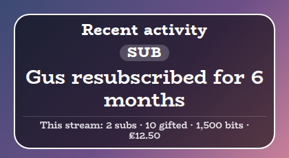
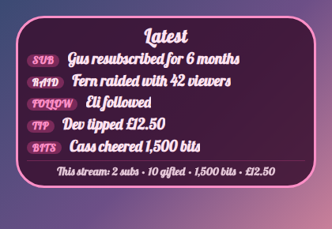
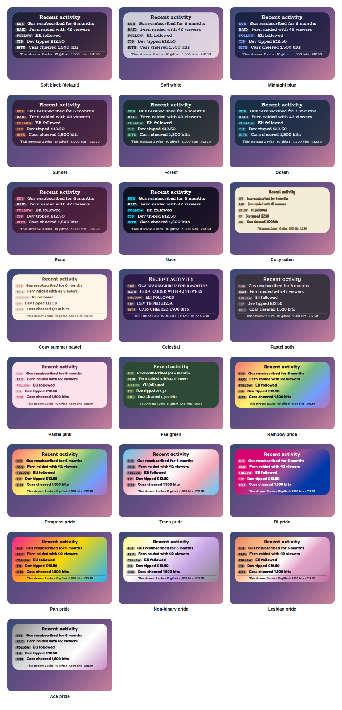

# Recent Activity Overlay

A StreamElements custom widget that shows the latest events on your stream: new subs and resubs, gifted subs, bits, tips, follows and raids, with running totals for the stream underneath. It is a small, calm list rather than a pop-up alert.

<p align="center"></p>

It is a single self-contained widget in plain JavaScript, with no dependencies and nothing to install. Every sentence is wording you can change, so it can say what suits your channel.

## Features

- Every kind of event: new subs and resubs, gifted subs, bits, tips, follows and raids, each on or off.
- Gift bombs counted once: a gift of 10 is one line saying so, not one per recipient (see [How events are read](#how-events-are-read)).
- Your wording: every sentence is a setting, with tokens for the name, count, amount and months, and each kind has a small tag you can rename.
- Totals: running totals for the stream, with each one on or off.
- Two layouts: a list of the latest events, or just the newest one, large.
- Filters: leave out small cheers and tips, bots, or any kind of event.
- Fading: optionally hide events after a number of seconds.
- Chat control: clear the feed, or the feed and the totals, from chat.
- Sounds: an optional sound when an event arrives.
- Customisable: around 70 settings cover what shows, the wording, tags, totals, sizes, shape, outline, colours, fonts, sounds and animation.
- Saved: the last 50 events and the totals survive a browser-source refresh.
- Tests and a dev harness: a local harness with a time machine and an automated test script, so nothing needs a live stream.

## Screenshots

**One event, large.** The latest layout shows only the newest event, which suits a corner of the screen.

<p></p>

**Your own look.** Choose Custom for the style preset and every colour, the font, the outline and the wording are settings.

<p></p>

## Style presets

One setting picks the look. The same twenty-two presets, with the same colours, are in every overlay in this set, so overlays from this set match whichever you choose. This is how each one looks in this overlay. The presets are defined once, in the [kit](../../kit), and a test keeps this overlay in step with it.

<p></p>

| Preset | Look |
| --- | --- |
| Soft black (default) | See-through black with white text. |
| Soft white | Frosted white with dark text. |
| Midnight blue | Deep navy with a periwinkle accent. |
| Sunset | Deep plum with orange and coral. |
| Forest | Deep green with a mint accent. |
| Ocean | Deep teal with an aqua accent. |
| Rose | Deep berry with a pink accent. |
| Neon | Near black with cyan and magenta. |
| Cosy cabin | Cream and brown, in Chicle. |
| Cosy summer pastel | Warm cream and coral, in Baloo 2. |
| Celestial | Deep purple and gold, in Cinzel. |
| Pastel goth | Charcoal and lilac, in Quicksand. |
| Pastel pink | Soft blush pink with rose, in Fredoka. |
| Pastel sage | Soft sage green with deep green, in Fredoka. |
| Fae green | Mossy green with a firefly lime accent, in Almendra. |
| Rainbow pride | A soft wash of the six rainbow stripes, in Fredoka. |
| Trans pride | Light blue, pink and white. |
| Bi pride | Magenta, purple and blue, with white text. |
| Pan pride | Pink, yellow and light blue. |
| Non-binary pride | Yellow, white, purple and black, softened so the text stays readable. |
| Lesbian pride | The orange to pink stripes. |
| Ace pride | Black, grey, white and purple, softened so the text stays readable. |

The last seven are pride presets, built from the stripes of the rainbow, trans, bi, pan, non-binary, lesbian and ace flags. The card or panel wears the flag as its background, with only as much of a wash over it as the text needs to stay readable, so flags with a black stripe come out softer. A bar is striped like the flag where an overlay has one, and the slices of a wheel and the options of a poll take their colours from the stripes in order. The colours follow each flag's published design,.

Choose **Custom** to use the colour pickers and font instead. They are ignored while a preset is chosen.

## Quick start

1. In StreamElements, edit your overlay and add **+ Add Widget, Static/Custom, Custom Widget**.
2. Select the widget, open **Settings, Open Editor**, and paste each file from `widget/` into the matching tab: `widget.html` into HTML, `widget.css` into CSS, `widget.js` into JS, and `fields.json` into Fields.
3. Click **Done**. The settings are grouped into Commands, Feed, Wording, Tags and totals, Size, Manual controls, Look, Custom colours, Sounds and Troubleshooting.
4. Size and position the widget. The text scales with the box, and the card grows downwards as events arrive. If the box is too short for everything, the card shrinks to fit instead of running off the bottom (untick **Shrink to fit the box** under Look to turn that off).

The widget reads Twitch chat and events through StreamElements, so it works as soon as it is on an active overlay.

## How events are read

- **Subs.** A new sub or resub is one line. A resub says how many months it was for.
- **Gifted subs.** StreamElements reports a gift bomb as one announcement where `amount` is the real number of subs, then one follow-up per recipient where `amount` is a streak or lifetime figure (for example 170). The widget shows only the announcement, so a gift of 10 is one line saying 10. A single gifted sub is a line saying 1 sub.
- **Bits and tips.** Each is a line with its amount. Set the currency symbol under **Wording**.
- **Follows and raids.** Each is a line. A raid says how many viewers came.

Anonymous gifters and cheerers appear as **Anonymous**, which you can rename. Tick **debug** in Troubleshooting to log every event to the browser-source console.

## Wording

Every sentence is a setting. These tokens can be used in them:

| Token | What it becomes |
| --- | --- |
| `{name}` | Who it was from. |
| `{count}` | The number of gifted subs. |
| `{subs}` | The word sub, or subs, to match the count. |
| `{months}` | The number of months of a resub. |
| `{amount}` | The bits, the tip amount, or the raid's viewers. |
| `{currency}` | The currency symbol. |

## Chat commands

The command word is a setting. Viewers can type the bare `!activity` to make the title pop, and everything else needs the broadcaster or, by default, a moderator.

| Command | What it does |
| --- | --- |
| `!activity clear` | Empties the list and keeps the totals. |
| `!activity reset` | Empties the list and the totals, for the start of a new stream. |

## Configuration

Every setting has a plain label in StreamElements, grouped as follows.

| Group | What it covers |
| --- | --- |
| Commands | The command word and who may use it. |
| Feed | Layout, how many events, their order, fading, which kinds show, smallest cheer and tip, and names to leave out. |
| Wording | The sentence for each kind of event, the currency symbol, and the name shown for anonymous people. |
| Tags and totals | The small tag for each kind, and which running totals show and how they are labelled. |
| Size | Text, title and latest-event sizes, and the space between events. |
| Manual controls | Buttons to clear the feed, or the feed and the totals. |
| Look | Title, the style preset, font, boldness, corners, padding, outline, shadow, Animate and whether it shrinks to fit the box. |
| Custom colours | Panel, text, accent, tag and alert colours, used when the style preset is Custom. |
| Sounds | A sound and volume for an event arriving, with a Test button and a master mute. |
| Troubleshooting | A debug log of every event to the browser-source console. |

The full list, with defaults, is in [`widget/fields.json`](widget/fields.json). The colour and font pickers apply only when the style preset is **Custom**.

## Local development

There is no build step and no dependencies. Serve this overlay's folder and open the dev harness:

```sh
npm run dev
# then open http://localhost:8000/dev/
```

The harness stands in for StreamElements. It sends subs, resubs, gifted subs, gift bombs of any size (with the per-recipient follow-ups StreamElements sends), bits, tips, follows and raids, and chat commands as a viewer, moderator or broadcaster. A **time machine** skips the clock forward so you can watch events fade out. Its **Every setting** section is generated from `widget/fields.json`, so it offers exactly what StreamElements will.

At the top of the harness, **Look and export** switches the style preset on the live widget, and can download or copy a `fields.json` with your current settings as its defaults. Paste that into the Fields tab of a new custom widget in StreamElements and it starts out looking the way it does here.

The harness must be served over http rather than opened as a file, and fonts come from Google Fonts. It also shows a Ko-fi support button in the corner. That button belongs to the harness only and is not part of the widget, so it never appears on stream.

## Testing

```sh
npm test
```

This runs the real `widget/widget.js` headlessly against a small mock of the page and StreamElements, with a clock the test controls, and exits non-zero on any failure. It covers every kind of event including the gift bomb case, order and length, fading, filters, the wording and tags, the totals, every chat command and permission, saving across a refresh, every look setting and the sounds. It also checks the style presets against the shared palette, and that every setting in `fields.json` is read by the widget and every button does something.

## Project layout

```
widget/   the widget: HTML, CSS, JS and the StreamElements fields
dev/      the local dev harness
test/     the automated tests
docs/     screenshots used in this README
```

## Compatibility and limitations

The widget uses the StreamElements events `onWidgetLoad` and `onEventReceived` with `message`, `subscriber-latest`, `cheer-latest`, `tip-latest`, `follower-latest`, `raid-latest` and `widget-button`, and `SE_API.store`. Gifts are credited to the `sender` of the event, so a client that did not send it would not show them. StreamElements does.

It shows events as they arrive while it is running. It does not read the stream's earlier history, so a freshly added widget starts empty.

It is a list, not an alert: there is no pop-up, media or text-to-speech. If you want those, use the alerts that StreamElements and Streamlabs already provide.

A StreamElements widget can read chat but cannot write to it, so `!activity` makes the title pop rather than replying.

The JavaScript is plain ES5, so it can be pasted straight into the StreamElements editor.

## Related overlays

These overlays share the same default look and the same twenty-two style presets, so they sit together on one stream.

- [Sub Goals Overlay](../sub-goals): sub and bits goals that fill as chat reaches them.
- [Subathon Overlay](../subathon): a subathon clock with a cap, power-ups and sub goals.
- [Spin Wheel Overlay](../spin-wheel): a wheel for giveaways, raffles and forfeits.
- [Chat Poll Overlay](../chat-poll): quick polls voted on by typing an option.
- [Squat Tracker Overlay](../squat-tracker): a running count driven by gifted sub bombs.
- [Rage Bar Overlay](../rage-bar): a bar chat fills with subs, bits and channel points.
- [Chat Counter Overlay](../counter): a counter chat commands change, for deaths, wins and anything else.
- [Leaderboard Overlay](../leaderboard): top gifters, cheerers and tippers.
- [Hype Meter Overlay](../hype-meter): a meter that chat activity fills, with levels.
- [Stream Goals Overlay](../stream-goals): sub and bits goals that start again for each stream.
- [Reminder Overlay](../reminder): reminders you set from chat, which stay on screen until cleared.
- [Chat Feed Overlay](../chat-feed): on-screen chat with profile pictures and pronouns.

## Support

If this saves you time, you can support its development on Ko-fi:

[](https://ko-fi.com/journeyingjordan)

Thanks for using it.

## Contributing

Contributions are welcome. See [CONTRIBUTING.md](../../CONTRIBUTING.md).

## License

[MIT](../../LICENSE). The copyright notice, including the Ko-fi link, must be kept in copies and substantial portions of the code.
