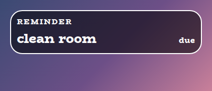
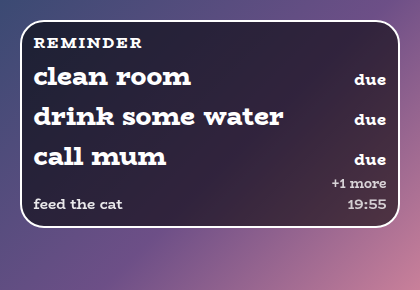
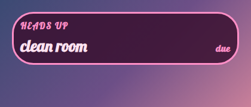
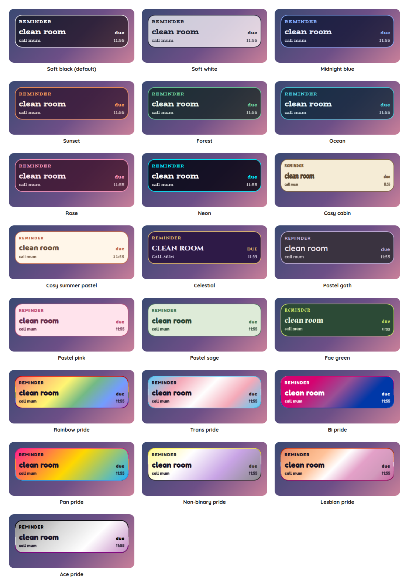

# Reminder Overlay

A StreamElements custom widget for the things you promised yourself you would do while streaming. Type `!reminder 15m clean room`, and it appears on screen with a countdown on the right. When the countdown runs out it changes to "due" and stays there, through a refresh and however long you ignore it, until you type `!reminder clear`.

<p align="center"></p>

It is a single self-contained widget in plain JavaScript, with no dependencies and nothing to install. Nothing shows on screen until a reminder is set, so it can sit in a scene all the time.

## Features

- Set from chat: `!reminder 15m clean room`, with times like `90s`, `1h30m`, `1:30:00` or a bare number of minutes.
- Gone when idle: with nothing to show, the whole widget disappears and leaves its box empty, and it comes back when a reminder is due, or is waiting if you show those.
- A countdown on every reminder: the words on the left and a timer on the right, which counts down while it waits and turns to "due" when it runs out.
- Stays until cleared: a reminder that is due is never timed out. It survives a refresh, and one that came due while the overlay was closed shows as soon as it loads.
- Several at once: reminders stack in the order they came due, with a count of any more.
- Clear, snooze and cancel: `!reminder clear` takes away what is showing, `snooze` hides it for a while and brings it back, and `cancel` drops one that is still waiting.
- Hard to miss: the border pulses while a reminder is showing, and a sound can play again every few seconds until you deal with it.
- Moderator control: the streamer, and by default moderators, can set and clear them. Viewers cannot.
- Customisable: around 40 settings cover the wording, sizes, shape, outline, colours, fonts, sounds and animation.
- Saved: reminders, waiting and showing, survive a browser-source refresh.
- Tests and a dev harness: a local harness with a time machine and an automated test script, so a reminder fifteen minutes away can be tried in a click.
- An outer frame in the accent colour, on by default in every preset, and switched off with one checkbox (the flag's stripes in the pride presets).

## Screenshots

**Several at once.** Reminders stack in the order they came due, and any beyond the limit are counted.

<p></p>

**Your own look.** Choose Custom for the style preset and every colour, the font, the outline and the wording are settings.

<p></p>

## Style presets

One setting picks the look. The same twenty-two presets, with the same colours, are in every overlay in this set, so overlays from this set match whichever you choose. This is how each one looks in this overlay. The presets are defined once, in the [kit](../../kit), and a test keeps this overlay in step with it.

<p></p>

| Preset | Look |
| --- | --- |
| Soft black (default) | See-through black with white text. |
| Soft white | Frosted white with dark text. |
| Midnight blue | Deep navy with a periwinkle accent. |
| Sunset | Deep plum with orange and coral. |
| Forest | Deep green with a mint accent. |
| Ocean | Deep teal with an aqua accent. |
| Rose | Deep berry with a pink accent. |
| Neon | Near black with cyan and magenta. |
| Cosy cabin | Cream and brown, in Chicle. |
| Cosy summer pastel | Warm cream and coral, in Baloo 2. |
| Celestial | Deep purple and gold, in Cinzel. |
| Pastel goth | Charcoal and lilac, in Quicksand. |
| Pastel pink | Soft blush pink with rose, in Fredoka. |
| Pastel sage | Soft sage green with deep green, in Fredoka. |
| Fae green | Mossy green with a firefly lime accent, in Almendra. |
| Rainbow pride | A soft wash of the six rainbow stripes, in Fredoka. |
| Trans pride | Light blue, pink and white. |
| Bi pride | Magenta, purple and blue, with white text. |
| Pan pride | Pink, yellow and light blue. |
| Non-binary pride | Yellow, white, purple and black, softened so the text stays readable. |
| Lesbian pride | The orange to pink stripes. |
| Ace pride | Black, grey, white and purple, softened so the text stays readable. |

The last seven are pride presets, built from the stripes of the rainbow, trans, bi, pan, non-binary, lesbian and ace flags. The card or panel wears the flag as its background, with only as much of a wash over it as the text needs to stay readable, so flags with a black stripe come out softer. A bar is striped like the flag where an overlay has one, and the slices of a wheel and the options of a poll take their colours from the stripes in order. The colours follow each flag's published design,.

Choose **Custom** to use the colour pickers and font instead. They are ignored while a preset is chosen.

## Quick start

1. In StreamElements, edit your overlay and add **+ Add Widget, Static/Custom, Custom Widget**.
2. Select the widget, open **Settings, Open Editor**, and paste each file from `widget/` into the matching tab: `widget.html` into HTML, `widget.css` into CSS, `widget.js` into JS, and `fields.json` into Fields.
3. Click **Done**. The settings are grouped into Commands, Reminders, Size, Manual controls, Look, Custom colours, Sounds and Troubleshooting.
4. Size and position the widget. The text scales with the box, and nothing shows until a reminder is set. If the box is too short for everything, the card shrinks to fit instead of running off the bottom (untick **Shrink to fit the box** under Look to turn that off).

The widget reads Twitch chat and events through StreamElements, so it works as soon as it is on an active overlay.

## Chat commands

The command word is a setting. Viewers can type the bare `!reminder` to make the title pop, and everything else needs the broadcaster or, by default, a moderator.

| Command | What it does |
| --- | --- |
| `!reminder 15m clean room` | Shows "clean room" in fifteen minutes. |
| `!reminder 1h30m` | Shows the default text in an hour and a half. |
| `!reminder clear` | Takes away the reminders that are showing. Ones still waiting are kept. |
| `!reminder clear all` | Takes away everything, waiting ones too. |
| `!reminder snooze 10m` | Hides the reminders that are showing, and brings them back in ten minutes. A bare `snooze` uses the default time. |
| `!reminder cancel 2` | Cancels the second waiting reminder, soonest first. |
| `!reminder cancel room` | Cancels the first waiting reminder with those words in it. |

**Writing the time.** The time is the first word after the command, with no spaces inside it: `90s`, `15m`, `1h30m`, `1d`, `1.5h`, `1:30:00` (hours, minutes, seconds), `5:00` (minutes and seconds), or a bare number, which is minutes. Everything after it is the reminder. A reminder can be set up to two days ahead.

## The countdown, and due

As soon as a reminder is set it shows on screen, with its words on the left and a timer on the right counting down: `clean room        14:59`. When the timer runs out it changes to `due`, the REMINDER title appears and the border starts to pulse. It then stays exactly like that until you clear it. Several reminders stack, with the ones that are due above the ones still counting down.

If you would rather a reminder stayed out of sight until it is due, untick **Show a reminder as soon as it is set**. The word shown when the countdown ends is a setting too, and a blank one shows nothing.

## It stays until cleared

A reminder that is due shows "due" where the countdown was, and stays. It has no timeout. Refreshing the browser source does not lose it, and neither does closing OBS: reminders are saved with the time they are due, so one that came due while the overlay was closed appears as soon as it loads.

Because it cannot be missed, it can also be annoying, which is the point. Tick the repeat setting to play the sound again every few seconds until it is cleared, or `snooze` it if you are not ready yet.

## Configuration

Every setting has a plain label in StreamElements, grouped as follows.

| Group | What it covers |
| --- | --- |
| Commands | The command word and who may use it. |
| Reminders | The text for a reminder with no words, the snooze time, how many show at once and can wait, the repeating sound, whether a reminder shows while it counts down, and the word for when it is due. |
| Size | Text, title and waiting-reminder sizes, the space between reminders, and the pulsing border. |
| Manual controls | Buttons to show a test reminder, clear, clear everything, and snooze. |
| Look | Title, the style preset, font, boldness, corners, padding, outer frame, outline, shadow, Animate and whether it shrinks to fit the box. |
| Custom colours | Panel, text, accent, bar and alert colours, used when the style preset is Custom. |
| Sounds | A sound and volume for a reminder arriving, with a Test button and a master mute. |
| Troubleshooting | A debug log of every event to the browser-source console. |

The **outer frame** is a border round the widget in the preset's accent colour, on by default in every preset. Untick **An outer frame** under Look for none, or set the outline thickness to change how thick it is, since at 0 it has a default thickness that grows with the box. With the frame unticked, the outline is whatever you set, as before, in the outline colour. In a pride preset the frame is the flag's stripes, as a ring that follows the panel's corners.

The full list, with defaults, is in [`widget/fields.json`](widget/fields.json). The colour and font pickers apply only when the style preset is **Custom**.

## Local development

There is no build step and no dependencies. Serve this overlay's folder and open the dev harness:

```sh
npm run dev
# then open http://localhost:8000/dev/
```

The harness stands in for StreamElements. It sends chat commands as a viewer, moderator or broadcaster, with quick buttons for the common ones. A **time machine** skips the clock forward, so a reminder fifteen minutes away appears in a click. Its **Every setting** section is generated from `widget/fields.json`, so it offers exactly what StreamElements will.

At the top of the harness, **Look and export** switches the style preset on the live widget, and can download or copy a `fields.json` with your current settings as its defaults. Paste that into the Fields tab of a new custom widget in StreamElements and it starts out looking the way it does here.

The **box-size bar** at the bottom of the stage sets the size of the widget's box in pixels, from two number boxes or a list of common sizes, and remembers it for next time. A StreamElements widget fills whatever box you draw for it, so drawing it in different boxes is the quickest way to see how it behaves. It is the same bar on every overlay's dev page.

The harness must be served over http rather than opened as a file, and fonts come from Google Fonts. It also shows a Ko-fi support button in the corner. That button belongs to the harness only and is not part of the widget, so it never appears on stream.

## Testing

```sh
npm test
```

This runs the real `widget/widget.js` headlessly against a small mock of the page and StreamElements, with a clock the test controls, and exits non-zero on any failure. It covers every way of writing the time, setting, stacking, clearing, snoozing and cancelling, who may do what, reminders that came due while the overlay was closed, the waiting list, the repeating sound, every look setting and saving across a refresh. It also checks the style presets against the shared palette, and that every setting in `fields.json` is read by the widget and every button does something.

## Project layout

```
widget/   the widget: HTML, CSS, JS and the StreamElements fields
dev/      the local dev harness
test/     the automated tests
docs/     screenshots used in this README
```

## Compatibility and limitations

The widget uses the StreamElements events `onWidgetLoad` and `onEventReceived` with `message` and `widget-button`, and `SE_API.store`.

A reminder is timed by the clock of the computer running the overlay, and it only appears while the widget is loaded. If the overlay is closed when a reminder is due, it appears, saying due, the next time the overlay loads.

A StreamElements widget can read chat but cannot write to it, so setting a reminder gives no reply in chat. You will see it appear on screen with its countdown straight away.

The JavaScript is plain ES5, so it can be pasted straight into the StreamElements editor.

## Related overlays

These overlays share the same default look and the same twenty-two style presets, so they sit together on one stream.

- [Sub Goals Overlay](../sub-goals): sub and bits goals that fill as chat reaches them.
- [Subathon Overlay](../subathon): a subathon clock with a cap, power-ups and sub goals.
- [Spin Wheel Overlay](../spin-wheel): a wheel for giveaways, raffles and forfeits.
- [Chat Poll Overlay](../chat-poll): quick polls voted on by typing an option.
- [Squat Tracker Overlay](../squat-tracker): a running count driven by gifted sub bombs.
- [Rage Bar Overlay](../rage-bar): a bar chat fills with subs, bits and channel points.
- [Chat Counter Overlay](../counter): a counter chat commands change, for deaths, wins and anything else.
- [Leaderboard Overlay](../leaderboard): top gifters, cheerers and tippers.
- [Hype Meter Overlay](../hype-meter): a meter that chat activity fills, with levels.
- [Recent Activity Overlay](../recent-activity): the latest subs, gifts, bits, tips, follows and raids.
- [Stream Goals Overlay](../stream-goals): sub and bits goals that start again for each stream.
- [Chat Feed Overlay](../chat-feed): on-screen chat with profile pictures and pronouns.
- [Camera Overlay](../camera): a framed window for your camera with a nameplate, and a cover that you and your moderators control from chat.
- [Now Playing Overlay](../now-playing): what you are playing, from Last.fm, Tuna, Spotify or Pear Desktop, with album art and a progress bar.

## Support

If this saves you time, you can support its development on Ko-fi:

[](https://ko-fi.com/journeyingjordan)

Thanks for using it.

## Contributing

Contributions are welcome. See [CONTRIBUTING.md](../../CONTRIBUTING.md).

## License

[MIT](../../LICENSE). The copyright notice, including the Ko-fi link, must be kept in copies and substantial portions of the code.
