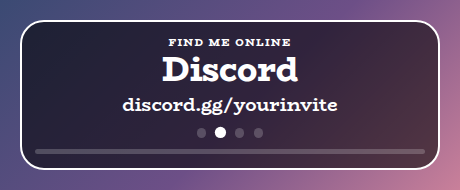
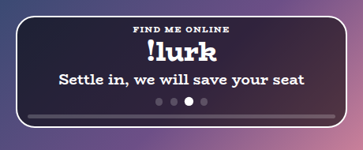
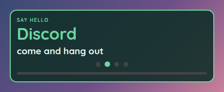
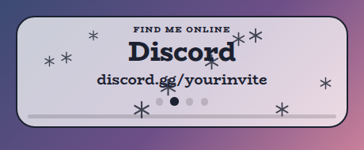
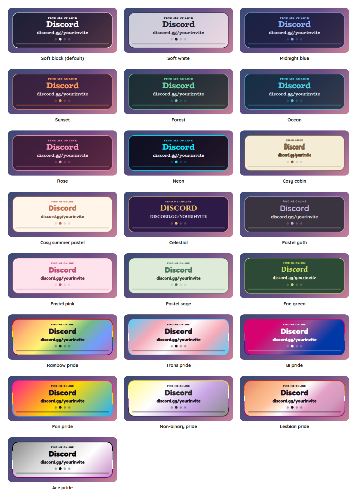

# Rotating Panel Overlay

A StreamElements custom widget for the things you keep telling people. One small panel takes turns showing your socials and your chat commands, one at a time: your Discord, your Twitch, `!lurk`, `!socials`, whatever you find yourself typing again and again. It fades from one to the next every few seconds, with a dot for each and a thin bar that fills while one stays.

<p align="center"></p>

It is a single self-contained widget in plain JavaScript, with no dependencies and nothing to install. Up to twelve entries are written in the settings, and nothing else needs setting up.

## Features

- Stays put in OBS: the panel is always as tall as the box you draw, with its content in the middle, so it does not grow or shrink as entries come and go. Untick Fill the height of the box for a panel as tall as its content.
- Socials and commands in one place: each entry is a heading and its words, written as `Discord | discord.gg/yourinvite`.
- Up to twelve entries, in the order written, or shuffled each time round.
- A card that keeps its size: every entry sits in the same space, so the panel is as tall as its tallest entry and never jumps as they take turns.
- A way to arrive: fade, slide in, or straight away, with a dot for each entry and a bar that fills while one stays.
- Steered from chat: `!panel next`, `prev`, `go 3`, `pause`, `resume`, `off` and `on`, for the moment you want to dwell on one, or hide the panel.
- Gone when you want: `!panel off` hides the whole widget and leaves its box empty, and it stays off through a refresh.
- Moderator control: the streamer, and by default moderators, can steer it. Viewers cannot.
- Customisable: around 45 settings cover the entries, timing, sizes, shape, outline, colours, fonts and animation.
- Tests and a dev harness: a local harness with a time machine and an automated test script.
- An outer frame in the accent colour, on by default in every preset, and switched off with one checkbox (the flag's stripes in the pride presets).
- Decorations: sparkles, hearts, stars, flowers, moons, snowflakes, bubbles, butterflies, clouds, leaves, paw prints, music notes or bows behind the words, scattered, along the edges, in the corners, a little way in from the corners or on the border, in the accent colour, a pride flag's colours or a colour of your own, twinkling, drifting or still. Off by default.

## Screenshots

**A command.** An entry can be a chat command and what it does, such as `!lurk`.

<p></p>

**Your own look.** Choose Custom for the style preset and every colour, the font, the corners, the alignment and the wording are settings.

<p></p>

## Quick start

1. In StreamElements, edit your overlay and add **+ Add Widget, Static/Custom, Custom Widget**.
2. Select the widget, open **Settings, Open Editor**, and paste each file from `widget/` into the matching tab: `widget.html` into HTML, `widget.css` into CSS, `widget.js` into JS, and `fields.json` into Fields.
3. Click **Done**. Under **Entries**, replace the four examples with your own, one in each box, and clear the ones you do not need.
4. Size and position the widget. The text scales with the box. If the box is too short for the tallest entry, the card shrinks to fit instead of running off the bottom (untick **Shrink to fit the box** under Look to turn that off).

The widget reads Twitch chat through StreamElements, so it works as soon as it is on an active overlay.

## Writing the entries

Each entry is one setting, a heading and its words with a vertical bar between them:

| What you write | What shows |
| --- | --- |
| `Discord \| discord.gg/yourinvite` | "Discord" large in the accent colour, with the address under it. |
| `!lurk \| Settle in, we will save your seat` | The command large, and what it does under it. |
| `Be kind to each other` | Just that, large. |
| `\| Thank you for being here` | Just the words, under no heading. |

A blank entry is skipped. Entries take turns in the order you wrote them, or shuffled each time round if you tick **Shuffle**, and a shuffle never shows the same one twice in a row.

## Chat commands

The command word is a setting. Viewers can type the bare `!panel` to make the title pop, and everything else needs the broadcaster or, by default, a moderator.

| Command | What it does |
| --- | --- |
| `!panel next` | Moves on now, and the entry's time starts again. |
| `!panel prev` | Goes back one. |
| `!panel go 3` | Jumps to the third entry as you wrote it. |
| `!panel pause` | Holds on the entry showing, for as long as you like, even through a refresh. |
| `!panel resume` | Lets it carry on. |
| `!panel off` | Hides the whole panel. |
| `!panel on` | Brings it back. |

**Decorations.** Snowflakes behind the words, here in the Soft white preset.

<p></p>

## Style presets

One setting picks the look. The same twenty-three presets, with the same colours, are in every overlay in this set, so overlays from this set match whichever you choose. This is how each one looks in this overlay. The presets are defined once, in the [kit](../../kit), and a test keeps this overlay in step with it.

<p></p>

| Preset | Look |
| --- | --- |
| Soft black (default) | See-through black with white text. |
| Text only (no box) | No box, frame or shadow: just the words, with a soft dark halo so they read over any picture. |
| Soft white | Frosted white with dark text. |
| Midnight blue | Deep navy with a periwinkle accent. |
| Sunset | Deep plum with orange and coral. |
| Forest | Deep green with a mint accent. |
| Ocean | Deep teal with an aqua accent. |
| Rose | Deep berry with a pink accent. |
| Neon | Near black with cyan and magenta. |
| Cosy cabin | Cream and brown, in Chicle. |
| Cosy summer pastel | Warm cream and coral, in Baloo 2. |
| Celestial | Deep purple and gold, in Cinzel. |
| Pastel goth | Charcoal and lilac, in Quicksand. |
| Pastel pink | Soft blush pink with rose, in Fredoka. |
| Pastel sage | Soft sage green with deep green, in Fredoka. |
| Fae green | Mossy green with a firefly lime accent, in Almendra. |
| Rainbow pride | A soft wash of the six rainbow stripes, in Fredoka. |
| Trans pride | Light blue, pink and white. |
| Bi pride | Magenta, purple and blue, with white text. |
| Pan pride | Pink, yellow and light blue. |
| Non-binary pride | Yellow, white, purple and black, softened so the text stays readable. |
| Lesbian pride | The orange to pink stripes. |
| Ace pride | Black, grey, white and purple, softened so the text stays readable. |

The last seven are pride presets, built from the stripes of the rainbow, trans, bi, pan, non-binary, lesbian and ace flags. The card or panel wears the flag as its background, with only as much of a wash over it as the text needs to stay readable, so flags with a black stripe come out softer. A bar is striped like the flag where an overlay has one, and the slices of a wheel and the options of a poll take their colours from the stripes in order. The colours follow each flag's published design,.

Choose **Custom** to use the colour pickers and font instead. They are ignored while a preset is chosen.

## Configuration

Every setting has a plain label in StreamElements, grouped as follows.

| Group | What it covers |
| --- | --- |
| Commands | The command word and who may use it. |
| Entries | Twelve boxes, one for each entry. |
| Rotation | How long each stays, shuffling, how an entry arrives, the dots and the bar, and where the words sit. |
| Size | Text, heading and title sizes, and the space between a heading and its words. |
| Manual controls | Buttons for next, previous, pause, carry on, hide and show. |
| Look | Title, the style preset, font, boldness, corners, padding, outer frame, outline, shadow, Animate and whether it fills the height of the box and whether it shrinks to fit it. |
| Custom colours | Panel, text, accent and dot colours, used when the style preset is Custom. A checkbox there also lets the Panel opacity apply to any preset, not only Custom. |
| Decorations | The shape, where they go, how many, how big, how solid (the Decoration opacity, which is its own setting and not the panel's, and 1 is fully solid), their colour, and how they move. |
| Troubleshooting | A debug log of every event to the browser-source console. |

The **outer frame** is a border round the widget in the preset's accent colour, on by default in every preset. Untick **An outer frame** under Look for none, or set the outline thickness to change how thick it is, since at 0 it has a default thickness that grows with the box. In a pride preset the frame is the flag's stripes, as a ring that follows the panel's corners.

The **decorations** are small shapes drawn behind the words: sparkles, hearts, stars, flowers, moons, snowflakes, bubbles, butterflies, clouds, leaves, paw prints, music notes, bows, or a mix of sparkles, hearts and stars. Choose one under **Decorations**, then where they go (scattered, along the inside of the edges, in the corners, a little way in from the corners (a couple of small shapes dotted near the top right and bottom right is a gentle look), or on the border with half of each outside it), how many (up to 24), how big, how solid, and whether they twinkle in place, drift upwards or stay still. They take the accent colour, or in a pride preset the colours of the flag in turn, or you can ask for the text colour, both in turn, or a colour of your own. On the border they need a little room round the widget in its box, since StreamElements shows only what is inside the box, and a panel that fills its box has none. Twinkling dips a little and drifting fades in and out, so choose Stay still, or turn Animate off, to keep them fully solid. With Animate off they stay still. They are off by default.

The full list, with defaults, is in [`widget/fields.json`](widget/fields.json). The colour and font pickers apply only when the style preset is **Custom**.

## Using it with Streamer.bot

This overlay runs unchanged with Streamer.bot. Choose Streamer.bot at the top of [the website](https://jordan-lee-code.github.io/stream-overlays/), set the overlay up, and copy its address into an OBS Browser source. The steps, and what differs from StreamElements, are in the [root README](../../README.md#using-an-overlay-with-streamerbot).

## Local development

There is no build step and no dependencies. Serve this overlay's folder and open the dev harness:

```sh
npm run dev
# then open http://localhost:8000/dev/
```

The harness stands in for StreamElements. It sends chat commands as a viewer, moderator or broadcaster, with quick buttons for the common ones. A **time machine** skips the clock forward, so the entries take turns as fast as you can skip ahead. Its **Every setting** section is generated from `widget/fields.json`, so it offers exactly what StreamElements will.

At the top of the harness, **Look and export** switches the style preset on the live widget, and can download or copy a `fields.json` with your current settings as its defaults. Paste that into the Fields tab of a new custom widget in StreamElements and it starts out looking the way it does here.

The **Design** panel under the copy buttons carries a look from one overlay to the next, so it only has to be set up once. Set the style preset, font, colours, shape, frame and decorations here, press **Save this design**, then open another overlay's dev page and press **Use saved design**. It can also be copied, downloaded as `design.json` or pasted in, and **Use my saved design whenever I open an overlay** applies it for you. Only the design travels, so each overlay's own wording and behaviour settings are left as they are, and anything an overlay does not have is skipped.

The **Troubleshooting import** panel brings a problem seen on stream into the dev page. In the StreamElements widget editor open the **Data** tab, copy everything in it, paste it into the panel and press **Load this**: the settings come across as they are on stream, and anything the Data tab does not hold stays as it was. A Data tab that holds another widget's settings changes nothing.

The **box-size bar** at the bottom of the stage sets the size of the widget's box in pixels, from two number boxes or a list of common sizes, and remembers it for next time. A StreamElements widget fills whatever box you draw for it, so drawing it in different boxes is the quickest way to see how it behaves. It is the same bar on every overlay's dev page.

The harness must be served over http rather than opened as a file, and fonts come from Google Fonts. It also shows a Ko-fi support button in the corner. That button belongs to the harness only and is not part of the widget, so it never appears on stream.

## Testing

```sh
npm test
```

This runs the real `widget/widget.js` headlessly against a small mock of the page and StreamElements, with a clock the test controls, and exits non-zero on any failure. It covers how entries are read, the timing and the order, shuffling, every chat command, who may do what, holding and hiding across a refresh and every look setting. It also checks the style presets against the shared palette, and that every setting in `fields.json` is read by the widget and every button does something.

## Project layout

```
widget/   the widget: HTML, CSS, JS and the StreamElements fields
dev/      the local dev harness
test/     the automated tests
docs/     screenshots used in this README
```

## Compatibility and limitations

The widget uses the StreamElements events `onWidgetLoad` and `onEventReceived` with `message` and `widget-button`, and `SE_API.store`, which keeps whether the panel is paused or hidden.

A StreamElements widget cannot read your chatbot's list of commands, so the entries are written by hand in the settings, up to twelve of them. It also cannot write to chat, so it shows a command such as `!lurk` without being able to answer when someone types it. Your chatbot does that part.

The JavaScript is plain ES5, so it can be pasted straight into the StreamElements editor.

## Related overlays

These overlays share the same default look and the same twenty-three style presets, so they sit together on one stream.

- [Stream Start Countdown Overlay](../start-countdown): a full-screen starting soon countdown you set from chat.
- [Sub Goals Overlay](../sub-goals): sub and bits goals that fill as chat reaches them.
- [Subathon Overlay](../subathon): a subathon clock with a cap, power-ups and sub goals.
- [Spin Wheel Overlay](../spin-wheel): a wheel for giveaways, raffles and forfeits.
- [Chat Poll Overlay](../chat-poll): quick polls voted on by typing an option.
- [Squat Tracker Overlay](../squat-tracker): a running count driven by gifted sub bombs.
- [Rage Bar Overlay](../rage-bar): a bar chat fills with subs, bits and channel points.
- [Chat Counter Overlay](../counter): a counter chat commands change, for deaths, wins and anything else.
- [Leaderboard Overlay](../leaderboard): top gifters, cheerers and tippers.
- [Hype Meter Overlay](../hype-meter): a meter that chat activity fills, with levels.
- [Recent Activity Overlay](../recent-activity): the latest subs, gifts, bits, tips, follows and raids.
- [Stream Goals Overlay](../stream-goals): sub and bits goals that start again for each stream.
- [Chat Feed Overlay](../chat-feed): on-screen chat with profile pictures and pronouns.
- [Camera Overlay](../camera): a framed window for your camera with a nameplate, and a cover that you and your moderators control from chat.
- [Now Playing Overlay](../now-playing): what you are playing, from Last.fm, Tuna, Spotify or Pear Desktop, with album art and a progress bar.

## Support

If this saves you time, you can support its development on Ko-fi:

[](https://ko-fi.com/journeyingjordan)

Thanks for using it.

## Contributing

Contributions are welcome. See [CONTRIBUTING.md](../../CONTRIBUTING.md).

## License

[MIT](../../LICENSE). The copyright notice, including the Ko-fi link, must be kept in copies and substantial portions of the code.
