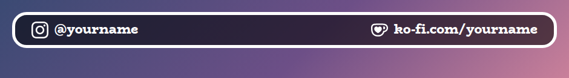
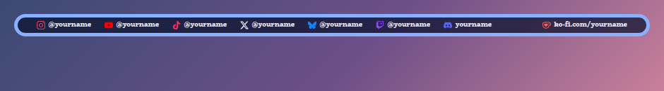
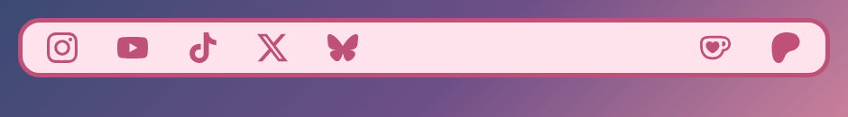
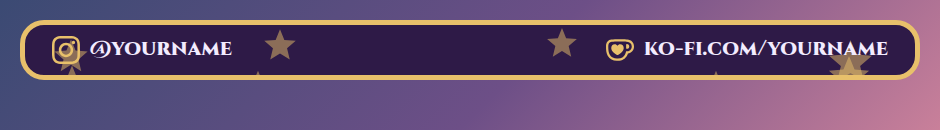
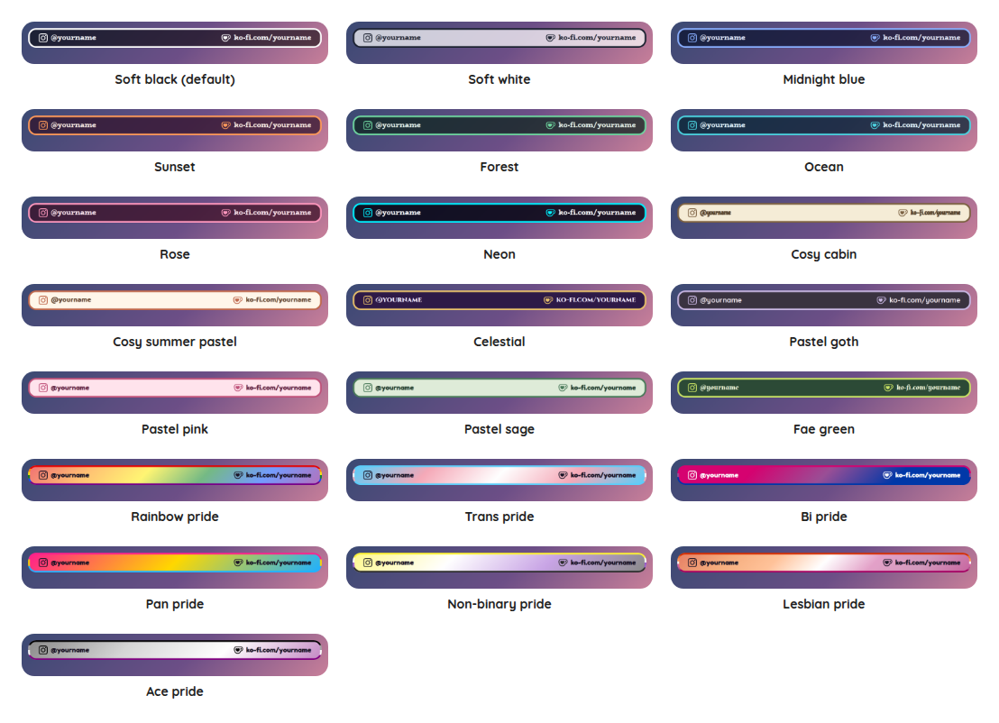

# Socials Bar Overlay

A StreamElements custom widget that puts your social links on screen in one horizontal bar. Your sites sit on the left, one at a time, fading from one into the next, each with its logo in front of your handle. Your Ko-fi stays on the right, always visible, with its logo too.

<p align="center"></p>

It is a single self-contained widget in plain JavaScript, with no dependencies and nothing to install, and nothing in it needs the internet except the font. The logos are drawn by the widget itself, so they cannot go missing.

## Features

- Sixteen sites: Instagram, YouTube, TikTok, Twitter or X, Bluesky, Twitch, Discord, Facebook, Threads, Mastodon, Snapchat, GitHub, Kick and Reddit on the left, and Ko-fi and Patreon on the right. A site with a blank handle is left out, so you only show the ones you use.
- The left side rotates: one site at a time fades out as the next fades in, and the bar stays the width of the widest one, so nothing jumps about. You choose how many seconds each stays and how long the fade takes, or untick Rotate to show them all side by side.
- A logo in front of every handle, in your accent colour, your text colour, or each site's own colour. Or logos on their own, with no handles.
- Wraps when it is tight: if there are too many for the width of the box, the sites wrap onto a second row instead of running off the edge.
- Scales with the box: the text scales with the width of the box you draw.
- Customisable: around fifty settings cover the handles, rotation, sizes, shape, outline, colours, fonts and animation.
- All twenty-two style presets, including the seven pride flags.
- An outer frame in the accent colour, on by default in every preset, and switched off with one checkbox (the flag's stripes in the pride presets).
- Decorations: sparkles, hearts, stars, flowers, moons, snowflakes, bubbles, butterflies, clouds, leaves, paw prints, music notes or bows behind the bar, scattered, along the edges, in the corners, a little way in from the corners or on the border, twinkling, drifting or still. Off by default.
- Tests and a dev harness: a local harness with quick buttons for the rotation, the logo colour and extra sites, and an automated test script.

## Screenshots

Every site side by side, in each site's own colour, in the Midnight blue preset. Ko-fi stays on the right.

<p></p>

Logos on their own, with Patreon beside Ko-fi, in the Pastel pink preset.

<p></p>

With decorations along the edges, in the Celestial preset.

<p></p>

## Style presets

One setting picks the look. The same twenty-two presets, with the same colours, are in every overlay in this set, so overlays from this set match whichever you choose. This is how each one looks in this overlay. The presets are defined once, in the [kit](../../kit), and a test keeps this overlay in step with it.

<p></p>

| Preset | Look |
| --- | --- |
| Soft black (default) | See-through black with white text. |
| Soft white | Frosted white with dark text. |
| Midnight blue | Deep navy with a periwinkle accent. |
| Sunset | Deep plum with orange and coral. |
| Forest | Deep green with a mint accent. |
| Ocean | Deep teal with an aqua accent. |
| Rose | Deep berry with a pink accent. |
| Neon | Near black with cyan and magenta. |
| Cosy cabin | Cream and brown, in Chicle. |
| Cosy summer pastel | Warm cream and coral, in Baloo 2. |
| Celestial | Deep purple and gold, in Cinzel. |
| Pastel goth | Charcoal and lilac, in Quicksand. |
| Pastel pink | Soft blush pink with rose, in Fredoka. |
| Pastel sage | Soft sage green with deep green, in Fredoka. |
| Fae green | Mossy green with a firefly lime accent, in Almendra. |
| Rainbow pride | A soft wash of the six rainbow stripes, in Fredoka. |
| Trans pride | Light blue, pink and white. |
| Bi pride | Magenta, purple and blue, with white text. |
| Pan pride | Pink, yellow and light blue. |
| Non-binary pride | Yellow, white, purple and black, softened so the text stays readable. |
| Lesbian pride | The orange to pink stripes. |
| Ace pride | Black, grey, white and purple, softened so the text stays readable. |

The last seven are pride presets, built from the stripes of the rainbow, trans, bi, pan, non-binary, lesbian and ace flags. The card or panel wears the flag as its background, with only as much of a wash over it as the text needs to stay readable, so flags with a black stripe come out softer. The slices of a wheel and the options of a poll take their colours from the stripes in order. The colours follow each flag's published design,.

Choose **Custom** to use the colour pickers and font instead. They are ignored while a preset is chosen.

## Quick start

1. In StreamElements, edit your overlay and add **+ Add Widget, Static/Custom, Custom Widget**.
2. Select the widget, open **Settings, Open Editor**, and paste each file from `widget/` into the matching tab: `widget.html` into HTML, `widget.css` into CSS, `widget.js` into JS, and `fields.json` into Fields.
3. Click **Done**. The settings are grouped into Left side, Right side, Rotation, Layout, Size, Look, Custom colours, Decorations and Troubleshooting.
4. Type your own handles under **Left side** and **Right side**. They start out as `@yourname`, so replace each one and clear the ones you do not use.
5. Size and position the widget. A box that is wide and short suits it, such as 900 by 90.

The widget does not read chat or events, so it works as soon as it is on an overlay.

## Your handles

Each site has its own text box, and what you type is exactly what is shown, so write it the way you want viewers to read it: `@yourname`, `yourname.bsky.social` or `ko-fi.com/yourname`. Anything typed is shown as plain text and never as markup. Leave a box blank and that site is not shown.

The sites on the left show in the order they are listed in the settings. Ko-fi comes first on the right, then Patreon.

## Rotation

By default the left side shows one site at a time. Each stays for **Seconds each site stays on screen** (four by default, never less than one), then fades out while the next fades in over **Seconds the fade between sites takes**. The sites all share one space, so the bar is as wide as the widest handle and the right side does not shift.

Untick **Rotate the left side** to show every site side by side. With only one site on the left there is nothing to rotate, so it just stays. **Animate** off stops the fade, and the sites then change without it.

The logos are the sites' own marks, drawn from [Simple Icons](https://simpleicons.org), which are released into the public domain (CC0). The logos belong to the sites they stand for, and are here only to point to your own pages.

## Configuration

Every setting has a plain label in StreamElements, grouped as follows.

| Group | What it covers |
| --- | --- |
| Left side | A handle for each of Instagram, YouTube, TikTok, Twitter or X, Bluesky, Twitch, Discord, Facebook, Threads, Mastodon, Snapchat, GitHub, Kick and Reddit. |
| Right side | Ko-fi and Patreon. |
| Rotation | Whether the left side rotates, how long each site stays, and how long the fade takes. |
| Layout | Whether handles show beside the logos, and the logo colour. |
| Size | Text size, how big the logos are and the space between sites. |
| Look | The style preset, font, boldness, corners, padding, outer frame, outline, shadow, Animate and whether it shrinks to fit the box. |
| Custom colours | Panel, text and accent colours, used when the style preset is Custom. A checkbox there also lets the Panel opacity apply to any preset, not only Custom. |
| Decorations | The shape, where they go, how many, how big, how solid (the Decoration opacity, which is its own setting and not the panel's, and 1 is fully solid), their colour, and how they move. Twinkling dips a little and drifting fades in and out, so choose Stay still, or turn Animate off, to keep them fully solid. |
| Troubleshooting | A debug line in the browser-source console saying how many sites are shown. |

## Local development

There is no build step and no dependencies. Serve this overlay's folder and open the dev harness:

```sh
npm run dev
# then open http://localhost:8000/dev/
```

The harness stands in for StreamElements. **Quick looks** switch the rotation, the handles and the logo colour for you, **Try more sites** fills in Twitch, Discord and Patreon so a longer rotation and a second support link can be seen, and its **Every setting** section is generated from `widget/fields.json`, so it offers exactly what StreamElements will.

At the top of the harness, **Look and export** switches the style preset on the live widget, and can download or copy a `fields.json` with your current settings as its defaults. Paste that into the Fields tab of a new custom widget in StreamElements and it starts out looking the way it does here.

The **box-size bar** at the bottom of the stage sets the size of the widget's box in pixels, from two number boxes or a list of common sizes, and remembers it for next time.

The harness must be served over http rather than opened as a file, and fonts come from Google Fonts. It also shows a Ko-fi support button in the corner. That button belongs to the harness only and is not part of the widget, so it never appears on stream.

## Testing

```sh
npm test
```

This runs the real `widget/widget.js` headlessly against a small mock of the page and StreamElements, with a clock the test controls, and exits non-zero on any failure. It covers which sites are shown and where, blank and spaced handles, the rotation and its timing, the fade, loading again without a second timer, the sizes, the logo colours, every style preset, the frame and the decorations.

## Project layout

```
widget/   the widget: HTML, CSS, JS and the StreamElements fields
dev/      the local dev harness
test/     the automated tests
docs/     screenshots used in this README
```

## Compatibility and limitations

The widget uses the StreamElements event `onWidgetLoad`. It reads no chat and stores nothing. The handles are text and are not links, because nobody can click a stream overlay, so they are there to be read.

The JavaScript is plain ES5, so it can be pasted straight into the StreamElements editor.

## Related overlays

These overlays share the same default look and the same twenty-two style presets, so they sit together on one stream.

- [Sub Goals Overlay](../sub-goals): sub and bits goals that fill as chat reaches them.
- [Subathon Overlay](../subathon): a subathon clock with a cap, power-ups and sub goals.
- [Spin Wheel Overlay](../spin-wheel): a wheel for giveaways, raffles and forfeits.
- [Chat Poll Overlay](../chat-poll): quick polls voted on by typing an option.
- [Squat Tracker Overlay](../squat-tracker): a running count driven by gifted sub bombs.
- [Rage Bar Overlay](../rage-bar): a bar chat fills with subs, bits and channel points.
- [Chat Counter Overlay](../counter): a counter chat commands change, for deaths, wins and anything else.
- [Leaderboard Overlay](../leaderboard): top gifters, cheerers and tippers.
- [Hype Meter Overlay](../hype-meter): a meter that chat activity fills, with levels.
- [Recent Activity Overlay](../recent-activity): the latest subs, gifts, bits, tips, follows and raids.
- [Stream Goals Overlay](../stream-goals): sub and bits goals that start again for each stream.
- [Chat Feed Overlay](../chat-feed): on-screen chat with profile pictures and pronouns.
- [Camera Overlay](../camera): a framed window for your camera with a nameplate, and a cover that you and your moderators control from chat.
- [Now Playing Overlay](../now-playing): what you are playing, from Last.fm, Tuna, Spotify or Pear Desktop, with album art and a progress bar.
- [Local Time Overlay](../local-time): the time in any timezone, with a line above it such as Local timezone: GMT.
- [Reminder Overlay](../reminder): reminders set from chat, with a countdown that turns to due and stays until cleared.

## Support

If this saves you time, you can support its development on Ko-fi:

[](https://ko-fi.com/journeyingjordan)

Thanks for using it.

## Contributing

Contributions are welcome. See [CONTRIBUTING.md](../../CONTRIBUTING.md).

## License

[MIT](../../LICENSE). The copyright notice, including the Ko-fi link, must be kept in copies and substantial portions of the code.
