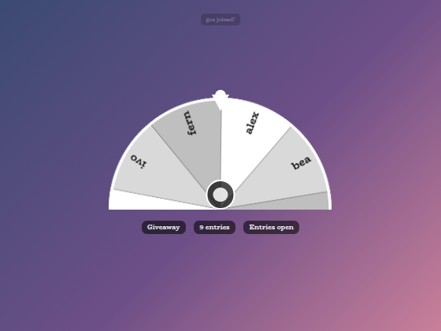
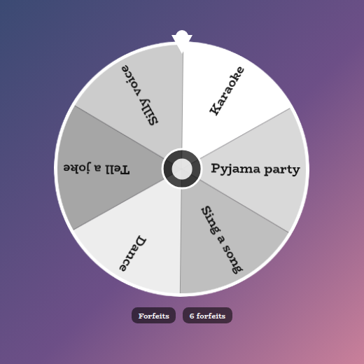
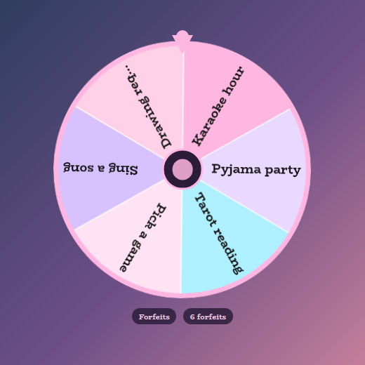
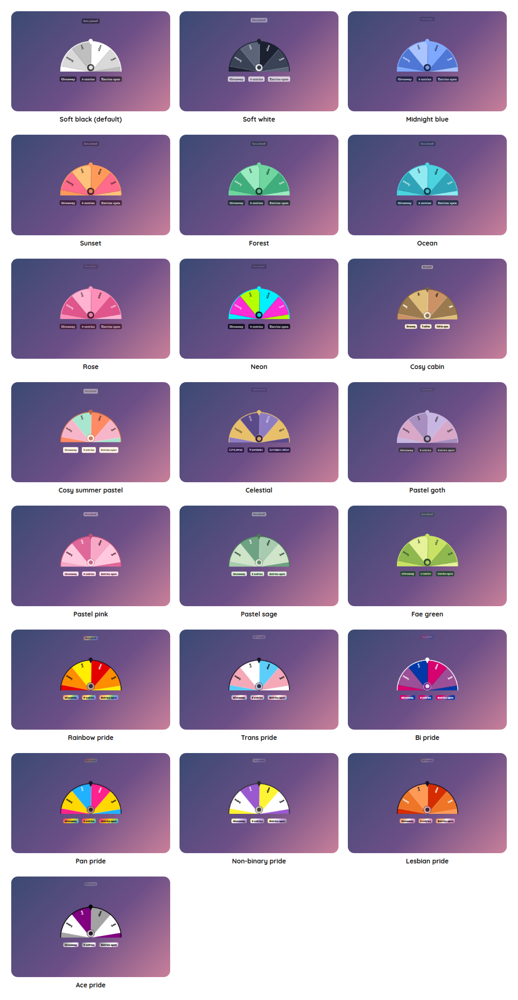

# Spin Wheel Overlay

A StreamElements custom widget: a spinning wheel for giveaways, raffles and forfeits. Viewers type `!spin` to put their name on the wheel, and the streamer types `!spin go` to draw a winner live.

<p align="center"></p>

It started as a raffle and grew into a wheel that also runs forfeit spins, weighted odds for subscribers, a "Truth or..." question round, and a wheel that spins itself when a goal is reached. It is one self-contained widget in plain JavaScript, with no dependencies and nothing to install.

## Features

- Giveaway raffle: viewers join with `!spin`, their name lands on the wheel with a small toast, and `!spin go` draws a winner with a reveal and confetti.
- Forfeits mode: a wheel of things chat makes you do, starting empty and built live from chat. Forfeits can be crossed off as they are landed on, and the wheel can spin itself on a bits, subs, follows or donation trigger.
- Truth or... mode: chat submits questions, the wheel draws one, and it stays on screen while it is answered. A set number of lifelines lets the streamer skip questions, and moderators can strike an inappropriate one for free.
- Subscriber-weighted odds: give subscribers and VIPs extra slots, reflected both in the maths and in how wide their slice is.
- Goal auto-spin: spin on each new sub, every N followers, or when cumulative bits or tips cross a threshold, with an optional progress bar.
- Multi-winner draws: `!spin go 3` draws several distinct winners in a row.
- Entry countdown: optionally close entries automatically after a set number of seconds.
- Recent-winner cooldown: keep the last few winners out of the next draws.
- Re-roll and re-show: put the last winner back and draw again, or re-show the most recent winner.
- Chat colours and idle drift: slices can use each viewer's chat colour, and the wheel drifts slowly while it waits.
- A shared look: the default is a see-through black theme with white and grey slices and BioRhyme text, the same as the other overlays in this set.
- Customisable: around 180 settings cover the wording of every label, the shape and colours of every part, the text, sounds and animation.
- Saved: entrants, mode, recent winners, lifelines and a running countdown are saved, so a refresh mid-giveaway loses nothing.
- Testable offline: a local dev harness and an automated test script.

## Screenshots

**Forfeits mode.** A wheel of forfeits built live with `!spin forfeit add`, shown here as a full circle. Long labels are shortened on the wheel and shown in full in the reveal.

<p></p>

**Your own look.** Every part is a setting. This one uses custom slice colours, a thicker rim, white dividers, rounder pills and a pink theme. You can also pick any of the twenty-two [style presets](#style-presets) with one setting.

<p></p>

## Style presets

One setting picks the look. The same twenty-two presets, with the same colours, are in every overlay in this set, so overlays from this set match whichever you choose. This is how each one looks in this overlay. The presets are defined once, in the [kit](../../kit), and a test keeps this overlay in step with it.

<p></p>

| Preset | Look |
| --- | --- |
| Soft black (default) | See-through black with white text. |
| Soft white | Frosted white with dark text. |
| Midnight blue | Deep navy with a periwinkle accent. |
| Sunset | Deep plum with orange and coral. |
| Forest | Deep green with a mint accent. |
| Ocean | Deep teal with an aqua accent. |
| Rose | Deep berry with a pink accent. |
| Neon | Near black with cyan and magenta. |
| Cosy cabin | Cream and brown, in Chicle. |
| Cosy summer pastel | Warm cream and coral, in Baloo 2. |
| Celestial | Deep purple and gold, in Cinzel. |
| Pastel goth | Charcoal and lilac, in Quicksand. |
| Pastel pink | Soft blush pink with rose, in Fredoka. |
| Pastel sage | Soft sage green with deep green, in Fredoka. |
| Fae green | Mossy green with a firefly lime accent, in Almendra. |
| Rainbow pride | A soft wash of the six rainbow stripes, in Fredoka. |
| Trans pride | Light blue, pink and white. |
| Bi pride | Magenta, purple and blue, with white text. |
| Pan pride | Pink, yellow and light blue. |
| Non-binary pride | Yellow, white, purple and black, softened so the text stays readable. |
| Lesbian pride | The orange to pink stripes. |
| Ace pride | Black, grey, white and purple, softened so the text stays readable. |

The last seven are pride presets, built from the stripes of the rainbow, trans, bi, pan, non-binary, lesbian and ace flags. The card or panel wears the flag as its background, with only as much of a wash over it as the text needs to stay readable, so flags with a black stripe come out softer. A bar is striped like the flag where an overlay has one, and the slices of a wheel and the options of a poll take their colours from the stripes in order. The colours follow each flag's published design,.

Choose **Custom** to use the colour pickers and font instead. They are ignored while a preset is chosen.

## Quick start

1. In StreamElements, edit your overlay and add **+ Add Widget, Static/Custom, Custom Widget**.
2. Select the widget, open **Settings, Open Editor**, and paste each file from `widget/` into the matching tab: `widget.html` into HTML, `widget.css` into CSS, `widget.js` into JS, and `fields.json` into Fields.
3. Click **Done**. The settings are grouped into Commands, Rules, Odds, Truth or..., Goal auto-spin, Wording, Wheel, Pills and cards, Text, Look, Custom colours, Animation, Sounds and Manual controls.
4. Size and position the widget on the overlay. The wheel scales to the box.

The widget reads Twitch chat through StreamElements, so the commands work as soon as it is on an active overlay.

If you would rather import, `npm run build` writes `dist/spinning-wheel.overlay.json`. StreamElements does not document its overlay import format, so pasting the files in (above) is the reliable route.

## Chat commands

Every command word is configurable. The defaults are:

| Command | Who | What it does |
| --- | --- | --- |
| `!spin` | anyone | Joins the wheel (giveaway mode, while entries are open). |
| `!spin go` | broadcaster, mods | Spins and draws a winner. |
| `!spin go 3` | broadcaster, mods | Draws several winners in one go. |
| `!spin open` | broadcaster, mods | Opens entries. |
| `!spin close` | broadcaster, mods | Closes entries. |
| `!spin clear` | broadcaster, mods | Removes everyone from the wheel. |
| `!spin remove name` | broadcaster, mods | Removes one entrant. |
| `!spin add Alice, Bob` | broadcaster, mods | Adds entrants by hand, comma separated. |
| `!spin reroll` | broadcaster, mods | Puts the last winner back and draws again. |
| `!spin lastwinner` | broadcaster, mods | Re-shows the most recent winner. |
| `!spin mode giveaway`, `forfeits` or `questions` | broadcaster, mods | Switches wheel mode. |
| `!spin forfeit add Karaoke, Pyjama party` | broadcaster, mods | Forfeits: adds one or more, comma separated. |
| `!spin forfeit remove Karaoke` | broadcaster, mods | Forfeits: removes one by name. |
| `!spin forfeit clear` | broadcaster, mods | Forfeits: clears the wheel. |
| `!spin ask <question>` | anyone | Truth or...: submits a question. |
| `!spin veto` | broadcaster, mods | Truth or...: skips the current question, spending a lifeline. |
| `!spin strike` | mods | Truth or...: removes the current question for free. |
| `!spin resetlifelines` | broadcaster, mods | Truth or...: tops the lifelines back up. |

Whether moderators can use the streamer commands, or only the broadcaster, is a setting.

## Forfeits mode

Switch with `!spin mode forfeits`. The wheel starts empty and is built live: `!spin forfeit add Karaoke hour, Pyjama party` adds one or more forfeits (each optionally `label|weight|#colour`), `!spin forfeit remove` takes one out and `!spin forfeit clear` empties the wheel. Forfeits are saved, so a refresh keeps what has been built. By default a forfeit is **crossed off** once it is landed on, so the wheel works like a bucket list to spin through. Turn that off if forfeits should stay and repeat.

The forfeit wheel can spin itself. In the **Goal auto-spin** group, turn on auto-spin and choose a trigger: each new subscriber, every N followers, bits or a StreamElements donation. For bits and donations, **Cumulative** adds them up until they reach the threshold and then spins, carrying the remainder. **Each** spins once for every individual cheer or donation that meets the threshold. Auto-spin works in any mode.

## Truth or... mode

Chat submits questions with `!spin ask`, and the wheel draws one that stays on screen while it is answered. A set number of **lifelines** (4 by default) lets the streamer `!spin veto` a question to skip it, and moderators can `!spin strike` an inappropriate one without it costing a lifeline. Showing who asked is a toggle. What happens if a question is not answered is left to the streamer, and nothing in the widget names or encourages a consequence.

## Theming

The default look is *Soft black*: see-through black pills and cards, white text in BioRhyme, and slices in shades of white and grey. In the **Look** and **Custom colours** groups you can:

- Pick a **style preset**: one of the twenty-two shared presets (see [Style presets](#style-presets)). A preset sets the whole palette and font at once, and colours every part (pills, toast, winner card, goal bar, hub) from its own tones.
- Set the style preset to **Custom** to use your own colours and font. There is a colour picker for the panel (with an opacity), the text, the accent, the pointer, each of the six slices, and every individual part: pills, the joined toast, the winner card and its label, the empty-wheel message, the goal bar, the hub, the outline and the names on light and dark slices.
- Choose the **wheel shape**: *Semicircle* (the default) shows only the top half so it takes about half the height, which suits tucking it along an edge of a scene, and *Full circle* is the classic wheel. Both spin and draw the same way.

Everything scales with the box the wheel is drawn in, text included, so it looks the same at any size.

## Configuration

Every setting has a plain label in StreamElements, grouped as follows.

| Group | What it covers |
| --- | --- |
| Commands | Every command word. |
| Rules | Who can spin, the default mode, whether entries start open, one entry per user, subscriber-only entry, the entry cap and the entry countdown. |
| Odds | Subscriber and VIP weights, removing winners, forfeit cross-off and the winner cooldown. |
| Truth or... | The lifeline count, anonymous questions and the maximum question length. |
| Goal auto-spin | The trigger type, count or threshold, and an optional goal bar. |
| Wording | The text of every badge, noun, toast, winner label, lifeline line, idle message and goal label, with the words in curly brackets filled in for you. |
| Wheel | The shape, idle drift, chat-colour slices, the rim and divider thickness, the size and boldness of the names, the hub ring and a shadow. |
| Pills and cards | The roundness, padding and tilt of pills, the toast and the winner card, the goal bar's thickness, an outline, tails and shadows. |
| Text | The size and boldness of the empty-wheel message, toast, pills, goal label, winner label, winner name, line under the winner and lifelines. |
| Look and Custom colours | One of the twenty-two shared style presets (Soft black by default) or Custom colours and font, with a colour for every part. |
| Animation | One switch for all animation, the spin and winner display times, and how long the toast, card, goal bar and countdown pulse take. |
| Sounds | A sound and volume for someone joining, each tick and the winner, plus a master mute. |
| Manual controls | Buttons for spin, open, close, clear, switch mode, reroll, re-show and the Truth or... controls, and to test each sound. |

The full list, with defaults, is in [`widget/fields.json`](widget/fields.json).

## Sounds

Sounds are off until you add them, and no audio is bundled so that the sounds on a stream, and their licensing, are the streamer's own choice. Each of the three has an upload box in the **Sounds** group, so there is nothing to host: **Join sound** (someone enters the wheel), **Tick sound** (plays as slices pass the pointer) and **Winner sound** (plays on the reveal). Each has its own volume. For clips that are free to use, [freesound.org](https://freesound.org) and [pixabay.com/sound-effects](https://pixabay.com/sound-effects/) are good places to look, and each clip's licence should be read before it goes on stream. StreamElements also lets you upload audio in the widget editor and gives you a URL to paste.

Fonts load from Google Fonts at run time and are chosen by the **Font** setting. Each style preset brings its own, and any Google font name works with Custom.

## Chat replies

A StreamElements widget can read chat but cannot write to it. When someone uses `!spin` the confirmation is visual: their name lands on the wheel and the entry count rises. If you would like chat to see a reply as well, add a StreamElements **chatbot command** with the same name and a response message. The two sit side by side, both reacting to the same message.

## Local development

There is no build step and no dependencies. Serve this overlay's folder and open the dev harness:

```sh
npm run dev
# then open http://localhost:8000/dev/
```

The harness stands in for StreamElements. Use its panel to send `!spin` as different users (toggling subscriber, VIP and moderator), spin, switch modes and fire goal events. Its **Every setting** section is generated from `widget/fields.json`, so it offers exactly what StreamElements will, and each sound setting has a **Use a test beep** button. The local dev page also shows a Ko-fi support button in the corner. That button belongs to the harness only and is not part of the widget, so it never appears on stream.

At the top of the harness, **Look and export** switches the style preset on the live widget, and can download or copy a `fields.json` with your current settings as its defaults. Paste that into the Fields tab of a new custom widget in StreamElements and it starts out looking the way it does here.

The harness must be served over http rather than opened as a file, and fonts come from Google Fonts.

## Testing

```sh
npm test
```

This runs the real `widget/widget.js` headlessly against a small mock of the page, the canvas and StreamElements, and exits non-zero on any failure. It covers all three modes, draws and removal, moderator controls, multi-winner draws, the cooldown, reroll and re-show, the entry countdown, goal auto-spins, theming (including a regression for the StreamElements rgba colour format), persistence, the entry toast and forfeit cross-off. It also covers every wording, look and colour setting, what is drawn on the canvas (the rim, dividers and names), the sounds and the animation switch, and checks that every field in `fields.json` is read by the widget.

## Project layout

```
widget/   the widget: HTML, CSS, JS and the StreamElements fields
dev/      the local dev harness
test/     the automated test script
build/    builds the optional overlay import file into dist/
docs/     screenshots used in this README
```

## Compatibility and limitations

- Built for Twitch. The event handling is platform-neutral, so other platforms would be a small addition.
- With a very large entry list the names on the wheel thin out and some labels are hidden to stay readable. The winner is always shown clearly in the reveal card, so this is cosmetic rather than a fairness issue.
- Entrants, mode, recent winners, lifelines and a running countdown are saved to the StreamElements widget store, so a browser-source refresh mid-giveaway loses nothing.

The widget uses the StreamElements events `onWidgetLoad`, `onEventReceived` (`message`, `subscriber-latest`, `follower-latest`, `cheer-latest`, `tip-latest`, `widget-button`) and `SE_API.store`. The JavaScript is plain ES5, so it can be pasted straight into the StreamElements editor.

## Related overlays

These overlays share the same default look and the same twenty-two style presets, so they sit together on one stream.

- [Sub Goals Overlay](../sub-goals): sub and bits goals that fill as chat reaches them.
- [Subathon Overlay](../subathon): a subathon clock with a cap, power-ups and sub goals.
- [Chat Poll Overlay](../chat-poll): quick polls voted on by typing an option.
- [Squat Tracker Overlay](../squat-tracker): a running count driven by gifted sub bombs.
- [Rage Bar Overlay](../rage-bar): a bar chat fills with subs, bits and channel points.
- [Chat Counter Overlay](../counter): a counter chat commands change, for deaths, wins and anything else.
- [Leaderboard Overlay](../leaderboard): top gifters, cheerers and tippers.
- [Hype Meter Overlay](../hype-meter): a meter that chat activity fills, with levels.
- [Recent Activity Overlay](../recent-activity): the latest subs, gifts, bits, tips, follows and raids.
- [Stream Goals Overlay](../stream-goals): sub and bits goals that start again for each stream.
- [Reminder Overlay](../reminder): reminders you set from chat, which stay on screen until cleared.
- [Chat Feed Overlay](../chat-feed): on-screen chat with profile pictures and pronouns.

## Support

If this saves you time, you can support its development on Ko-fi:

[](https://ko-fi.com/journeyingjordan)

Thanks for using it.

## Contributing

Contributions are welcome. See [CONTRIBUTING.md](../../CONTRIBUTING.md).

## License

[MIT](../../LICENSE). The copyright notice, including the Ko-fi link, must be kept in copies and substantial portions of the code.
