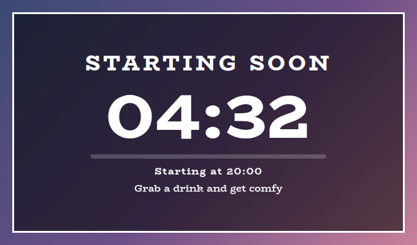
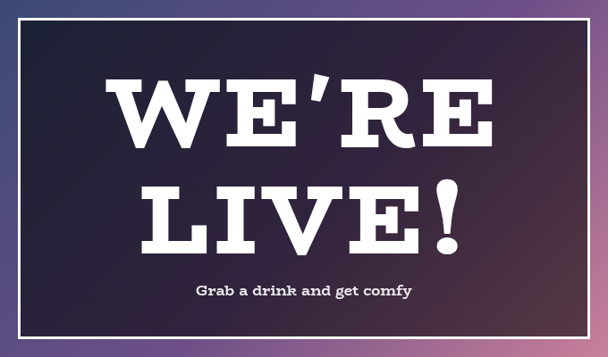
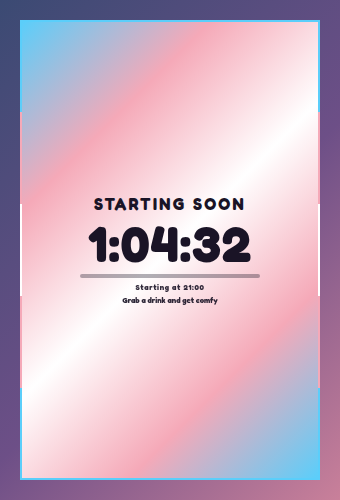
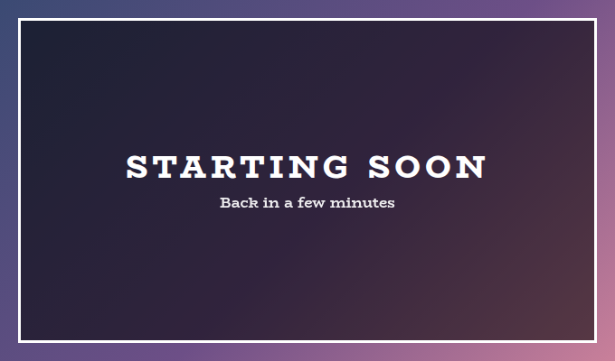
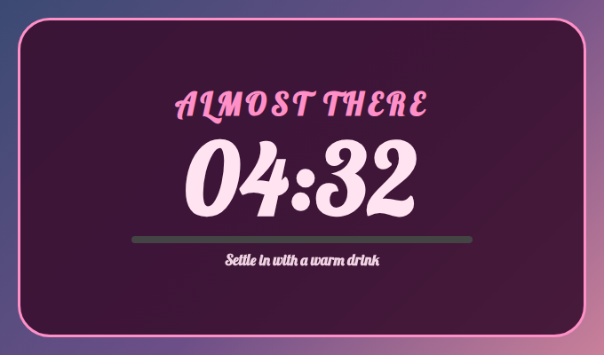
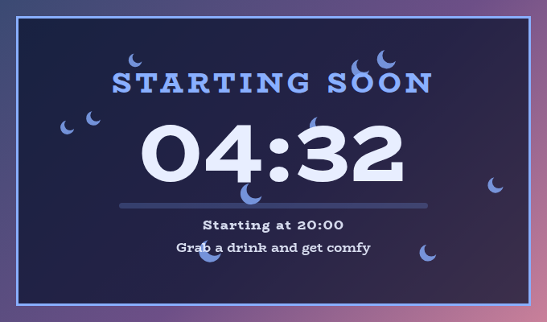
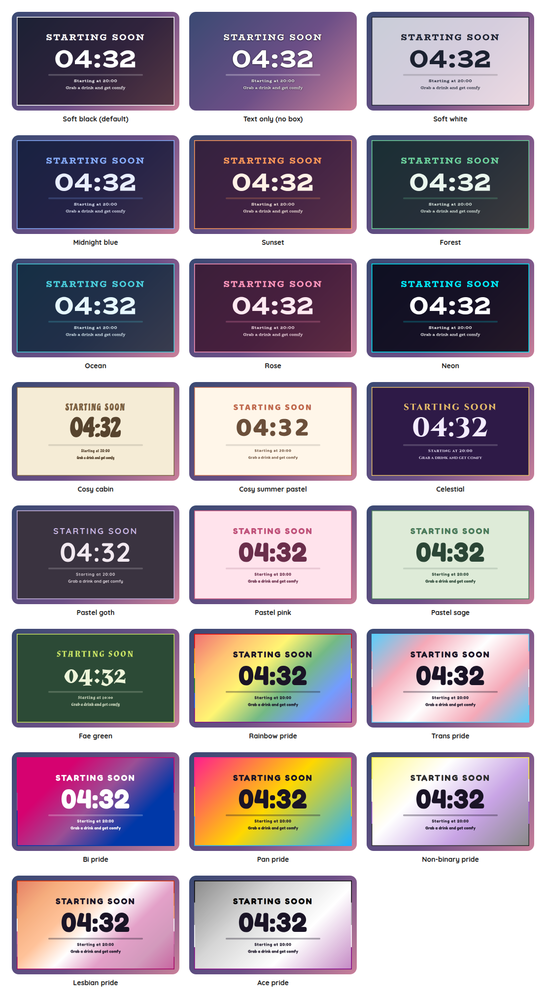

# Stream Start Countdown Overlay

A StreamElements custom widget for the minutes before you go live. Type `!countdown 10m`, or `!countdown at 20:30`, and a big clock counts down on a "Starting soon" screen with a bar that fills as it goes, the time you start, and a few friendly lines that take turns underneath. When it reaches zero the headline changes to "We're live!" and stays until you clear it.

<p align="center"></p>

It is a single self-contained widget in plain JavaScript, with no dependencies and nothing to install. It is designed around a full 1920 by 1080 scene, and it stretches to any box you draw for it.

## Features

- Set from chat: `!countdown 10m`, or a time of day with `!countdown at 20:30` or `at 8pm`.
- Made for a full screen, and happy in any box: every size is a share of the box's width at 16 by 9, or of its height if the box is short for its width, so it never runs off the edge in a square, a tall strip or a small window.
- A clock, a bar and the start time: the clock counts down, the bar fills, and "Starting at 20:00" says when, on a 24-hour or 12-hour clock.
- Lines that take turns: "Grab a drink and get comfy", "Say hi in chat", or whatever you like, changing every few seconds.
- A last-seconds pulse: the clock turns the alert colour for its final ten seconds, or never, as you prefer.
- A headline for when you are live: "We're live!" takes over the screen at zero, with an optional sound.
- Changed while it runs: `add 5m` when you need a little longer, `less 1m`, `live` to go now, `stop` to start again.
- A card on its own too: with no countdown set it is just the headline and the lines, which suits a screen that says "Back soon".
- Moderator control: the streamer, and by default moderators, can run it. Viewers cannot.
- Saved: the time is kept as a moment, so a refresh, or closing OBS for a minute, does the right thing.
- Customisable: around 45 settings cover the wording, sizes, colours, fonts, sounds and animation.
- Tests and a dev harness: a local harness with a time machine and an automated test script.
- An outer frame in the accent colour, on by default in every preset, and switched off with one checkbox (the flag's stripes in the pride presets).
- Decorations: sparkles, hearts, stars, flowers, moons, snowflakes, bubbles, butterflies, clouds, leaves, paw prints, music notes or bows behind the words, scattered, along the edges, in the corners, a little way in from the corners or on the border, in the accent colour, a pride flag's colours or a colour of your own, twinkling, drifting or still. Off by default.

## Screenshots

**When you are live.** At zero the headline takes the clock's place.

<p></p>

**Stretched.** It adapts to the box you give it. Here it is a tall, narrow box in the trans pride preset.

<p></p>

**Just the headline.** With no countdown set, it is a card with a headline and your lines.

<p></p>

**Your own look.** Choose Custom for the style preset and every colour, the font, the corners and the wording are settings.

<p></p>

## Quick start

1. In StreamElements, edit your overlay and add **+ Add Widget, Static/Custom, Custom Widget**.
2. Select the widget, open **Settings, Open Editor**, and paste each file from `widget/` into the matching tab: `widget.html` into HTML, `widget.css` into CSS, `widget.js` into JS, and `fields.json` into Fields.
3. Click **Done**. The settings are grouped into Commands, Countdown, Messages, Size, Manual controls, Look, Custom colours, Sounds and Troubleshooting.
4. Make the widget as big as your scene, 1920 by 1080 for a full screen, and put it at the front of a "Starting soon" scene with your own background behind it.

The widget reads Twitch chat through StreamElements, so it works as soon as it is on an active overlay.

## Chat commands

The command word is a setting. Viewers can type the bare `!countdown` to make the headline pop, and everything else needs the broadcaster or, by default, a moderator.

| Command | What it does |
| --- | --- |
| `!countdown 10m` | Starts a countdown that ends in ten minutes. |
| `!countdown at 20:30` | Starts one that ends at the next 20:30 on the computer running the overlay. `8pm` and `8:30 pm` work too. |
| `!countdown start` | Starts one of the default length. `start 15m` gives its own length. |
| `!countdown add 5m` | Pushes the start back by five minutes. Adding to a countdown that is not running starts one. |
| `!countdown less 2m` | Brings the start forward by two minutes. |
| `!countdown live` | Goes live now. `now` does the same. |
| `!countdown stop` | Clears the countdown and goes back to the headline. `clear` does the same. |

**Writing a length of time.** `90s`, `10m`, `1h30m`, `1d`, `1.5h`, `1:30:00` (hours, minutes, seconds), `5:00` (minutes and seconds), or a bare number, which is minutes. A countdown can be set up to two days ahead.

**Writing a time of day.** After `at`, a 24-hour time such as `20:30`, or an am or pm one such as `8pm` or `8:30 pm`. If that time has already passed today, it means tomorrow. A bare number is not a time of day, since a bare number is minutes everywhere else.

## Going live

When the clock reaches zero the headline changes to the words in **What the headline says when the countdown reaches zero**, "We're live!" by default, and the clock, bar and start time go. A sound can play once as it happens. It stays like that until you start another countdown or `stop` it, so you can leave the scene up as long as you like, and a refresh will not bring the clock back.

A countdown that ran out while the overlay was closed shows as live as soon as it loads, and stays quiet, since the moment has passed.

## The rotating lines

Under the clock, a line from your list takes its turn every few seconds, fading in as it arrives. Write them in the **Lines that rotate** setting, separated by a vertical bar: `Grab a drink and get comfy | Say hi in chat | Be kind to each other`. One line stays still, and a blank setting leaves the space out.

**Decorations.** Moons behind the words, here in the Midnight blue preset.

<p></p>

## Style presets

One setting picks the look. The same twenty-two presets, with the same colours, are in every overlay in this set, so overlays from this set match whichever you choose. This is how each one looks in this overlay. The presets are defined once, in the [kit](../../kit), and a test keeps this overlay in step with it.

<p></p>

| Preset | Look |
| --- | --- |
| Soft black (default) | See-through black with white text. |
| Soft white | Frosted white with dark text. |
| Midnight blue | Deep navy with a periwinkle accent. |
| Sunset | Deep plum with orange and coral. |
| Forest | Deep green with a mint accent. |
| Ocean | Deep teal with an aqua accent. |
| Rose | Deep berry with a pink accent. |
| Neon | Near black with cyan and magenta. |
| Cosy cabin | Cream and brown, in Chicle. |
| Cosy summer pastel | Warm cream and coral, in Baloo 2. |
| Celestial | Deep purple and gold, in Cinzel. |
| Pastel goth | Charcoal and lilac, in Quicksand. |
| Pastel pink | Soft blush pink with rose, in Fredoka. |
| Pastel sage | Soft sage green with deep green, in Fredoka. |
| Fae green | Mossy green with a firefly lime accent, in Almendra. |
| Rainbow pride | A soft wash of the six rainbow stripes, in Fredoka. |
| Trans pride | Light blue, pink and white. |
| Bi pride | Magenta, purple and blue, with white text. |
| Pan pride | Pink, yellow and light blue. |
| Non-binary pride | Yellow, white, purple and black, softened so the text stays readable. |
| Lesbian pride | The orange to pink stripes. |
| Ace pride | Black, grey, white and purple, softened so the text stays readable. |

The last seven are pride presets, built from the stripes of the rainbow, trans, bi, pan, non-binary, lesbian and ace flags. The card or panel wears the flag as its background, with only as much of a wash over it as the text needs to stay readable, so flags with a black stripe come out softer. A bar is striped like the flag where an overlay has one, and the slices of a wheel and the options of a poll take their colours from the stripes in order. The colours follow each flag's published design,.

Choose **Custom** to use the colour pickers and font instead. They are ignored while a preset is chosen.

## Configuration

Every setting has a plain label in StreamElements, grouped as follows.

| Group | What it covers |
| --- | --- |
| Commands | The command word and who may use it. |
| Countdown | The default length, the headline for when you are live, whether and how the start time shows, the bar, and the last-seconds pulse. |
| Messages | The rotating lines and how long each stays. |
| Size | The clock, headline, line and start time sizes, the bar's thickness and the space between the parts, all in units of the box. |
| Manual controls | Buttons to start, add five minutes, take a minute off, go live and clear. |
| Look | Headline, the style preset, font, boldness, corners, outer frame, outline, shadow and Animate. |
| Custom colours | Panel, text, accent, bar and alert colours, used when the style preset is Custom. A checkbox there also lets the Panel opacity apply to any preset, not only Custom. |
| Decorations | The shape, where they go, how many, how big, how solid (the Decoration opacity, which is its own setting and not the panel's, and 1 is fully solid), their colour, and how they move. |
| Sounds | A sound and volume for the moment you go live, with a Test button and a master mute. |
| Troubleshooting | A debug log of every event to the browser-source console. |

**Sizes.** A unit is a hundredth of the box's width at 16 by 9, so the default clock, 17 units, is a little under a fifth of a 1920 by 1080 screen. In a box that is short for its width, a unit is smaller so that everything still fits.

The overlay's panel is the whole box, with square corners by default, so it works as a full-screen scene. Put your own background picture or video underneath it in OBS and the translucent panel will sit over it.

The **outer frame** is a border round the widget in the preset's accent colour, on by default in every preset. Untick **An outer frame** under Look for none, or set the outline thickness to change how thick it is, since at 0 it has a default thickness that grows with the box. In a pride preset the frame is the flag's stripes, as a ring that follows the panel's corners.

The **decorations** are small shapes drawn behind the words: sparkles, hearts, stars, flowers, moons, snowflakes, bubbles, butterflies, clouds, leaves, paw prints, music notes, bows, or a mix of sparkles, hearts and stars. Choose one under **Decorations**, then where they go (scattered, along the inside of the edges, in the corners, a little way in from the corners (a couple of small shapes dotted near the top right and bottom right is a gentle look), or on the border with half of each outside it), how many (up to 24), how big, how solid, and whether they twinkle in place, drift upwards or stay still. They take the accent colour, or in a pride preset the colours of the flag in turn, or you can ask for the text colour, both in turn, or a colour of your own. On the border they need a little room round the widget in its box, since StreamElements shows only what is inside the box, and a panel that fills its box has none. Here the panel pulls in a little when they are on the border, so the outer halves show. Twinkling dips a little and drifting fades in and out, so choose Stay still, or turn Animate off, to keep them fully solid. With Animate off they stay still. They are off by default. They are scattered over the whole screen, behind the clock.

The full list, with defaults, is in [`widget/fields.json`](widget/fields.json). The colour and font pickers apply only when the style preset is **Custom**.

## Local development

There is no build step and no dependencies. Serve this overlay's folder and open the dev harness:

```sh
npm run dev
# then open http://localhost:8000/dev/
```

The harness stands in for StreamElements. It sends chat commands as a viewer, moderator or broadcaster, with quick buttons for the common ones. A **time machine** skips the clock forward, so a countdown ten minutes long runs out in a click. Its **Every setting** section is generated from `widget/fields.json`, so it offers exactly what StreamElements will.

At the top of the harness, **Look and export** switches the style preset on the live widget, and can download or copy a `fields.json` with your current settings as its defaults. Paste that into the Fields tab of a new custom widget in StreamElements and it starts out looking the way it does here.

The **Design** panel under the copy buttons carries a look from one overlay to the next, so it only has to be set up once. Set the style preset, font, colours, shape, frame and decorations here, press **Save this design**, then open another overlay's dev page and press **Use saved design**. It can also be copied, downloaded as `design.json` or pasted in, and **Use my saved design whenever I open an overlay** applies it for you. Only the design travels, so each overlay's own wording and behaviour settings are left as they are, and anything an overlay does not have is skipped.

The **box-size bar** at the bottom of the stage sets the size of the widget's box in pixels, from two number boxes or a list of common sizes, and remembers it for next time. A StreamElements widget fills whatever box you draw for it, so drawing it in different boxes is the quickest way to see how it behaves. It is the same bar on every overlay's dev page.

The harness must be served over http rather than opened as a file, and fonts come from Google Fonts. It also shows a Ko-fi support button in the corner. That button belongs to the harness only and is not part of the widget, so it never appears on stream.

## Testing

```sh
npm test
```

This runs the real `widget/widget.js` headlessly against a small mock of the page and StreamElements, with a clock the test controls, and exits non-zero on any failure. It covers every way of writing a length of time or a time of day, changing and clearing a countdown, the bar, the rotating lines, who may do what, a countdown that ran out while the overlay was closed, the sound, every look setting and saving across a refresh. It also checks the style presets against the shared palette, and that every setting in `fields.json` is read by the widget and every button does something.

## Project layout

```
widget/   the widget: HTML, CSS, JS and the StreamElements fields
dev/      the local dev harness
test/     the automated tests
docs/     screenshots used in this README
```

## Compatibility and limitations

The widget uses the StreamElements events `onWidgetLoad` and `onEventReceived` with `message` and `widget-button`, and `SE_API.store`.

The countdown is timed by the clock of the computer running the overlay, and so is a time of day such as `20:30`. If you stream from one computer and your chat commands are read on another, they still agree, because the time is saved as a moment and not as a number of seconds left.

A StreamElements widget can read chat but cannot write to it, so a command gives no reply in chat. You will see the clock change on screen straight away.

The JavaScript is plain ES5, so it can be pasted straight into the StreamElements editor.

## Related overlays

These overlays share the same default look and the same twenty-two style presets, so they sit together on one stream.

- [Rotating Panel Overlay](../rotating-panel): socials and chat commands that take turns on one panel.
- [Reminder Overlay](../reminder): reminders you set from chat, which stay on screen until cleared.
- [Sub Goals Overlay](../sub-goals): sub and bits goals that fill as chat reaches them.
- [Subathon Overlay](../subathon): a subathon clock with a cap, power-ups and sub goals.
- [Spin Wheel Overlay](../spin-wheel): a wheel for giveaways, raffles and forfeits.
- [Chat Poll Overlay](../chat-poll): quick polls voted on by typing an option.
- [Squat Tracker Overlay](../squat-tracker): a running count driven by gifted sub bombs.
- [Rage Bar Overlay](../rage-bar): a bar chat fills with subs, bits and channel points.
- [Chat Counter Overlay](../counter): a counter chat commands change, for deaths, wins and anything else.
- [Leaderboard Overlay](../leaderboard): top gifters, cheerers and tippers.
- [Hype Meter Overlay](../hype-meter): a meter that chat activity fills, with levels.
- [Recent Activity Overlay](../recent-activity): the latest subs, gifts, bits, tips, follows and raids.
- [Stream Goals Overlay](../stream-goals): sub and bits goals that start again for each stream.
- [Chat Feed Overlay](../chat-feed): on-screen chat with profile pictures and pronouns.
- [Camera Overlay](../camera): a framed window for your camera with a nameplate, and a cover that you and your moderators control from chat.
- [Now Playing Overlay](../now-playing): what you are playing, from Last.fm, Tuna, Spotify or Pear Desktop, with album art and a progress bar.

## Support

If this saves you time, you can support its development on Ko-fi:

[](https://ko-fi.com/journeyingjordan)

Thanks for using it.

## Contributing

Contributions are welcome. See [CONTRIBUTING.md](../../CONTRIBUTING.md).

## License

[MIT](../../LICENSE). The copyright notice, including the Ko-fi link, must be kept in copies and substantial portions of the code.
