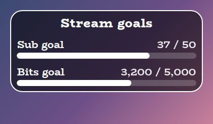
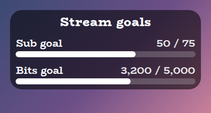
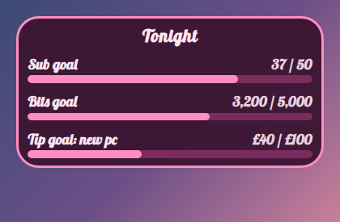
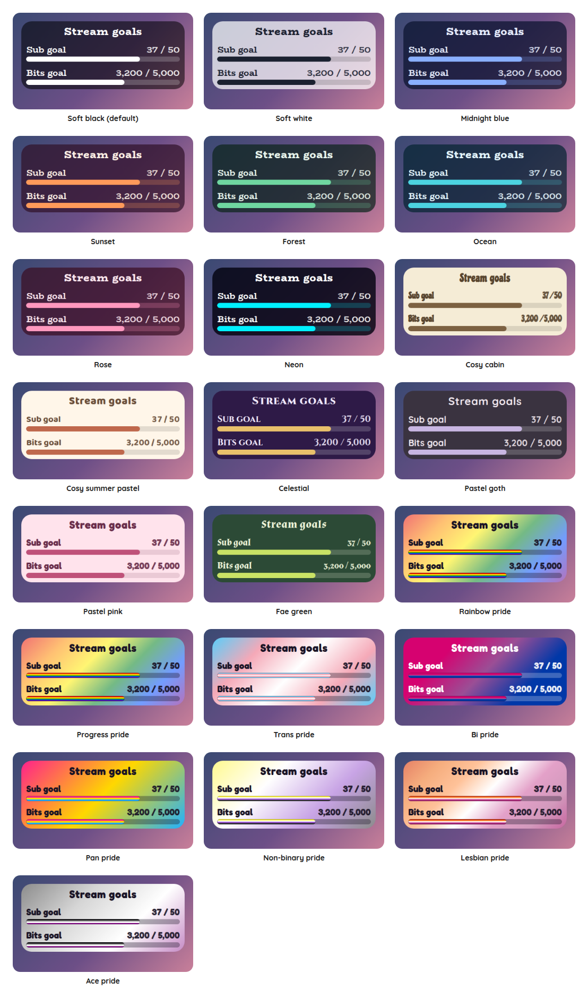

# Stream Goals Overlay

A StreamElements custom widget that shows this stream's goals, such as 50 new subs and 5,000 bits, with a bar for each. It starts again by itself for every new stream, so you never have to remember to reset it, and when a goal is reached it can raise itself to a stretch goal.

<p align="center"></p>

It is a single self-contained widget in plain JavaScript, with no dependencies and nothing to install. For named goals that unlock rewards, such as "15 subs unlocks chat confessions", see the [Sub Goals Overlay](../sub-goals).

## Features

- Starts again for each stream: it notices a quiet gap between streams and begins afresh, or it can reset only when you ask, or on every load (see [Starting again](#starting-again)).
- Subs and bits: with optional tip and follow goals, each with its own label, goal and bar, and each switched on or off as you need, so only the goals you want take up room on screen.
- A donation goal: switch on the tip goal and name it for what it is for, such as "Tip goal: new pc". It counts money written your way: the symbol before or after the amount, a comma or a point for the decimal, and cents shown or not. Switch off the others if the donation goal is all you want.
- Gift bombs counted once: a gift of 10 counts 10, not once per recipient (see [How counting works](#how-counting-works)).
- Stretch goals: when a goal is reached it celebrates, then raises itself by an amount you choose, and carries on.
- Sub points: optionally count tier 2 as 2 and tier 3 as 6, as Twitch does.
- Chat control: set or adjust a count, reset, pause and resume from chat.
- Wording: the labels, how a count reads and the reached text are settings, and each goal can be named for what it is for, so it reads "Tip goal: new pc".
- Sounds: optional sounds for progress and for a goal being reached.
- Customisable: around 55 settings cover the goals, wording, sizes, shape, outline, colours, fonts, sounds and animation.
- Saved: the counts survive a browser-source refresh.
- Tests and a dev harness: a local harness with a time machine and an automated test script, so a new stream can be simulated in a click.

## Screenshots

**Reaching a goal.** A goal that is reached says so, and then raises itself if you have set a stretch amount.

<p></p>

**Your own look.** Choose Custom for the style preset and every colour, the font, the outline and the wording are settings.

<p></p>

## Style presets

One setting picks the look. The same twenty-two presets, with the same colours, are in every overlay in this set, so overlays from this set match whichever you choose. This is how each one looks in this overlay. The presets are defined once, in the [kit](../../kit), and a test keeps this overlay in step with it.

<p></p>

| Preset | Look |
| --- | --- |
| Soft black (default) | See-through black with white text. |
| Soft white | Frosted white with dark text. |
| Midnight blue | Deep navy with a periwinkle accent. |
| Sunset | Deep plum with orange and coral. |
| Forest | Deep green with a mint accent. |
| Ocean | Deep teal with an aqua accent. |
| Rose | Deep berry with a pink accent. |
| Neon | Near black with cyan and magenta. |
| Cosy cabin | Cream and brown, in Chicle. |
| Cosy summer pastel | Warm cream and coral, in Baloo 2. |
| Celestial | Deep purple and gold, in Cinzel. |
| Pastel goth | Charcoal and lilac, in Quicksand. |
| Pastel pink | Soft blush pink with rose, in Fredoka. |
| Pastel sage | Soft sage green with deep green, in Fredoka. |
| Fae green | Mossy green with a firefly lime accent, in Almendra. |
| Rainbow pride | A soft wash of the six rainbow stripes, in Fredoka. |
| Trans pride | Light blue, pink and white. |
| Bi pride | Magenta, purple and blue, with white text. |
| Pan pride | Pink, yellow and light blue. |
| Non-binary pride | Yellow, white, purple and black, softened so the text stays readable. |
| Lesbian pride | The orange to pink stripes. |
| Ace pride | Black, grey, white and purple, softened so the text stays readable. |

The last seven are pride presets, built from the stripes of the rainbow, trans, bi, pan, non-binary, lesbian and ace flags. The card or panel wears the flag as its background, with only as much of a wash over it as the text needs to stay readable, so flags with a black stripe come out softer. A bar is striped like the flag where an overlay has one, and the slices of a wheel and the options of a poll take their colours from the stripes in order. The colours follow each flag's published design,.

Choose **Custom** to use the colour pickers and font instead. They are ignored while a preset is chosen.

## Quick start

1. In StreamElements, edit your overlay and add **+ Add Widget, Static/Custom, Custom Widget**.
2. Select the widget, open **Settings, Open Editor**, and paste each file from `widget/` into the matching tab: `widget.html` into HTML, `widget.css` into CSS, `widget.js` into JS, and `fields.json` into Fields.
3. Click **Done**. The settings are grouped into Commands, Resetting, Subs goal, Bits goal, Tips goal, Follows goal, Counting, Sizes, Manual controls, Look, Custom colours, Sounds and Troubleshooting.
4. Size and position the widget. The text and bars scale with the box, and the card grows with the number of goals you show. If the box is too short for everything, the card shrinks to fit instead of running off the bottom (untick **Shrink to fit the box** under Look to turn that off).

The widget reads Twitch chat and events through StreamElements, so it works as soon as it is on an active overlay.

## How counting works

- **Subs.** A new sub, a resub and a gifted sub each count one. A resub counts once however many months it was for. Tick **Count Twitch sub points** if you would rather tier 2 counted 2 and tier 3 counted 6.
- **Gift bombs.** StreamElements reports a gift bomb as one announcement where `amount` is the real number of subs, then one follow-up per recipient where `amount` is a streak or lifetime figure (for example 170). The widget counts only the announcement, so a gift of 10 counts 10.
- **Bits.** Every cheer adds its bits.
- **Tips and follows.** Tips add their amount, in the currency of your StreamElements account, and each follow adds one. Both are switched off until you show their goals. Tips are kept to the cent, so a run of small ones adds up to exactly what was given, and there is no conversion between currencies: a tip in another one counts at the amount StreamElements reports. Bits, subs, follows and raids never count towards the tip goal.

Tick **debug** in Troubleshooting to log every event to the browser-source console.

## Starting again

A StreamElements widget cannot tell when you go live, so it works it out from quiet. While it is running it notes every 30 seconds that it is alive. When it loads, if it was last seen more than the **quiet gap** ago (6 hours by default), that was a different stream and the goals start at zero. If the overlay is simply left open between streams, the first event after a gap that long starts the new stream first, then counts.

That means a refresh in the middle of a stream, or OBS restarting, keeps your counts, while the next day's stream starts fresh. If you would rather decide yourself, set **When the goals start again** to *Only when I reset them*, or to *Every time the widget loads*. `!goals reset` and the **Start every goal again** button work in every mode.

## Stretch goals

Each goal has a **raise** amount. When the goal is reached it shows the reached text for a few seconds, then the goal goes up by that amount and the bar continues. A gift big enough to pass several goals at once raises it past all of them. Set the raise to 0 and the goal stays reached, with the bar full.

## Chat commands

The command word is a setting. Viewers can type the bare `!goals` to make the title pop, and everything else needs the broadcaster or, by default, a moderator.

| Command | What it does |
| --- | --- |
| `!goals set subs 30` | Sets a count. Use `subs`, `bits`, `tips` or `follows`. |
| `!goals add bits 500` | Adds to a count. A negative number takes some off. |
| `!goals add tips 5.50` | Adds money to the tip goal. |
| `!goals reset` | Starts every goal again. |
| `!goals pause` and `!goals resume` | Stops and starts counting, for example before you go live. |

An amount is a number: `500`, `5.50` or `5,50`. For tips it can also have a currency sign in front or behind, such as `$5`, or the symbol you set for tips, such as `5 kr`. Anything else is refused and changes nothing, and is never guessed at. That includes `1,250` (a comma could mean a thousands separator or a decimal, and a wrong guess would add the wrong number), `1e3` and `1k`.

## Configuration

Every setting has a plain label in StreamElements, grouped as follows.

| Group | What it covers |
| --- | --- |
| Commands | The command word and who may use it. |
| Resetting | When the goals start again, and how many quiet hours mean a new stream. |
| Subs goal, Bits goal, Tips goal, Follows goal | Whether to show it, its label, what it is for (shown after the label), its goal and its raise amount. |
| Counting | Sub points, how a count reads, the currency symbol and where it goes, the decimal and whether cents show, the reached text and how long it shows before a raise. |
| Sizes | Text, title and bar sizes, and the space between goals. |
| Manual controls | Buttons to start again, pause and resume. |
| Look | Title, the style preset, font, boldness, corners, padding, outline, shadow, Animate and whether it shrinks to fit the box. |
| Custom colours | Panel, text, accent, bar and alert colours, used when the style preset is Custom. |
| Sounds | A sound and volume for progress and for a goal being reached, with Test buttons and a master mute. |
| Troubleshooting | A debug log of every event to the browser-source console. |

The full list, with defaults, is in [`widget/fields.json`](widget/fields.json). The colour and font pickers apply only when the style preset is **Custom**.

## Local development

There is no build step and no dependencies. Serve this overlay's folder and open the dev harness:

```sh
npm run dev
# then open http://localhost:8000/dev/
```

The harness stands in for StreamElements. It sends subs, gifted subs, gift bombs of any size (with the per-recipient follow-ups StreamElements sends), bits, tips and follows, and chat commands as a viewer, moderator or broadcaster. A **time machine** skips the clock forward, so you can check how a long gap starts a new stream. Its **Every setting** section is generated from `widget/fields.json`, so it offers exactly what StreamElements will.

At the top of the harness, **Look and export** switches the style preset on the live widget, and can download or copy a `fields.json` with your current settings as its defaults. Paste that into the Fields tab of a new custom widget in StreamElements and it starts out looking the way it does here.

The **box-size bar** at the bottom of the stage sets the size of the widget's box in pixels, from two number boxes or a list of common sizes, and remembers it for next time. A StreamElements widget fills whatever box you draw for it, so drawing it in different boxes is the quickest way to see how it behaves. It is the same bar on every overlay's dev page.

The harness must be served over http rather than opened as a file, and fonts come from Google Fonts. It also shows a Ko-fi support button in the corner. That button belongs to the harness only and is not part of the widget, so it never appears on stream.

## Testing

```sh
npm test
```

This runs the real `widget/widget.js` headlessly against a small mock of the page and StreamElements, with a clock the test controls, and exits non-zero on any failure. It covers every way of counting including the gift bomb case, reaching and raising goals, starting again after a gap, in manual mode and on every load, every chat command and permission, saving across a refresh, every look setting and the sounds. It also checks the style presets against the shared palette, and that every setting in `fields.json` is read by the widget and every button does something.

## Project layout

```
widget/   the widget: HTML, CSS, JS and the StreamElements fields
dev/      the local dev harness
test/     the automated tests
docs/     screenshots used in this README
```

## Compatibility and limitations

The widget uses the StreamElements events `onWidgetLoad` and `onEventReceived` with `message`, `subscriber-latest`, `cheer-latest`, `tip-latest`, `follower-latest` and `widget-button`, and `SE_API.store`.

It cannot see when a stream starts, so a new stream is recognised by a quiet gap. If you stream twice within the gap (two sessions in one day, say), the second continues the first's counts unless you reset it, or shorten the gap, with `!goals reset`. The gap only has to be shorter than the time between your streams and longer than any pause inside one.

Time only counts while the widget is running. A browser source that is closed does not note that it is alive, which is what lets the next load see the gap.

A StreamElements widget can read chat but cannot write to it, so `!goals` makes the title pop rather than replying.

The JavaScript is plain ES5, so it can be pasted straight into the StreamElements editor.

## Related overlays

These overlays share the same default look and the same twenty-two style presets, so they sit together on one stream.

- [Sub Goals Overlay](../sub-goals): sub and bits goals that fill as chat reaches them.
- [Subathon Overlay](../subathon): a subathon clock with a cap, power-ups and sub goals.
- [Spin Wheel Overlay](../spin-wheel): a wheel for giveaways, raffles and forfeits.
- [Chat Poll Overlay](../chat-poll): quick polls voted on by typing an option.
- [Squat Tracker Overlay](../squat-tracker): a running count driven by gifted sub bombs.
- [Rage Bar Overlay](../rage-bar): a bar chat fills with subs, bits and channel points.
- [Chat Counter Overlay](../counter): a counter chat commands change, for deaths, wins and anything else.
- [Leaderboard Overlay](../leaderboard): top gifters, cheerers and tippers.
- [Hype Meter Overlay](../hype-meter): a meter that chat activity fills, with levels.
- [Recent Activity Overlay](../recent-activity): the latest subs, gifts, bits, tips, follows and raids.
- [Reminder Overlay](../reminder): reminders you set from chat, which stay on screen until cleared.
- [Chat Feed Overlay](../chat-feed): on-screen chat with profile pictures and pronouns.
- [Over Camera Overlay](../over-camera): a cover for your camera that you and your moderators control from chat.
- [Under Camera Overlay](../under-camera): a nameplate for under your camera, with your name, pronouns and rotating lines.
- [Now Playing Overlay](../now-playing): what you are playing, from Last.fm, Tuna, Spotify or Pear Desktop, with album art and a progress bar.

## Support

If this saves you time, you can support its development on Ko-fi:

[](https://ko-fi.com/journeyingjordan)

Thanks for using it.

## Contributing

Contributions are welcome. See [CONTRIBUTING.md](../../CONTRIBUTING.md).

## License

[MIT](../../LICENSE). The copyright notice, including the Ko-fi link, must be kept in copies and substantial portions of the code.
