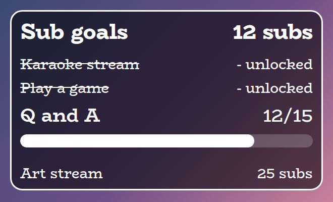
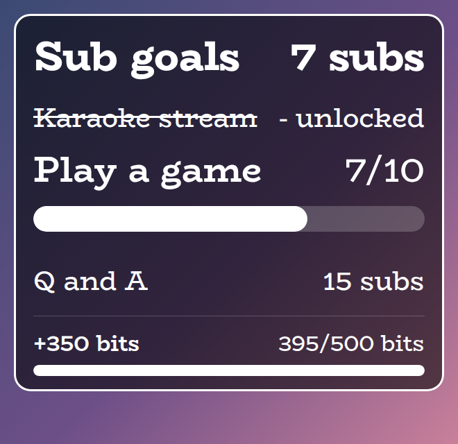
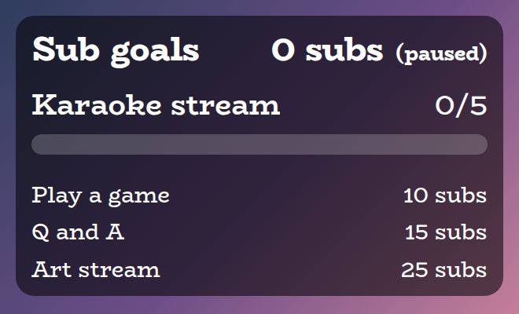
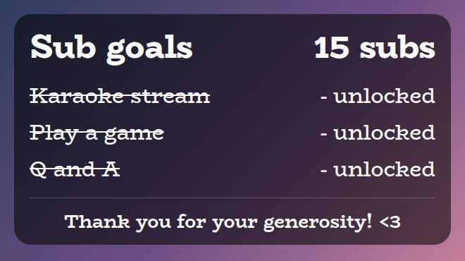
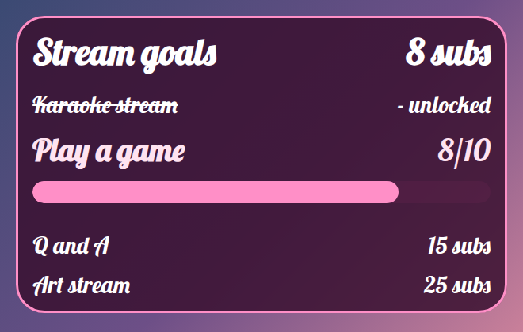
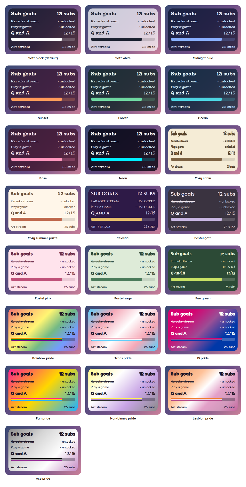

# Sub Goals Overlay

A StreamElements custom widget that shows the goals chat is working towards, such as "5 subs unlocks karaoke", with a progress bar that fills as subs, bits and tips arrive.



Goals are added live from chat with `!incentive add 15 chat confessions`. The widget is plain JavaScript with no dependencies and nothing to install, and almost everything about how it looks and what it says can be changed from the StreamElements settings.

## Features

- Live goals: add, remove and clear goals from chat, with several shown at once.
- Progress: the goal being worked on gets the biggest line and a progress bar, while the others condense to a single line. Reached goals celebrate, then stay on screen struck through.
- Subs and bits: new subs, resubs and gifted subs all count, and bits convert at a rate you choose, with leftovers carried over. The bits bar takes a few seconds to calculate, so chat can watch it happen.
- Tips: tips from StreamElements convert at a rate you choose in your channel's currency (5 to a sub by default), with leftovers carried over and the same strip as bits, so a direct donation moves the goals too.
- Sounds: optional sounds for a sub, for bits and for a goal being reached.
- Pause and resume: stop counting before a stream starts and start it when you go live.
- Scales to its box: text scales with the space the widget is given in StreamElements, and long goal names shrink to fit rather than wrapping or being cut off.
- Customisable: more than 80 settings cover wording, colours, fonts, sizes, spacing, sounds and the chat command words.
- Testable offline: a local dev harness and an automated test script, no live stream needed.

## Screenshots

The overlay sits over your scene with a see-through panel. These are all taken from the local dev harness, with the default settings unless noted.

**Bits turning into a sub.** A cheer shows a chip and a bar that fills over a few seconds while the number counts up. When the bar fills it flashes the subs it made, then drops back to show the bits left over.

<p></p>

**Tracking paused.** `!incentive stop` ignores new subs and bits, so goals can be set up before going live. A note appears beside the count.

<p></p>

**Every goal reached.** Reached goals stay on screen, struck through, and a thank-you message appears at the bottom.

<p></p>

**Your own look.** Colours, fonts, wording, outline, shadow and spacing are all settings. This one uses a pink theme, a different font for the title, and "gifts" in place of "subs".

<p></p>

## Style presets

One setting picks the look. The same twenty-one presets, with the same colours, are in every overlay in this set, so overlays from this set match whichever you choose. This is how each one looks in this overlay. The presets are defined once, in the [kit](../../kit), and a test keeps this overlay in step with it.

<p></p>

| Preset | Look |
| --- | --- |
| Soft black (default) | See-through black with white text. |
| Soft white | Frosted white with dark text. |
| Midnight blue | Deep navy with a periwinkle accent. |
| Sunset | Deep plum with orange and coral. |
| Forest | Deep green with a mint accent. |
| Ocean | Deep teal with an aqua accent. |
| Rose | Deep berry with a pink accent. |
| Neon | Near black with cyan and magenta. |
| Cosy cabin | Cream and brown, in Chicle. |
| Cosy summer pastel | Warm cream and coral, in Baloo 2. |
| Celestial | Deep purple and gold, in Cinzel. |
| Pastel goth | Charcoal and lilac, in Quicksand. |
| Pastel pink | Soft blush pink with rose, in Fredoka. |
| Fae green | Mossy green with a firefly lime accent, in Almendra. |
| Rainbow pride | A soft wash of the six rainbow stripes, in Fredoka. |
| Trans pride | Light blue, pink and white. |
| Bi pride | Magenta, purple and blue, with white text. |
| Pan pride | Pink, yellow and light blue. |
| Non-binary pride | Yellow, white, purple and black, softened so the text stays readable. |
| Lesbian pride | The orange to pink stripes. |
| Ace pride | Black, grey, white and purple, softened so the text stays readable. |

The last seven are pride presets, built from the stripes of the rainbow, trans, bi, pan, non-binary, lesbian and ace flags. The card or panel wears the flag as its background, with only as much of a wash over it as the text needs to stay readable, so flags with a black stripe come out softer. A bar is striped like the flag where an overlay has one, and the slices of a wheel and the options of a poll take their colours from the stripes in order. The colours follow each flag's published design,.

Choose **Custom** to use the colour pickers and font instead. They are ignored while a preset is chosen.

## Quick start

1. In StreamElements, add a **Custom widget** to your overlay and open its editor.
2. Paste `widget/widget.html` into the HTML tab, `widget/widget.css` into CSS and `widget/widget.js` into JS.
3. Open the Fields tab and paste in the contents of `widget/fields.json`.
4. Resize the widget box on the canvas. The text scales with the box, so it looks the same at any size. About 620 by 560 pixels suits four goals.
5. Use the **Add examples** button in Manual controls to check the look, or add goals from chat.

If you prefer to import, run `npm run build` to generate `dist/incentives.overlay.json`. StreamElements does not document its overlay import format, so pasting the files in (above) is the reliable route.

## Chat commands

The command word is `!incentive` by default. The broadcaster and moderators can use everything except showing the panel, and the broadcaster alone can be chosen in the settings. Every word below can be renamed in the settings.

| Command | What it does |
| --- | --- |
| `!incentive add 15 chat confessions` | Adds a goal: the number of subs needed, then its name. |
| `!incentive remove 2` | Removes the second goal in the order shown. |
| `!incentive remove karaoke` | Removes the nearest goal whose name contains that text. |
| `!incentive clear` | Removes every goal. |
| `!incentive subs +3` | Adjusts the sub count. Also `-3`, `set 12` and `=12`. |
| `!incentive bits +500` | Adds bits from somewhere else. They use your bits rate and play the bits animation. |
| `!incentive reset` | Sets the count back to zero and re-opens every goal, ready for a new stream. |
| `!incentive tip 5` | Adds a tip from somewhere else (`12.50` or `$12.50`). It uses your tip rate and plays the strip. |
| `!incentive stop` | Pauses tracking. New subs and bits are ignored until you start it again. |
| `!incentive start` | Resumes tracking. |
| `!incentive` or `!incentive list` | Shows the panel. Anyone can use this. |

A widget can read chat but cannot write to it, so `!incentive list` only shows the panel. A StreamElements chatbot command can reply in chat if you would like the goals read out.

## How counting works

Every sub counts as one: a new sub, a resub, a Prime sub and a single gifted sub each add one. A gift bomb adds the number of subs that were gifted.

StreamElements reports a gift bomb as several events. One announcement carries the real number of subs, and then one follow-up per recipient carries a streak or lifetime figure (for example 170) in the same `amount` field. The widget counts the announcement and ignores the follow-ups, so a bomb of 10 moves the total by 10 and not by 1,710.

Bits count at 500 to a sub by default. A cheer too small to make a whole sub is kept, so 300 bits followed by another 300 makes one sub with 100 left over. A rate of 0 switches bits off.

Tips work the same way. The tip rate is an amount in your channel's currency (the figure StreamElements sends with the tip), 5 to a sub by default, so a 3 followed by another 3 makes one sub with 1 left over. Bits and tips keep separate leftovers. A rate of 0 switches tips off. The currency symbol in the strip is a setting too: it can go before the amount (`$5`) or after it (`5€`, or `5 kr` for a word, which gets a space), and the decimal can be a comma (`5,50`). These change only how the strip reads, not how a tip is counted.

If a count ever looks wrong on a live stream, tick **Log each subscriber and cheer event** in the Troubleshooting settings. Each event is then logged to the browser-source console exactly as it arrived.

## Goals and the thank-you message

Goals are shown nearest first. By default four upcoming goals show at once. When a goal is reached it glows and says "Unlocked!" for a few seconds, then settles into a struck-through line that stays on screen. Several goals reached by one gift bomb take turns.

Once every goal has been reached and the last celebration is over, a thank-you message appears at the bottom of the panel. It disappears again if you add a goal or reset. Both are optional and configurable.

Whether tracking is running, the sub count, leftover bits and the goals are all saved in the StreamElements store, so a browser-source refresh keeps them.

## Configuration

Every setting has a plain label in StreamElements, grouped as follows.

| Group | What it covers |
| --- | --- |
| Commands | The command word, who can use it, and the word for each action. |
| Counting | Whether new subs and gifts count, whether tracking starts on, and a starting count. |
| Bits | The bits rate, the animation, how long the bar takes to calculate, and how long the strip stays. |
| Tips | The tip amount that counts as one sub, the currency symbol for the strip, whether it goes before or after the amount, and a comma or point for the decimal. |
| Goals | How many show at once, their order, whether reached goals stay, and the celebration time. |
| Wording | The words for sub and subs, the celebrating text, the reached text and the paused note. |
| Look | The style preset (one of twenty-one, or Custom), the font, the heading, panel shape and padding, bar thickness and spacing, the thank you message, and the switch for animation. |
| Custom colours | A colour for each part, used when the preset is Custom. |
| Manual controls | Buttons to add example goals, adjust the count, start or stop tracking, reset and clear. |
| Sounds | A sound and volume for subs, bits and goals, plus a master mute. |
| Troubleshooting | Logs every event to the browser console. |

The full list, with defaults, is in [`widget/fields.json`](widget/fields.json).

## Sounds

Each of the three sounds has an upload box in the Sounds group, so there is nothing to host yourself. Leave a box empty for no sound.

A gift bomb plays the sub sound once, not once per recipient, and a bomb that reaches several goals plays the goal sound once. When a sub or cheer is what reaches a goal, only the goal sound plays, unless you untick that option. Manual `!incentive subs` corrections are silent.

A browser may refuse to play sound until someone has interacted with the page, which can happen in an editor preview. An OBS browser source plays sounds without that.

## Building on it

The tracker is meant to be reused. Each sub or cheer that it counts is announced on the page as a `subgoals:counted` event, so another widget can build on it without parsing StreamElements events a second time and the two always agree on how many subs something was worth. That includes the gift bomb case, where only the announcement counts.

```js
window.addEventListener("subgoals:counted", function (e) {
  // e.detail for a sub:  { kind: "sub", count, tier, gifted, bulk, who, subs }
  // e.detail for bits:   { kind: "bits", amount, who, subs }
  // e.detail for a tip:  { kind: "tip", amount, who, subs }
});
```

| Field | Meaning |
| --- | --- |
| `kind` | `"sub"`, `"bits"` or `"tip"`. |
| `count` | For a sub, how many subs it was worth. A gift bomb is its real size, once. |
| `tier` | `1`, `2` or `3`. A Prime sub is tier 1. For a gift bomb, the tier of the gifts. |
| `gifted`, `bulk` | Whether it was a gift, and whether it was a gift bomb. |
| `amount` | For bits, the number of bits. For a tip, the amount in your currency. |
| `who` | The gifter or subscriber, or the person who cheered or tipped. |
| `subs` | The running sub total after this event. |

Nothing is announced while tracking is stopped, for subs or bits the settings do not count, or for manual corrections such as `!incentive subs +5`. The [Subathon Overlay](../subathon) is built this way: it embeds this widget unchanged and adds time to its clock from these announcements.

## Local development

There is no build step and no dependencies. Serve this overlay's folder and open the dev harness:

```sh
npm run dev
# then open http://localhost:8000/dev/
```

The harness stands in for StreamElements. It can send new subs, resubs, single gifts, gift bombs and cheers, type chat commands as a viewer, moderator or broadcaster, and show what would be saved. The **Every setting** section is generated from `widget/fields.json`, so it offers exactly what StreamElements will, and each sound setting has a **Use a test beep** button.

At the top of the harness, **Look and export** switches the style preset on the live widget, and can download or copy a `fields.json` with your current settings as its defaults. Paste that into the Fields tab of a new custom widget in StreamElements and it starts out looking the way it does here.

The harness must be served over http rather than opened as a file. Fonts come from Google Fonts, so an internet connection is needed for the right look. The local dev page also shows a Ko-fi support button in the corner. That button belongs to the harness only and is not part of the widget, so it never appears on stream.

## Testing

```sh
npm test
```

This runs the real `widget/widget.js` headlessly against a small mock of the page and of StreamElements, and exits non-zero if anything fails. It covers sub and bits counting (including the gift bomb case), commands and permissions, goals, sounds, persistence and every setting. It also checks that every field in `fields.json` is read by the widget.

## Project layout

```
widget/   the widget itself: HTML, CSS, JS and the StreamElements fields
dev/      the local dev harness
test/     the automated test script
build/    builds the optional overlay import file into dist/
docs/     screenshots used in this README
```

## Compatibility and limitations

The widget uses the StreamElements events `onWidgetLoad`, `onEventReceived` with `subscriber-latest`, `cheer-latest`, `message` and `widget-button`, and `SE_API.store`. Event shapes follow the StreamElements documentation, and the Troubleshooting option is there to check them against a live stream.

The JavaScript is plain ES5, so it can be pasted straight into the StreamElements editor.

## Related overlays

These overlays share the same default look and the same twenty-one style presets, so they sit together on one stream.

- [Subathon Overlay](../subathon): a subathon clock with a cap, power-ups and sub goals.
- [Spin Wheel Overlay](../spin-wheel): a wheel for giveaways, raffles and forfeits.
- [Chat Poll Overlay](../chat-poll): quick polls voted on by typing an option.
- [Squat Tracker Overlay](../squat-tracker): a running count driven by gifted sub bombs.
- [Rage Bar Overlay](../rage-bar): a bar chat fills with subs, bits and channel points.
- [Chat Counter Overlay](../counter): a counter chat commands change, for deaths, wins and anything else.
- [Leaderboard Overlay](../leaderboard): top gifters, cheerers and tippers.
- [Hype Meter Overlay](../hype-meter): a meter that chat activity fills, with levels.
- [Recent Activity Overlay](../recent-activity): the latest subs, gifts, bits, tips, follows and raids.
- [Stream Goals Overlay](../stream-goals): sub and bits goals that start again for each stream.
- [Reminder Overlay](../reminder): reminders you set from chat, which stay on screen until cleared.

## Support

If this saves you time, you can support its development on Ko-fi:

[](https://ko-fi.com/journeyingjordan)

Thanks for using it.

## Contributing

Contributions are welcome. See [CONTRIBUTING.md](../../CONTRIBUTING.md).

## License

[MIT](../../LICENSE). The copyright notice, including the Ko-fi link, must be kept in copies and substantial portions of the code.
