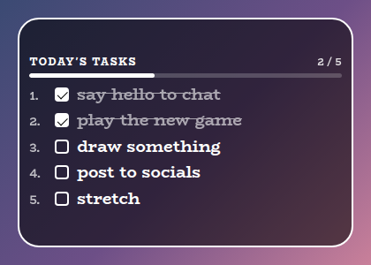
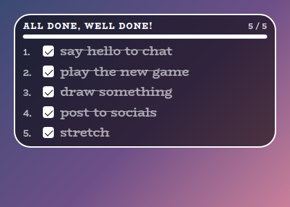
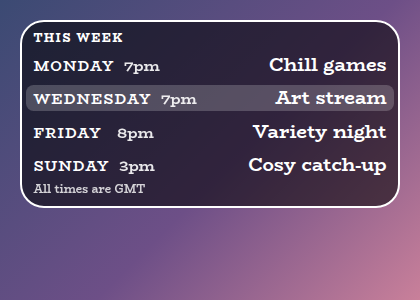
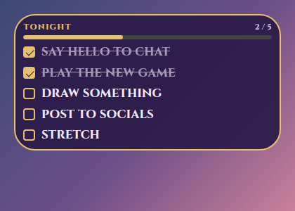
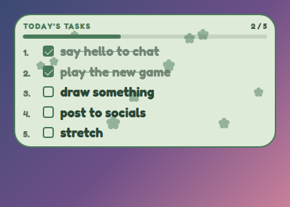
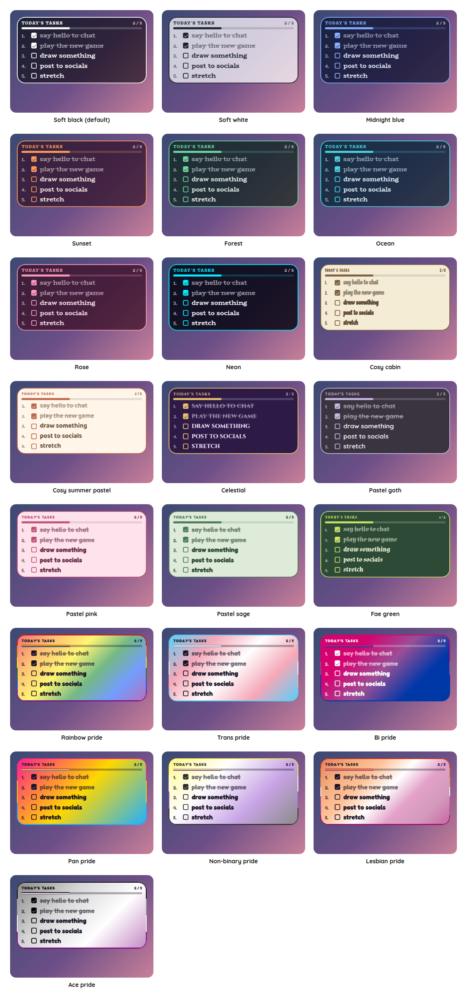

# Task List and Schedule Overlay

A StreamElements custom widget with two jobs, each a quiet kind of company on screen. As a **task list**, it holds what you mean to do on stream today, and you and your moderators tick things off from chat with `!task add say hello` and `!task done 1`. As a **schedule**, it shows when you stream, with today's slot picked out.

<p align="center"></p>

It is a single self-contained widget in plain JavaScript, with no dependencies and nothing to install. Which of the two it shows is one setting, so a stream can have one of each, side by side.

## Features

- A task list you run from chat: `!task add`, `done`, `undo`, `remove`, `edit` and `clear`, with a tick box that fills as each is done.
- Done where people can see it: a count such as 2 / 5, a bar that fills, and a title that turns to "All done, well done!" when the last one is ticked.
- Gone when idle: with nothing on the list, the whole widget disappears and leaves its box empty.
- Tasks by number or by words: `!task done 2` or `!task done stretch`.
- A schedule you write once: up to ten slots such as `Monday | 7pm | Chill games`, with today's slots highlighted and moving on at midnight by themselves.
- Saved: the list and its ticks survive a refresh.
- Moderator control: the streamer, and by default moderators, can change the list. Viewers cannot.
- Fits its box: the card shrinks to fit when the box is short, and the text scales with the box's width.
- Customisable: around 45 settings cover the wording, sizes, shape, outline, colours, fonts and animation.
- Tests and a dev harness: a local harness with quick buttons for every command, and an automated test script.
- An outer frame in the accent colour, on by default in every preset, and switched off with one checkbox (the flag's stripes in the pride presets).
- Decorations: sparkles, hearts, stars, flowers, moons, snowflakes, bubbles, butterflies, clouds, leaves, paw prints, music notes or bows behind the words, scattered, along the edges, in the corners, a little way in from the corners or on the border, in the accent colour, a pride flag's colours or a colour of your own, twinkling, drifting or still. Off by default.

## Screenshots

**All done.** When the last task is ticked the title cheers, in words of your own, and the bar is full.

<p></p>

**The schedule.** Today's slot is picked out, here a Wednesday, with a note underneath for the time zone.

<p></p>

**Your own look.** Choose Custom for the style preset and every colour, the font, the corners and the wording are settings.

<p></p>

## Quick start

1. In StreamElements, edit your overlay and add **+ Add Widget, Static/Custom, Custom Widget**.
2. Select the widget, open **Settings, Open Editor**, and paste each file from `widget/` into the matching tab: `widget.html` into HTML, `widget.css` into CSS, `widget.js` into JS, and `fields.json` into Fields.
3. Click **Done**. Under **Mode**, choose the task list or the schedule. The settings are grouped into Commands, Mode, Tasks, Schedule, Size, Manual controls, Look, Custom colours and Troubleshooting.
4. Size and position the widget. The text scales with the box, and if the box is too short for everything the card shrinks to fit instead of running off the bottom (untick **Shrink to fit the box** under Look to turn that off).

The widget reads Twitch chat through StreamElements, so it works as soon as it is on an active overlay.

## Chat commands

The command word is a setting. Viewers can type the bare `!task` to make the title pop, and everything else needs the broadcaster or, by default, a moderator. The commands work in the task list mode, and do nothing in the schedule.

| Command | What it does |
| --- | --- |
| `!task add say hello` | Puts "say hello" at the end of the list. |
| `!task done 2` | Ticks the second task. `tick` does the same. |
| `!task done stretch` | Ticks the first task with those words in it, preferring one that is not done yet. |
| `!task undo 2` | Unticks it. `untick` does the same. |
| `!task remove 3` | Takes a task off the list, by number or by words. `rm` and `delete` do the same. |
| `!task edit 1 say hello properly` | Changes a task's words. |
| `!task clear` | Takes away the ticked tasks and keeps the rest. |
| `!task clear all` | Takes away everything. |

A task's number is its place on the whole list, ticked ones included, so it stays the same when a ticked task is hidden.

## The schedule

In **Schedule**, write each slot in its own setting as a day, a time and what is on, with a vertical bar between them:

| What you write | What shows |
| --- | --- |
| `Monday \| 7pm \| Chill games` | MONDAY 7pm on the left, "Chill games" on the right. |
| `Sunday \| \| Rest day` | A day and what is on, with no time. |
| `Just a line` | Only the words, which suits a note such as "No stream in August". |

Up to ten slots are read, in the order written, and a blank one is left out. A slot whose day starts with the same first three letters as today's is highlighted, so `Wed`, `Wednesday` and `Weds` all match a Wednesday, and the highlight moves on at midnight by itself. The weekday is read from the clock of the computer running the overlay. A line for the time zone, such as "All times are GMT", can go under the list.

**Decorations.** Flowers behind the words, here in the Pastel sage preset.

<p></p>

## Style presets

One setting picks the look. The same twenty-two presets, with the same colours, are in every overlay in this set, so overlays from this set match whichever you choose. This is how each one looks in this overlay. The presets are defined once, in the [kit](../../kit), and a test keeps this overlay in step with it.

<p></p>

| Preset | Look |
| --- | --- |
| Soft black (default) | See-through black with white text. |
| Soft white | Frosted white with dark text. |
| Midnight blue | Deep navy with a periwinkle accent. |
| Sunset | Deep plum with orange and coral. |
| Forest | Deep green with a mint accent. |
| Ocean | Deep teal with an aqua accent. |
| Rose | Deep berry with a pink accent. |
| Neon | Near black with cyan and magenta. |
| Cosy cabin | Cream and brown, in Chicle. |
| Cosy summer pastel | Warm cream and coral, in Baloo 2. |
| Celestial | Deep purple and gold, in Cinzel. |
| Pastel goth | Charcoal and lilac, in Quicksand. |
| Pastel pink | Soft blush pink with rose, in Fredoka. |
| Pastel sage | Soft sage green with deep green, in Fredoka. |
| Fae green | Mossy green with a firefly lime accent, in Almendra. |
| Rainbow pride | A soft wash of the six rainbow stripes, in Fredoka. |
| Trans pride | Light blue, pink and white. |
| Bi pride | Magenta, purple and blue, with white text. |
| Pan pride | Pink, yellow and light blue. |
| Non-binary pride | Yellow, white, purple and black, softened so the text stays readable. |
| Lesbian pride | The orange to pink stripes. |
| Ace pride | Black, grey, white and purple, softened so the text stays readable. |

The last seven are pride presets, built from the stripes of the rainbow, trans, bi, pan, non-binary, lesbian and ace flags. The card or panel wears the flag as its background, with only as much of a wash over it as the text needs to stay readable, so flags with a black stripe come out softer. A bar is striped like the flag where an overlay has one, and the slices of a wheel and the options of a poll take their colours from the stripes in order. The colours follow each flag's published design,.

Choose **Custom** to use the colour pickers and font instead. They are ignored while a preset is chosen.

## Configuration

Every setting has a plain label in StreamElements, grouped as follows.

| Group | What it covers |
| --- | --- |
| Commands | The command word and who may use it. |
| Mode | Whether the widget shows the task list or the schedule. |
| Tasks | How many show at once and can be on the list, hiding ticked tasks, numbers, the count, the bar, the all-done title and whether the widget hides while empty. |
| Schedule | The schedule's title, its ten slots, a note under it and whether today is highlighted. |
| Size | Text, title and row spacing. |
| Manual controls | Buttons to add a test task, tick off the next, clear the ticked and clear everything. |
| Look | Title, the style preset, font, boldness, corners, padding, outer frame, outline, shadow, Animate and whether it shrinks to fit the box. |
| Custom colours | Panel, text, accent and bar colours, used when the style preset is Custom. A checkbox there also lets the Panel opacity apply to any preset, not only Custom. |
| Decorations | The shape, where they go, how many, how big, how solid (the Decoration opacity, which is its own setting and not the panel's, and 1 is fully solid), their colour, and how they move. |
| Troubleshooting | A debug log of every event to the browser-source console. |

The **outer frame** is a border round the widget in the preset's accent colour, on by default in every preset. Untick **An outer frame** under Look for none, or set the outline thickness to change how thick it is, since at 0 it has a default thickness that grows with the box. In a pride preset the frame is the flag's stripes, as a ring that follows the panel's corners.

The **decorations** are small shapes drawn behind the words: sparkles, hearts, stars, flowers, moons, snowflakes, bubbles, butterflies, clouds, leaves, paw prints, music notes, bows, or a mix of sparkles, hearts and stars. Choose one under **Decorations**, then where they go (scattered, along the inside of the edges, in the corners, a little way in from the corners (a couple of small shapes dotted near the top right and bottom right is a gentle look), or on the border with half of each outside it), how many (up to 24), how big, how solid, and whether they twinkle in place, drift upwards or stay still. They take the accent colour, or in a pride preset the colours of the flag in turn, or you can ask for the text colour, both in turn, or a colour of your own. On the border they need a little room round the widget in its box, since StreamElements shows only what is inside the box, and a panel that fills its box has none. Twinkling dips a little and drifting fades in and out, so choose Stay still, or turn Animate off, to keep them fully solid. With Animate off they stay still. They are off by default.

The full list, with defaults, is in [`widget/fields.json`](widget/fields.json). The colour and font pickers apply only when the style preset is **Custom**.

## Local development

There is no build step and no dependencies. Serve this overlay's folder and open the dev harness:

```sh
npm run dev
# then open http://localhost:8000/dev/
```

The harness stands in for StreamElements. It sends chat commands as a viewer, moderator or broadcaster, with quick buttons for the common ones. A **time machine** skips the clock forward, so what would take a stream to happen takes a few clicks. Its **Every setting** section is generated from `widget/fields.json`, so it offers exactly what StreamElements will.

At the top of the harness, **Look and export** switches the style preset on the live widget, and can download or copy a `fields.json` with your current settings as its defaults. Paste that into the Fields tab of a new custom widget in StreamElements and it starts out looking the way it does here.

The **Design** panel under the copy buttons carries a look from one overlay to the next, so it only has to be set up once. Set the style preset, font, colours, shape, frame and decorations here, press **Save this design**, then open another overlay's dev page and press **Use saved design**. It can also be copied, downloaded as `design.json` or pasted in, and **Use my saved design whenever I open an overlay** applies it for you. Only the design travels, so each overlay's own wording and behaviour settings are left as they are, and anything an overlay does not have is skipped.

The **box-size bar** at the bottom of the stage sets the size of the widget's box in pixels, from two number boxes or a list of common sizes, and remembers it for next time. A StreamElements widget fills whatever box you draw for it, so drawing it in different boxes is the quickest way to see how it behaves. It is the same bar on every overlay's dev page.

The harness must be served over http rather than opened as a file, and fonts come from Google Fonts. It also shows a Ko-fi support button in the corner. That button belongs to the harness only and is not part of the widget, so it never appears on stream.

## Testing

```sh
npm test
```

This runs the real `widget/widget.js` headlessly against a small mock of the page and StreamElements, with a clock the test controls, and exits non-zero on any failure. It covers adding, ticking, undoing, removing and editing tasks, matching by number and by words, the count and the all-done title, hiding and limits, who may do what, the schedule's slots and today's highlight moving on with the day, a damaged save and every look setting. It also checks the style presets against the shared palette, and that every setting in `fields.json` is read by the widget and every button does something.

## Project layout

```
widget/   the widget: HTML, CSS, JS and the StreamElements fields
dev/      the local dev harness
test/     the automated tests
docs/     screenshots used in this README
```

## Compatibility and limitations

The widget uses the StreamElements events `onWidgetLoad` and `onEventReceived` with `message` and `widget-button`, and `SE_API.store`, which keeps the task list.

The schedule is written in the settings, one slot to a setting, because StreamElements has no list field, so changing it means editing the widget's settings. The task list is the part meant to change while you stream.

A StreamElements widget cannot write to chat, so a command gives no reply there. You see the change on screen straight away.

The JavaScript is plain ES5, so it can be pasted straight into the StreamElements editor.

## Related overlays

These overlays share the same default look and the same twenty-two style presets, so they sit together on one stream.

- [Reminder Overlay](../reminder): reminders you set from chat, which stay on screen until cleared.
- [Rotating Panel Overlay](../rotating-panel): socials and chat commands that take turns on one panel.
- [Sub Goals Overlay](../sub-goals): sub and bits goals that fill as chat reaches them.
- [Subathon Overlay](../subathon): a subathon clock with a cap, power-ups and sub goals.
- [Spin Wheel Overlay](../spin-wheel): a wheel for giveaways, raffles and forfeits.
- [Chat Poll Overlay](../chat-poll): quick polls voted on by typing an option.
- [Squat Tracker Overlay](../squat-tracker): a running count driven by gifted sub bombs.
- [Rage Bar Overlay](../rage-bar): a bar chat fills with subs, bits and channel points.
- [Chat Counter Overlay](../counter): a counter chat commands change, for deaths, wins and anything else.
- [Leaderboard Overlay](../leaderboard): top gifters, cheerers and tippers.
- [Hype Meter Overlay](../hype-meter): a meter that chat activity fills, with levels.
- [Recent Activity Overlay](../recent-activity): the latest subs, gifts, bits, tips, follows and raids.
- [Stream Goals Overlay](../stream-goals): sub and bits goals that start again for each stream.
- [Chat Feed Overlay](../chat-feed): on-screen chat with profile pictures and pronouns.
- [Camera Overlay](../camera): a framed window for your camera with a nameplate, and a cover that you and your moderators control from chat.
- [Now Playing Overlay](../now-playing): what you are playing, from Last.fm, Tuna, Spotify or Pear Desktop, with album art and a progress bar.

## Support

If this saves you time, you can support its development on Ko-fi:

[](https://ko-fi.com/journeyingjordan)

Thanks for using it.

## Contributing

Contributions are welcome. See [CONTRIBUTING.md](../../CONTRIBUTING.md).

## License

[MIT](../../LICENSE). The copyright notice, including the Ko-fi link, must be kept in copies and substantial portions of the code.
