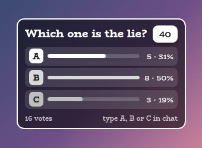
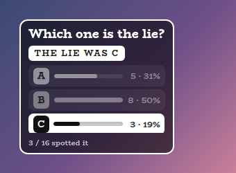
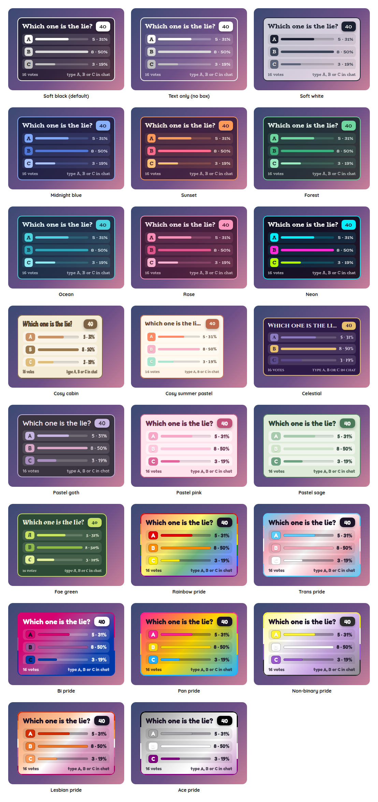

# Two Truths and a Lie Overlay

A StreamElements custom widget for a round of Two Truths and a Lie. You read out three statements, chat types A, B or C, and when the lie is revealed the card lights it up and says how many people spotted it.

<p align="center"></p>

It has two parts. The **overlay** is a self-contained widget that works on its own. The **answer server** in [`server/`](server) is optional: it keeps your running order, answers your chatbot one reveal at a time, and lets the overlay reveal the lie by itself. It is built from the [Chat Poll](../chat-poll) overlay, so voting, undo, sounds and style settings work the same way.

<p></p>

## Running a round

1. Type `!vote` as the streamer or a moderator. A vote opens on A, B and C. Use `!vote 60s` for a longer one, or `!vote Statement one, Statement two, Statement three` to put the words on screen.
2. Read the statements out. Chat votes with a letter or a number, one vote each, and can change it until the clock stops.
3. Reveal the lie in one of two ways:
   - **By hand:** type `!vote reveal B`.
   - **With the answer server:** run `!truth` once for who it was, and again for the lie. The overlay puts the name in its heading, then marks the lie.

A reveal ends the vote if it is still open. It also brings the card back if the result has already left the screen, so there is no rush to get to it before it hides.

## Commands

| Command | What it does |
| --- | --- |
| `!vote` | Opens a vote on A, B and C. |
| `!vote 60s` | The same, with its own length. |
| `!vote One, Two, Three` | A vote with the statements on screen. |
| `!vote reveal B` | Reveals B as the lie. A number works too. |
| `!vote end` | Stops voting without revealing. |
| `!vote extend 20` | Adds 20 seconds. |
| `!vote restart` | Same options, votes wiped. |
| `!vote cancel` | Takes the vote down. |
| `!vote results` / `!vote hide` | Shows or hides the result. |
| `!vote undo` | Steps back, including from a mistaken reveal. |

Undo changes the card only. It does not move the answer server's place in the running order. If you also use the Chat Poll overlay, change the **Command word** setting on one of them, because both start out as `!vote`.

## Quick start

1. In StreamElements, edit your overlay and add **+ Add Widget, Static/Custom, Custom Widget**.
2. Select the widget, open **Settings, Open Editor**, and paste each file from `widget/` into the matching tab: `widget.html` into HTML, `widget.css` into CSS, `widget.js` into JS, and `fields.json` into Fields.
3. Click **Done**.
4. To reveal from the answer server, [set it up](server/README.md), then put its address in **Reveals, Answer server address**.

## How the overlay stays free of spoilers

The overlay asks the server for one address, `/state`, every two seconds while an address is set. That address holds only what has already been read out: nothing before the first `!truth`, then a name, then that person's lie. The upcoming answers are only reachable with your secret key, and the overlay is never given the key.

Anyone who learns the address can read `/state`, so treat it as being as public as your stream. If the server cannot be reached, voting carries on and `!vote reveal` still works.

If something goes wrong, `!truthprev` on your chatbot undoes the last server step, and takes it off the card, while `!truthnext` skips a person. All the server commands are in [server/README.md](server/README.md).

A browser source that reloads does not replay the last reveal. If it reloads at the very moment of a reveal, use `!vote reveal` to put it on screen.

## Style presets

One setting picks the look. The same twenty-three presets, with the same colours, are in every overlay in this set, so overlays from this set match whichever you choose. This is how each one looks in this overlay. The presets are defined once, in the [kit](../../kit), and a test keeps this overlay in step with it.

<p></p>

| Preset | Look |
| --- | --- |
| Soft black (default) | See-through black with white text. |
| Text only (no box) | No box, frame or shadow: just the words, with a soft dark halo so they read over any picture. |
| Soft white | Frosted white with dark text. |
| Midnight blue | Deep navy with a periwinkle accent. |
| Sunset | Deep plum with orange and coral. |
| Forest | Deep green with a mint accent. |
| Ocean | Deep teal with an aqua accent. |
| Rose | Deep berry with a pink accent. |
| Neon | Near black with cyan and magenta. |
| Cosy cabin | Cream and brown, in Chicle. |
| Cosy summer pastel | Warm cream and coral, in Baloo 2. |
| Celestial | Deep purple and gold, in Cinzel. |
| Pastel goth | Charcoal and lilac, in Quicksand. |
| Pastel pink | Soft blush pink with rose, in Fredoka. |
| Pastel sage | Soft sage green with deep green, in Fredoka. |
| Fae green | Mossy green with a firefly lime accent, in Almendra. |
| Rainbow pride | A soft wash of the six rainbow stripes, in Fredoka. |
| Trans pride | Light blue, pink and white. |
| Bi pride | Magenta, purple and blue, with white text. |
| Pan pride | Pink, yellow and light blue. |
| Non-binary pride | Yellow, white, purple and black, softened so the text stays readable. |
| Lesbian pride | The orange to pink stripes. |
| Ace pride | Black, grey, white and purple, softened so the text stays readable. |

The last seven are pride presets, built from the stripes of the rainbow, trans, bi, pan, non-binary, lesbian and ace flags. The card or panel wears the flag as its background, with only as much of a wash over it as the text needs to stay readable, so flags with a black stripe come out softer. A bar is striped like the flag where an overlay has one, and the slices of a wheel and the options of a poll take their colours from the stripes in order. The colours follow each flag's published design.

Choose **Custom** to use the colour pickers and font instead. They are ignored while a preset is chosen.

## Dev harness

```sh
npm run dev
# then open http://localhost:8000/dev/
```

## Testing

```sh
npm test
```

`test/test-widget.js` drives the widget against a mock of the page, StreamElements and the answer server, covering voting, both ways of revealing and everything inherited from the chat poll. `test/test-server.js` runs the real server on a spare port with made-up answers, and checks that nothing unrevealed can be read without the key. `test/test-layout.js` renders the widget in headless Chromium, and skips itself if there is no browser.

## Compatibility and limitations

- None of this has been run against a live StreamElements overlay yet, so try a round off air first. The `debug` setting logs a failed request to the browser console.
- StreamElements shows the widget over `https`, so the answer server needs an `https` address too. The hosting steps use a Cloudflare Tunnel for that.
- Votes are counted per chat username, so a second account is a second vote.
- A reveal belongs to the latest vote that has not had one. If you skip a reveal, the next one lands on that card, so open a new vote for each person.
- Built for Twitch.

## Related overlays

These overlays share the same default look and the same twenty-three style presets, so they sit together on one stream.

- [Chat Poll Overlay](../chat-poll): quick polls voted on by typing an option.
- [Sub Goals Overlay](../sub-goals): sub and bits goals that fill as chat reaches them.
- [Subathon Overlay](../subathon): a subathon clock with a cap, power-ups and sub goals.
- [Spin Wheel Overlay](../spin-wheel): a wheel for giveaways, raffles and forfeits.
- [Squat Tracker Overlay](../squat-tracker): a running count driven by gifted sub bombs.
- [Rage Bar Overlay](../rage-bar): a bar chat fills with subs, bits and channel points.
- [Chat Counter Overlay](../counter): a counter chat commands change, for deaths, wins and anything else.
- [Leaderboard Overlay](../leaderboard): top gifters, cheerers and tippers.
- [Hype Meter Overlay](../hype-meter): a meter that chat activity fills, with levels.
- [Recent Activity Overlay](../recent-activity): the latest subs, gifts, bits, tips, follows and raids.
- [Stream Goals Overlay](../stream-goals): sub and bits goals that start again for each stream.
- [Reminder Overlay](../reminder): reminders you set from chat, which stay on screen until cleared.
- [Chat Feed Overlay](../chat-feed): on-screen chat with profile pictures and pronouns.
- [Camera Overlay](../camera): a framed window for your camera with a nameplate, and a cover that you and your moderators control from chat.
- [Now Playing Overlay](../now-playing): what you are playing, from Last.fm, Tuna, Spotify or Pear Desktop, with album art and a progress bar.

## Support

If this saves you time, you can support its development on Ko-fi:

[](https://ko-fi.com/journeyingjordan)

Thanks for using it.

## Contributing

Contributions are welcome. See [CONTRIBUTING.md](../../CONTRIBUTING.md).

## License

[MIT](../../LICENSE). The copyright notice, including the Ko-fi link, must be kept in copies and substantial portions of the code.
