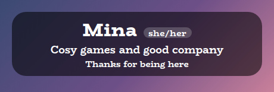
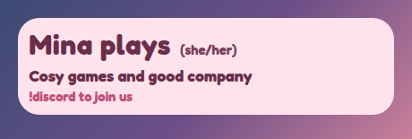
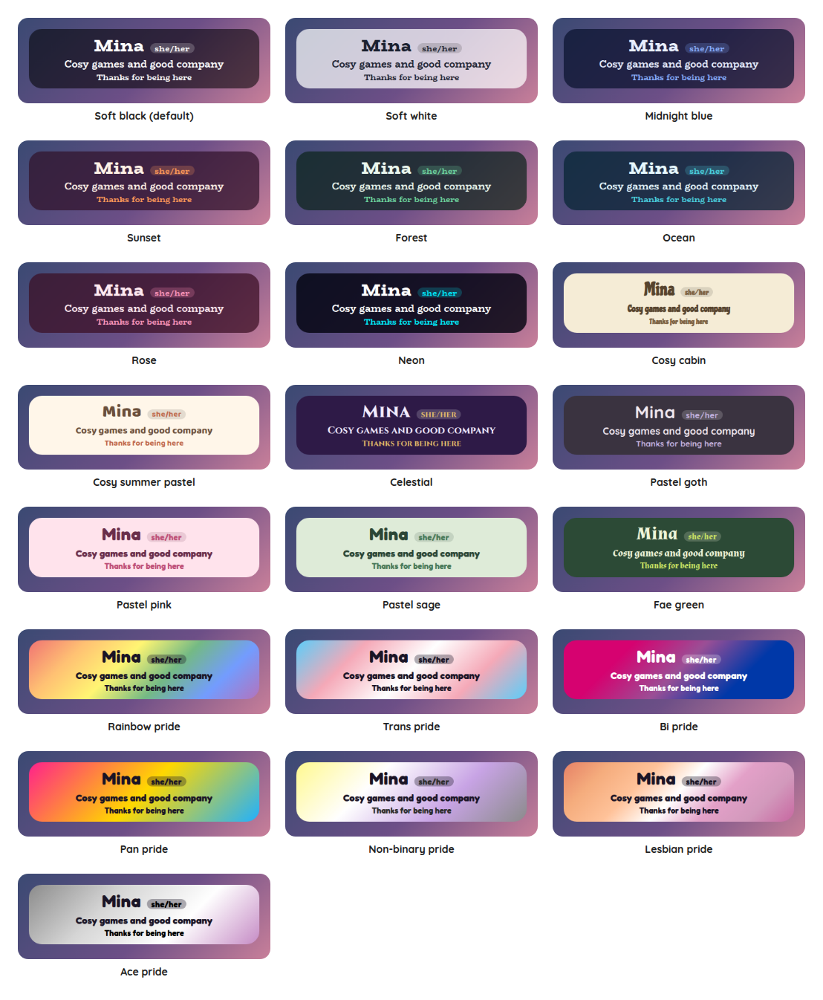

# Under Camera Overlay

A StreamElements custom widget for under your camera: a nameplate with your name, your pronouns, a line about your stream, and a few lines underneath that take turns, such as where to find you or a gentle reminder. It uses the same style presets as the rest of the set, so it sits with your other overlays and matches them.

<p align="center"></p>

It is a single self-contained widget in plain JavaScript, with no dependencies and nothing to install. It has no commands and nothing to operate: you set it up once and it sits there. For a cover that protects your camera from chat, see the [Over Camera Overlay](../over-camera).

## Features

- Your name, and your pronouns beside it as a small tag, in brackets, or as plain text.
- A line under your name, such as what you play or a welcome.
- Rotating lines: any number of short lines, separated by `|`, that take turns at a pace you choose, fading from one to the next. A single line simply stays.
- Aligned to the left, the middle or the right.
- Every part can be switched off, so it can be a name alone or just the rotating lines.
- Customisable: around 30 settings cover the plate, the lines, sizes, shape, outline, colours, fonts and animation.
- Scales with the box: the text scales with the width of the box you draw, and if the box is too short for everything the plate shrinks to fit.
- Tests and a dev harness: a local harness and an automated test script, so nothing needs a live stream.

## Screenshots

**In another preset,** here Pastel pink, aligned to the left, with the pronouns in brackets.

<p></p>

## Style presets

One setting picks the look. The same twenty-two presets, with the same colours, are in every overlay in this set, so overlays from this set match whichever you choose. This is how each one looks in this overlay. The presets are defined once, in the [kit](../../kit), and a test keeps this overlay in step with it.

<p></p>

| Preset | Look |
| --- | --- |
| Soft black (default) | See-through black with white text. |
| Soft white | Frosted white with dark text. |
| Midnight blue | Deep navy with a periwinkle accent. |
| Sunset | Deep plum with orange and coral. |
| Forest | Deep green with a mint accent. |
| Ocean | Deep teal with an aqua accent. |
| Rose | Deep berry with a pink accent. |
| Neon | Near black with cyan and magenta. |
| Cosy cabin | Cream and brown, in Chicle. |
| Cosy summer pastel | Warm cream and coral, in Baloo 2. |
| Celestial | Deep purple and gold, in Cinzel. |
| Pastel goth | Charcoal and lilac, in Quicksand. |
| Pastel pink | Soft blush pink with rose, in Fredoka. |
| Pastel sage | Soft sage green with deep green, in Fredoka. |
| Fae green | Mossy green with a firefly lime accent, in Almendra. |
| Rainbow pride | A soft wash of the six rainbow stripes, in Fredoka. |
| Trans pride | Light blue, pink and white. |
| Bi pride | Magenta, purple and blue, with white text. |
| Pan pride | Pink, yellow and light blue. |
| Non-binary pride | Yellow, white, purple and black, softened so the text stays readable. |
| Lesbian pride | The orange to pink stripes. |
| Ace pride | Black, grey, white and purple, softened so the text stays readable. |

The last seven are pride presets, built from the stripes of the rainbow, trans, bi, pan, non-binary, lesbian and ace flags. The card or panel wears the flag as its background, with only as much of a wash over it as the text needs to stay readable, so flags with a black stripe come out softer. A bar is striped like the flag where an overlay has one, and the slices of a wheel and the options of a poll take their colours from the stripes in order. The colours follow each flag's published design,.

Choose **Custom** to use the colour pickers and font instead. They are ignored while a preset is chosen.

## Quick start

1. In StreamElements, edit your overlay and add **+ Add Widget, Static/Custom, Custom Widget**.
2. Select the widget, open **Settings, Open Editor**, and paste each file from `widget/` into the matching tab: `widget.html` into HTML, `widget.css` into CSS, `widget.js` into JS, and `fields.json` into Fields.
3. Click **Done**. The settings are grouped into Plate, Rotating lines, Size, Look, Custom colours and Troubleshooting.
4. Type your name and pronouns under Plate, and your lines under Rotating lines.
5. Size and position the widget under your camera. The text scales with the box, and if the box is too short for everything, the plate shrinks to fit instead of running off the bottom (untick **Shrink to fit the box** under Look to turn that off).

## The rotating lines

Write the lines in one setting, separated by a vertical bar (`|`), for example:

```
!discord to join us | Hydrate and stretch | Be kind in chat
```

- Spaces around a bar are ignored, and blank lines are left out.
- Up to twenty lines take turns. **Seconds each line stays** is between 2 and 600.
- With Animate on, a line fades out and the next fades in. With Animate off it simply changes.
- With one line, nothing moves. With none, nothing shows.

Everything you type is shown exactly as typed, and never as markup.

## Configuration

Every setting has a plain label in StreamElements, grouped as follows.

| Group | What it covers |
| --- | --- |
| Plate | Your name, your pronouns and how they are written, the line under your name, and where the text sits. |
| Rotating lines | The lines, whether they show, and how long each stays. |
| Size | Text size, the size of your name and the space between the lines. |
| Look | The style preset, font, boldness, corners, padding, outline, shadow, Animate and whether it shrinks to fit the box. |
| Custom colours | Panel, text, accent and tag colours, used when the style preset is Custom. |
| Troubleshooting | A debug log of every event to the browser-source console. |

The full list, with defaults, is in [`widget/fields.json`](widget/fields.json). The colour and font pickers apply only when the style preset is **Custom**.

## Local development

There is no build step and no dependencies. Serve this overlay's folder and open the dev harness:

```sh
npm run dev
# then open http://localhost:8000/dev/
```

The harness stands in for StreamElements. This plate has no events to fire, so it is for changing the settings and watching it, and a **time machine** skips ahead so you do not have to wait for the lines to take their turns.

At the top of the harness, **Look and export** switches the style preset on the live widget, and can download or copy a `fields.json` with your current settings as its defaults. Paste that into the Fields tab of a new custom widget in StreamElements and it starts out as you have it.

The harness must be served over http rather than opened as a file, and fonts come from Google Fonts. It also shows a Ko-fi support button in the corner. That button belongs to the harness only and is not part of the widget, so it never appears on stream.

## Testing

```sh
npm test
```

This runs the real `widget/widget.js` headlessly against a small mock of the page and StreamElements, with a clock the test controls, and exits non-zero on any failure. It covers the plate and what each blank hides, the pronoun styles, the rotating lines and their timing, the limits, the look, text that must never be treated as markup, the style presets and settings of the wrong type.

## Project layout

```
widget/   the widget: HTML, CSS, JS and the StreamElements fields
dev/      the local dev harness
test/     the automated tests
docs/     screenshots used in this README
```

## Compatibility and limitations

The widget uses the StreamElements event `onWidgetLoad`, and does nothing with chat or any other event.

It has not been run on a live stream. There is nothing to configure for the first stream beyond the settings.

It does not look anything up: your pronouns are what you type. For pronouns beside each chatter's name, see the [Chat Feed Overlay](../chat-feed).

The JavaScript is plain ES5, so it can be pasted straight into the StreamElements editor.

## Related overlays

These overlays share the same default look and the same twenty-two style presets, so they sit together on one stream.

- [Sub Goals Overlay](../sub-goals): sub and bits goals that fill as chat reaches them.
- [Subathon Overlay](../subathon): a subathon clock with a cap, power-ups and sub goals.
- [Spin Wheel Overlay](../spin-wheel): a wheel for giveaways, raffles and forfeits.
- [Chat Poll Overlay](../chat-poll): quick polls voted on by typing an option.
- [Squat Tracker Overlay](../squat-tracker): a running count driven by gifted sub bombs.
- [Rage Bar Overlay](../rage-bar): a bar chat fills with subs, bits and channel points.
- [Chat Counter Overlay](../counter): a counter chat commands change, for deaths, wins and anything else.
- [Leaderboard Overlay](../leaderboard): top gifters, cheerers and tippers.
- [Hype Meter Overlay](../hype-meter): a meter that chat activity fills, with levels.
- [Stream Goals Overlay](../stream-goals): sub and bits goals that start again for each stream.
- [Reminder Overlay](../reminder): reminders you set from chat, which stay on screen until cleared.
- [Chat Feed Overlay](../chat-feed): on-screen chat with profile pictures and pronouns.

- [Recent Activity Overlay](../recent-activity): the latest subs, gifts, bits, tips, follows and raids.
- [Over Camera Overlay](../over-camera): a cover for your camera that you and your moderators control from chat.

## Support

If this saves you time, you can support its development on Ko-fi:

[](https://ko-fi.com/journeyingjordan)

Thanks for using it.

## Contributing

Contributions are welcome. See [CONTRIBUTING.md](../../CONTRIBUTING.md).

## License

[MIT](../../LICENSE). The copyright notice, including the Ko-fi link, must be kept in copies and substantial portions of the code.
